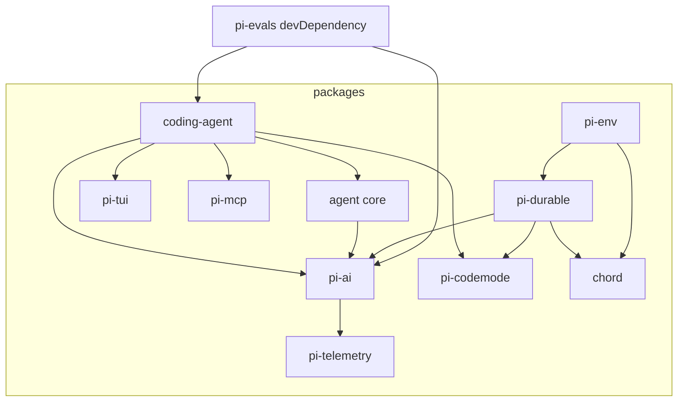

# Pi 指南（SimpleBase Cloud Agent 参考）

本文说明 [pi](https://github.com/earendil-works/pi) 的实际结构，以及如何在 SimpleBase 的 `internal/cloudagent`（Go，CloudWeGo Eino）上参考它改进运行时。API、文件名和类型以 pi `main` 的 commit `3daa20280f6a7c7cbe0935680c9a38fdc3863005`（2026-10-13，`fix(coding-agent): keep codemode cancellation prompt and bounded`）源码为准。克隆地址 `git@github.com:earendil-works/pi.git`，阅读时使用的是该 commit 的完整工作树。

Eino 的公开 API 不在本文重复。`ChatModelAgent`、`Runner`、`tool.StatefulInterrupt`、checkpoint 见同目录 [`eino-readme.md`](eino-readme.md)（对应 `github.com/cloudwego/eino v0.9.19`）。本文只在设计章节引用那些已经核对过的符号。

当前仓库里**没有**名为 `web-ui` 或 `mom` 的包，也没有 `apps/` 目录。根 `package.json` 的 workspaces 仍写着 `"apps/*"`，`biome.json` 仍忽略 `packages/mom/data/**/*`，`packages/coding-agent/CHANGELOG.md` 有一句历史说明（skills API 曾给 mom 用）。下文以磁盘上的 `packages/` 为准。

改 `internal/cloudagent` 时同时遵守 [`internal/AGENTS.md`](../AGENTS.md)：云 Agent 只读访问数据，或在 `skills_cli` 打开时经 CLI 调既有 HTTP API；沙盒工具经 `Sandbox` 接口。禁止直接写 DuckLake / S3 / 系统库，禁止向沙盒注入 SimpleBase 凭据。日志和审计不得输出 LLM 正文。本文只描述设计，不改业务代码。

## 目录

1. [整体架构](#1-整体架构)
2. [提供的能力](#2-提供的能力)
3. [评估与对照](#3-评估与对照)
4. [在 Go / Eino 上的设计](#4-在-go--eino-上的设计)
5. [骨架代码](#5-骨架代码)
6. [参考链接](#6-参考链接)

## 1. 整体架构

### 1.1 仓库在做什么

根 `README.md` 把 Pi 定义成可扩展的 agent harness：用 extensions、skills、prompt templates、themes 定制，打成 Pi package 经 npm 或 git 分发。默认不带 sub-agent 和 plan mode。入口是交互式 CLI `pi`，也可以 print / JSON、RPC，或进程内 TypeScript SDK。

一次用户输入的路径写在 `packages/coding-agent/docs/how-pi-works.md`：

```text
用户消息
  │
  ▼
SessionManager 把条目挂到当前叶子（id / parentId 树）
  │
  ▼
活跃分支 → 系统提示 + 工具声明 + 模型设置
  │
  ▼
@earendil-works/pi-ai 按 model.provider / model.api 流式请求
  │
  ▼
@earendil-works/pi-agent-core 的 agentLoop
  记录 assistant，校验并执行工具，再决定是否下一轮
  │
  ▼
同一套机制服务 TUI、print、JSON、RPC、SDK
```

会话条目组成一棵树。根到当前叶子的路径是活跃分支，下一轮模型只看这条路径。压缩在这条路径上插入摘要条目，原文留在树里。

### 1.2 Monorepo

npm workspaces：`packages/*`、`apps/*`，以及若干 `packages/coding-agent/examples/extensions/*`。`apps/` 在该 commit 不存在。构建顺序写在根 `package.json` 的 `build` 脚本：

```text
chord → tui → telemetry → codemode → mcp → ai → durable → env → agent → coding-agent
```

`packages/evals` 不在这条链上，用自己的 `eval` / `eval:host` / `eval:docs` 脚本。Node 要求 `>=22.19.0`。

| 目录 | npm 包 | 职责 |
| --- | --- | --- |
| `packages/ai` | `@earendil-works/pi-ai` | 多供应商 LLM、图片、分类器；统一消息与流式事件 |
| `packages/agent` | `@earendil-works/pi-agent-core` | 与供应商无关的 agent loop、工具执行、队列 |
| `packages/coding-agent` | `@earendil-works/pi-coding-agent` | CLI、会话树、压缩、skills、extensions、内置工具 |
| `packages/tui` | `@earendil-works/pi-tui` | 终端差分渲染，不是 Web UI |
| `packages/durable` | `@earendil-works/pi-durable` | 实验性持久化 harness：对话、文档、任务状态机 |
| `packages/chord` | `@earendil-works/chord` | 插件宿主、契约、复制状态、JSON link RPC |
| `packages/codemode` | `@earendil-works/pi-codemode` | QuickJS WASM 沙箱，脚本只能调用注入的工具 |
| `packages/mcp` | `@earendil-works/pi-mcp` | 独立 MCP 客户端（stdio、Streamable HTTP） |
| `packages/env` | `@earendil-works/pi-env` | Durable 的远程执行环境（SSH daemon） |
| `packages/telemetry` | `@earendil-works/pi-telemetry` | 与供应商无关的 span 契约 |
| `packages/evals` | `@earendil-works/pi-evals`（private） | coding agent 行为评估 |

Slack / 聊天自动化在另一个仓库 [earendil-works/pi-chat](https://github.com/earendil-works/pi-chat)，不在本 monorepo。

### 1.3 依赖关系

`package.json` 里的直接依赖（省略 typebox 等第三方）：



`packages/evals/package.json` 的 `dependencies` 是空的。`@earendil-works/pi-coding-agent` 和 `@earendil-works/pi-ai` 在 `devDependencies`。`src/harness.ts` 从这两个包导入。

### 1.4 各包内部怎么分

**`packages/ai/src`**

| 路径 | 作用 |
| --- | --- |
| `types.ts` | `Model`、`Message`、`Tool`、`AssistantMessageEvent`、`Usage`、`TranscriptContext` |
| `models.ts` | `createModels`、`Models.stream` / `streamSimple` / `complete` / `completeSimple`、deferred |
| `providers/*.ts` | 各供应商工厂；`providers/all.ts` 的 `builtinProviders()` 注册内置列表 |
| `api/*.ts` | 各 API 的请求与流解析（openai-completions、anthropic-messages、google-generative-ai 等） |
| `utils/validation.ts` | `validateToolArguments`、`validateToolCall` |
| `utils/transcript.ts` | `normalizeContext`、`getCurrentTools` |
| `utils/event-stream.ts` | `EventStream`、`AssistantMessageEventStream` |
| `auth/` | API key、OAuth（Anthropic、GitHub Copilot、OpenAI Codex 等） |
| `index.ts` | 无副作用的核心导出。供应商工厂不从这里出，走 `@earendil-works/pi-ai/providers/*` |

**`packages/agent/src`** 只有六个实现文件：

| 文件 | 作用 |
| --- | --- |
| `types.ts` | `AgentLoopConfig`、`AgentTool`、`AgentEvent`、`AgentState` |
| `agent-loop.ts` | `agentLoop`、`runAgentLoop`、`runToolCall` |
| `agent.ts` | `Agent` 类：队列、订阅、`prompt` / `continue` |
| `proxy.ts` | `streamProxy`，把流式事件经 HTTP SSE 代理 |
| `stream-fn.ts` | `setDefaultStreamFn` / `getDefaultStreamFn` |
| `index.ts` | 再导出 |

**`packages/coding-agent/src`**

| 路径 | 作用 |
| --- | --- |
| `main.ts` | CLI，按模式分发 interactive / print / json / rpc |
| `core/agent-session.ts` | `AgentSession`，持有 `Agent` 与 `SessionManager` |
| `core/sdk.ts` | `createAgentSession` |
| `core/session-manager.ts` | JSONL 会话树 |
| `core/compaction/` | `shouldCompact`、`prepareCompaction`、`compact` |
| `core/skills.ts` | 发现并加载 `SKILL.md` |
| `core/prompt-templates.ts` | 提示词模板 |
| `core/extensions/` | `ExtensionAPI`、loader、runner |
| `core/tools/` | read、bash、edit、write、grep、find、ls、powershell |
| `core/trust-manager.ts` | 项目信任，不是逐工具授权 |
| `modes/interactive/` | TUI |
| `modes/print-mode.ts` | 文本或 JSON 一次跑完 |
| `modes/rpc/` | stdin/stdout JSONL |
| `extensions/` | 内置扩展：codemode、mcp、llama、tool-search |

**`packages/durable/src`**

| 路径 | 作用 |
| --- | --- |
| `session/session.ts` | `createSession` |
| `session/transaction.ts` | `Transaction`，`forkConversation` |
| `session/forks.ts` | fork 时按策略复制 document |
| `harness/harness.ts` | `Harness.open` |
| `harness/generation.ts` | `GenerationTask` |
| `harness/tool.ts` | `ToolTask` |
| `harness/compaction.ts` | `CompactionTask` |
| `harness/events.ts` | 持久化之后的 `AgentEvent` |
| `storage/jsonl`、`storage/sqlite`、`storage/memory.ts` | 三种存储 |

### 1.5 两条运行时，不要混成一个 loop

coding-agent 用的是 **`packages/agent` 的内存 loop**。`AgentSession` 在 `core/agent-session.ts` 里持有 `readonly agent: Agent`，订阅它的事件再写入 `SessionManager`。

`packages/durable` 是另一条实验性运行时。`Harness.open` 打开存储，`GenerationTask` 的相位是 `prepare` → `request` / `retry` / `poll` → `tools`，每个工具调用是独立的 `ToolTask`（kind `pi.tool`）。崩溃后 `resume()` 从 checkpoint 继续。`watchEvents` 的事件形状对齐 coding-agent 的 JSON 模式，但事件在 commit 之后才发出。README 标明这是实验性 harness。SimpleBase 的第一阶段应对齐 **agent core + coding-agent 会话**，不要先搬 durable 的任务图。

## 2. 提供的能力

### 2.1 LLM 多供应商统一抽象

统一入口在 `packages/ai/src/models.ts` 的 `Models`：

```typescript
stream<TApi extends Api>(model: Model<TApi>, context: Context, options?: ModelsApiStreamOptions<TApi>): AssistantMessageEventStream
complete<TApi extends Api>(...): Promise<AssistantMessage>
streamSimple(model: Model<Api>, context: Context, options?: ModelsSimpleStreamOptions): AssistantMessageEventStream
completeSimple(...): Promise<AssistantMessage>
streamDeferred(model, handle, options?): AssistantMessageEventStream
fetchDeferred(model, handle, options?): Promise<AssistantMessage>
cancelDeferred(model, handle, options?): Promise<void>
```

`ModelsImpl` 的分发顺序：

1. `normalizeContext(context)` 把 `Context.systemPrompt` 和 `Context.tools` 折进首条 system 消息，得到 `TranscriptContext`。
2. 按 `model.provider` 找到 provider。
3. `applyAuth` 解析 API key、headers、可选的 `baseUrl`。
4. provider 内部再按 `model.api` 选 API 实现。找不到时流里报 `no API implementation for "<api>"`。

`Context`（`types.ts`）是调用方写法：`systemPrompt?`、`messages`、`tools?`。`TranscriptContext` 只有 `messages`，并且带 brand，避免未经归一化的对象进 provider。

`Api`（`KnownApi`）包括：`openai-completions`、`mistral-conversations`、`openai-responses`、`azure-openai-responses`、`openai-codex-responses`、`anthropic-messages`、`bedrock-converse-stream`、`google-generative-ai`、`google-vertex`、`pi-messages`。另外还有图片 API `openrouter-images`，以及分类器 API `typesafe-system-one`、`cloudflare-workers-ai-system-one`、`llama-cpp-classify`、`openai-decisions`。

`Model<TApi>` 在 `BaseModel` 上增加 `reasoning`、`thinkingLevelMap`、`promptCache`、`contextWindow`。思考档位类型是 `ThinkingLevel = "off" | "minimal" | "low" | "medium" | "high" | "xhigh" | "max"`（agent 的 `types.ts` 与 ai 的 model schema 共用这组字面量）。`thinkingLevelMap` 里 `null` 表示该模型不支持这一档。

`packages/ai/src/providers/all.ts` 的 `builtinProviders()` 注册的工厂（文件名即模块）包括：`amazon-bedrock`、`ant-ling`、`anthropic`、`azure`、`baseten`、`cerebras`、`cloudflare-ai-gateway`、`cloudflare-workers-ai`、`deepseek`、`fireworks`、`github-copilot`、`google`、`google-vertex`、`groq`、`huggingface`、`kimi-coding`、`meta`、`minimax`、`minimax-cn`、`mistral`、`moonshotai`、`moonshotai-cn`、`nvidia`、`openai`、`openai-codex`、`opencode`、`opencode-go`、`openrouter`、`qwen-token-plan`、`qwen-token-plan-cn`、`qwen-token-plan-individual`、`radius`、`together`、`typesafe`、`vercel-ai-gateway`、`xai`、`xiaomi`、`xiaomi-token-plan-ams`、`xiaomi-token-plan-cn`、`xiaomi-token-plan-sgp`、`zai`、`zai-coding-cn`。`providers/faux.ts` 由 `index.ts` 导出，不在 `builtinProviders()` 里。

兼容层 `packages/ai/src/compat.ts` 另有独立函数 `stream` / `streamSimple` / `complete` / `completeSimple`，**不**从 `index.ts` 再导出。内置 provider 走 builtin，否则按 `model.api` 找 API。agent loop 不直接调用这些函数，它依赖注入的 `StreamFn`。

`Usage` 字段：`input`、`output`、`cacheRead`、`cacheWrite`、可选 `cacheWrite1h`、可选 `reasoning`（`output` 的子集）、`totalTokens`、`cost`。`StopReason`：`pending`、`stop`、`length`、`toolUse`、`error`、`aborted`、`deferred`。

消息四种 role：`system`、`user`、`assistant`、`toolResult`。`SystemMessage` 可以带 `sections`（按名字替换或用 `null` 删除）、`toolsAdded`、`toolsRemoved`。重放全部 system 消息得到当前提示词和工具集。`AssistantMessage.content` 是 `text` / `thinking` / `toolCall`。`ToolCall` 有 `id`、`name`、`arguments`，以及可选的 `thoughtSignature`、`namespace`。

认证在 `packages/ai/src/auth/`：`credential-store.ts`、`resolve.ts`，OAuth 实现在 `auth/oauth/`（`anthropic.ts`、`github-copilot.ts`、`openai-codex.ts`、`openai-chatgpt.ts`、`openrouter.ts`、`xai.ts` 等）。agent 的 `getApiKey(provider)` 在每次模型请求前再取一次，用来换快过期的 OAuth token。

### 2.2 流式事件模型

有三层事件，名字不同，不要叠成一种。

**供应商流** `AssistantMessageEvent`（`packages/ai/src/types.ts`）：

| type | 要点 |
| --- | --- |
| `start` | 必须先于 partial |
| `text_start` / `text_delta` / `text_end` | 文本块 |
| `thinking_start` / `thinking_delta` / `thinking_end` | 推理块；redacted thinking 可以没有 delta |
| `toolcall_start` / `toolcall_delta` / `toolcall_end` | `toolcall_delta` 是后续 JSON 片段；`toolcall_end` 带完整 `ToolCall` |
| `done` | `reason` 为 `stop`、`length`、`toolUse`、`deferred` |
| `error` | `reason` 为 `aborted` 或 `error` |

成功流是 `start` → 若干 partial → `done`。请求还没开始就失败时可以直接 `error`。`partial` 是当时的整段 `AssistantMessage`，不是增量本身。

承载类型是 `packages/ai/src/utils/event-stream.ts` 的 `EventStream<T, R>`：`push`、`end`、`result()`、async iterator。`AssistantMessageEventStream` 在 `done` 或 `error` 时结束，并给最终消息补 `durationMs`。工厂是 `createAssistantMessageEventStream`。

**Agent 流** `AgentEvent`（`packages/agent/src/types.ts`）：

| type | 要点 |
| --- | --- |
| `agent_start` / `agent_end` | 一次 `prompt` 或 `continue`。`agent_end` 带本次新增的 `messages` |
| `turn_start` / `turn_end` | 一轮 assistant 加它的工具结果 |
| `message_start` / `message_end` | system、user、assistant、toolResult |
| `message_update` | 只在 assistant 流式期间。带 `assistantMessageEvent: AssistantMessageEvent` |
| `tool_execution_start` | `toolCallId`、`toolName`、`args` |
| `tool_execution_update` | 工具通过 `onUpdate` 推部分结果 |
| `tool_execution_end` | `result`、`isError`、可选 `durationMs` |

`streamAssistantResponse`（`agent-loop.ts`）把供应商事件原样放进 `message_update.assistantMessageEvent`。工具参数的增量因此是 `toolcall_delta`，发生在工具执行之前。

**Durable 流** `packages/durable/src/harness/events.ts` 的 `AgentEvent` 另有一套：`run_start` / `run_end`、`turn_*`、`message_*`、`tool_execution_*`，以及 `inbox_update`、`submission`、`auto_retry_*`、`deferred_poll`、`compaction_start` / `compaction_end`、`task_failed`。这是 commit 之后的投影，不是 agent core 的进程内事件。

代理传输在 `packages/agent/src/proxy.ts`。`streamProxy(model, context, options)` 向 `${proxyUrl}/api/stream` POST，解析 SSE 行 `data: <json>`。线上的 `ProxyAssistantMessageEvent` 不带 `partial`，客户端再还原成完整的 `AssistantMessageEvent`。`done` 的 reason 在代理类型里是 `stop | length | toolUse`（不含 `deferred`）。

### 2.3 工具调用与校验

工具在 ai 层只是声明。`packages/ai/src/types.ts`：

```typescript
interface Tool<TParameters extends TSchema = TSchema> {
  name: string
  description: string
  parameters: TParameters
  constrainedSampling?: false | ConstrainedSamplingConfig
}
```

`TSchema` 来自 TypeBox。`ConstrainedSamplingConfig` 是 `json_schema`（`strict: "prefer" | "require"`）或 `grammar`（`openai_lark` / `openai_regex`）。

可执行工具是 `packages/agent/src/types.ts` 的 `AgentTool`，扩展 `Tool`：

| 字段 | 作用 |
| --- | --- |
| `label` | UI 文案 |
| `prepareArguments?` | 校验前把原始参数改成符合 schema 的对象 |
| `outputSchema?` | `structuredContent` 的 JSON Schema |
| `execute(toolCallId, params, signal?, onUpdate?)` | 失败应 throw，或返回 `isError: true` |
| `replay?` | `"never"` 或 `"safe"`。durable 用来决定未知结果能否重放 |
| `executionMode?` | `"sequential"` 或 `"parallel"`，覆盖本轮默认 |

`AgentToolResult`：`content`（文本或图片）、`details`、可选 `structuredContent`、`usage`、`isError`、`terminate`。`structuredContent` 不发给模型。`terminate: true` 只有在**本批每个**已结束结果都为 true 时才让 loop 停（`shouldTerminateToolBatch`）。

校验函数 `validateToolArguments(tool, toolCall)` 在 `packages/ai/src/utils/validation.ts`：

1. `structuredClone(toolCall.arguments)`。
2. 去掉 optional 字段上不合法的 `null`。
3. `Value.Convert`（TypeBox）。
4. 若 schema 没有 TypeBox 标记，走 JSON Schema 强制转换。
5. `Compile` 的 `Check` 失败就 throw，错误里带路径和收到的 JSON。

`validateToolCall(tools, toolCall)` 先按名字找工具再调用上面的函数。agent loop 在 `prepareToolCall` 里调用 `validateToolArguments`，异常变成错误工具结果，不把异常抛出 loop。

`prepareToolCall` 的顺序（`agent-loop.ts`）：

1. 按 `toolCall.name` 找工具，没有则立刻错误结果。
2. 可选 `prepareArguments`。
3. `validateToolArguments`。
4. `beforeToolCall`。返回 `{ block: true }` 则不执行，`reason` 变成错误文本，可选 `terminate`。
5. 若 `AbortSignal` 已取消，结果是 `"Operation aborted"`。
6. `tool.execute`。
7. `afterToolCall` 按字段覆盖 `content`、`details`、`structuredContent`、`isError`、`usage`、`terminate`。没有深合并。

`runToolCall` 走同一条管道，但**不发** agent 事件。loop 里的 `executeToolCalls` 才会发 `tool_execution_*`。

执行模式 `ToolExecutionMode` 默认 `"parallel"`（`Agent` 构造默认值）：先按顺序 preflight（含 `beforeToolCall`），允许的调用并发执行，`tool_execution_end` 按完成顺序发，工具结果消息稍后再按 assistant 原文顺序发。任一工具声明 `executionMode: "sequential"`，或配置是 `"sequential"`，整批改为顺序执行。`stopReason === "length"` 时不执行，`failToolCallsFromTruncatedMessage` 给每个 call 一条错误结果。

coding-agent 内置工具名在 `packages/coding-agent/src/core/tools/index.ts` 的 `ToolName`：`read`、`bash`、`powershell`、`edit`、`write`、`grep`、`find`、`ls`。定义分别在同目录的 `read.ts`、`bash.ts`、`powershell.ts`、`edit.ts`、`write.ts`、`grep.ts`、`find.ts`、`ls.ts`，参数都是 TypeBox `Type.Object`。`createCodingToolDefinitions` 是 read/bash/edit/write；`createReadOnlyToolDefinitions` 是 read/grep/find/ls。`wrapToolDefinition`（`tool-definition-wrapper.ts`）把定义收成 `AgentTool`。

### 2.4 Agent loop

导出入口（`packages/agent/src/agent-loop.ts`）：

| 函数 | 作用 |
| --- | --- |
| `agentLoop(prompts, context, config, signal, streamFn)` | 新提示，返回 `EventStream<AgentEvent, AgentMessage[]>` |
| `agentLoopContinue(...)` | 不追加新提示。最后一条不能是 assistant，上下文不能空 |
| `runAgentLoop` / `runAgentLoopContinue` | 同上，但是 callback `emit`，返回新增消息 |
| `runToolCall` | 单次工具，无事件 |

`AgentLoopConfig` 继承 `SimpleStreamOptions`，必填 `model` 和 `convertToLlm`。可选钩子：

| 钩子 | 何时 |
| --- | --- |
| `transformContext` | `convertToLlm` 之前，适合裁剪 |
| `prepareRequest` | 每次模型请求之前，可换 context / model / thinkingLevel |
| `finishTurn` | 工具结果已经发出、`turn_end` 之前。`{ action: "end" }` 直接结束；`{ action: "continue" }` 保证再请求一次 |
| `prepareNextTurn` | `turn_end` 之后、下一轮之前 |
| `getSteeringMessages` | 本轮工具执行完后注入，插在下一次模型请求前 |
| `getFollowUpMessages` | 没有工具、也没有 steering 时，用来在「本来要停」之后再开一轮 |
| `beforeToolCall` / `afterToolCall` | 见上一节 |
| `getApiKey` | 每次请求前取 key |

`runLoop` 的控制流：

```text
pending = getSteeringMessages()
loop:
  prepareNextTurn（若已有上一轮）
  把 prepare 的消息和 pending 追加进上下文，并声明工具增减
  prepareRequest
  streamAssistantResponse
  stopReason 为 error 或 aborted → finishTurn → turn_end → agent_end → return
  有 toolCall:
    length → 全部记为失败，不执行
    否则 executeToolCalls
  finishTurn 若 end → agent_end → return
  pending = getSteeringMessages()
  内层继续条件：还有未终止的工具批，或 pending 非空
外层：getFollowUpMessages() 非空则注入并继续
      否则若 finishTurn 要求 continue，再空转一轮
      否则 agent_end
```

`streamAssistantResponse` 内部：`transformContext` → `convertToLlm` → `normalizeContext` → `streamFn`。`StreamFn` 的契约是：请求失败不要 throw，要在流里给出 `stopReason` 为 `error` 或 `aborted` 的最终消息。`convertToLlm` 和 `transformContext` 同样不许 throw。

工具声明的变化不靠静默替换。`declareToolChanges` 对比 `getCurrentTools(messages)`，在 system 消息上写 `toolsAdded` / `toolsRemoved`。

`Agent` 类（`packages/agent/src/agent.ts`）是 loop 的有状态外壳：

| 方法 | 作用 |
| --- | --- |
| `prompt(text \| AgentMessage \| AgentMessage[])` | 开始一次运行。已在跑则 throw，调用方应改用 `steer` 或 `followUp` |
| `continue()` | 从当前 transcript 继续。最后一条是 assistant 时，先排空 steering，再排空 follow-up |
| `steer` / `followUp` | 入队 |
| `subscribe` | 监听 `AgentEvent`。`agent_end` 的监听器还在结算时，`isStreaming` 仍为 true |
| `abort` | 取消当前 `AbortSignal` |
| `waitForIdle` | 等到运行和 `agent_end` 监听器结束 |
| `reset` | 只留基线 system 消息，清空队列 |

没有 `setModel`。换模型是写 `agent.state.model` 和 `agent.state.thinkingLevel`。队列模式 `QueueMode` 为 `"all"` 或 `"one-at-a-time"`，`steeringMode` 和 `followUpMode` 默认都是 `"one-at-a-time"`。

`handleRunFailure` 在 loop 意外失败时合成一条 `stopReason` 为 `aborted` 或 `error` 的 assistant，并补齐 `message_*`、`turn_end`、`agent_end`。

### 2.5 上下文、会话树、压缩

**会话文件。** `packages/coding-agent/src/core/session-manager.ts` 的 `SessionManager`。当前版本 `CURRENT_SESSION_VERSION = 3`。路径形态在 `docs/session-format.md`：`~/.pi/agent/sessions/--<path>--/<timestamp>_<session-id>.jsonl`。

第一条是 `SessionHeader`（`type: "session"`）。其后每条 `SessionEntryBase` 有 `id`、`parentId`、`timestamp`。`SessionEntry` 的 `type` 包括：

| type | 类型名 | 作用 |
| --- | --- | --- |
| `message` | `SessionMessageEntry` | 一条 `AgentMessage` |
| `compaction` | `CompactionEntry` | 摘要、`firstKeptEntryId`、`tokensBefore` |
| `branch_summary` | `BranchSummaryEntry` | 从 `fromId` 分出的分支摘要 |
| `thinking_level_change` / `model_change` | | 设置变更 |
| `usage` | | 用量 |
| `custom` / `custom_message` | | 扩展数据 |
| `context_edit` | | 上下文编辑 |
| `label` / `session_info` | | 标签与会话元数据 |

`leafId` 指向当前条目。`getBranch(fromId?)` 从叶子走到根再反转。`branch(branchFromId)` 把叶子移到该节点，下一次 append 成为它的子节点。`resetLeaf()` 让下一次 append 成为新根。`branchWithSummary` 在分支点追加 `BranchSummaryEntry`。`forkFrom` 把选中历史复制到新文件。`getTree()` 得到 `SessionTreeNode`（`entry`、`children`、可选 `label`）。

模型上下文不是整棵树。`buildContextEntries` 在路径上找最近的 compaction，保留摘要加上 `firstKeptEntryId` 之后的条目。`sessionEntryToContextMessages` 把 compaction 转成 `role: "compactionSummary"`，把 branch summary 转成 `role: "branchSummary"`。这两个 role 定义在 `packages/coding-agent/src/core/messages.ts`，通过模块增强挂到 `CustomAgentMessages`。`convertToLlm` 再把它们变成模型能读的 user/system 文本（带 `COMPACTION_SUMMARY_PREFIX` / `SUFFIX`）。

**压缩。** `packages/coding-agent/src/core/compaction/compaction.ts`：

```typescript
interface CompactionSettings {
  enabled: boolean
  reserveTokens: number
  keepRecentTokens: number
}
const DEFAULT_COMPACTION_SETTINGS = { enabled: true, reserveTokens: 16384, keepRecentTokens: 20000 }

function shouldCompact(contextTokens: number, contextWindow: number, settings: CompactionSettings): boolean
function prepareCompaction(...)
async function compact(...)
```

`shouldCompact` 为真的条件是 `enabled` 且 `contextTokens > contextWindow - reserveTokens`。`prepareCompaction` 按 `keepRecentTokens` 找切点，切点落在完整 turn 上，避免拆开工具调用和结果。`compact` 调模型写摘要。扩展可以接 `session_before_compact`（`reason: "manual" | "threshold" | "overflow"`）、`session_compact`、`session_compact_failed`。分支摘要在 `branch-summarization.ts`：`collectEntriesForBranchSummary`、`prepareBranchEntries`、`generateBranchSummary`。

原文不删除。后续请求只是不再把摘要点之前的消息放进模型上下文。

**Durable 的树不一样。** 没有 `Branch` 类型。`ConversationRecord`（`packages/durable/src/types.ts`）用 `parent?: { conversationId, at: EntryId }` 表示 fork 点。`Tx.forkConversation(parentConversationId, at, { ownership })` 在 `transaction.ts` 里建新 conversation，`prepareForkDocumentCopies`（`forks.ts`）按 document 的 `fork: "asOf" | "current" | "initial"` 复制状态。可见历史从最近的 `pi.reset` 之后算。压缩是任务 `pi.compaction`（`CompactionTask`），相位 `select` → `summarize` → `retry`。

### 2.6 扩展、skills、hooks、提示词

**Skills。** 规范在 `packages/coding-agent/docs/skills.md`，加载在 `src/core/skills.ts`。

| 符号 | 作用 |
| --- | --- |
| `SkillFrontmatter` | `name`、`description`、`disable-model-invocation`，外加索引签名 |
| `Skill` | 解析后的技能 |
| `loadSkills` / `loadSkillsFromDir` | 从目录加载 |
| `formatSkillsForPrompt` | 只把名称、描述、路径写进系统提示 |

发现规则：目录里有 `SKILL.md` 就是技能根，不再往下把子目录当另一个技能；否则根目录的直接 `.md` 可以算技能，子目录继续找 `SKILL.md`。忽略 `.gitignore` / `.ignore` / `.fdignore`。`loadSkills({ includeDefaults: true })` 的默认位置是 `{agentDir}/skills` 和 `{cwd}/.pi/skills`。包管理器还会加上 `.agents/skills`。

模型默认**看不到**技能正文，只看到目录。正文由模型用 `read` 按路径去读，或由用户发 `/skill:name`。`AgentSession._expandSkillCommand` 识别前缀 `/skill:`，把文件包进 `<skill name="..." location="...">`。`disable-model-invocation: true` 的技能不进系统提示。仓库里没有 `@skill` 这种写法。

**Prompt templates。** `docs/prompt-templates.md` 与 `src/core/prompt-templates.ts`。类型 `PromptTemplate`：`name`、`description`、`argumentHint?`、`content`、`sourceInfo`、`filePath`。文件在 `~/.pi/agent/prompts/`。`expandPromptTemplate` 在用户消息落地前做替换，支持 `$1`、`$@`、`${1:-default}`。`parseCommandArgs`、`substituteArgs`、`loadPromptTemplates` 是同文件的导出。

**Extensions。** `docs/extensions.md`，类型在 `src/core/extensions/types.ts`。`ExtensionAPI.on` 的事件名是：

```text
project_trust
resources_discover
session_start
session_info_changed
session_before_switch
session_before_fork
session_before_compact
session_compact
session_compact_failed
session_shutdown
mcp_servers_change
session_before_tree
session_tree
context
context_with_system
cache_warming_decision
before_provider_request
before_provider_headers
after_provider_response
provider_stream_event
before_agent_start
agent_start
agent_end
agent_before_settle
agent_settled
ui_prompt_start
ui_prompt_end
turn_start
turn_end
message_start
message_update
message_end
tool_execution_start
tool_execution_update
tool_execution_end
model_select
thinking_level_select
tool_call
tool_result
user_bash
input
```

`ExtensionMode` 是 `"tui" | "rpc" | "json" | "print"`。扩展工厂可以注册工具、命令、快捷键、provider、渲染器和 TUI。`tool_call` 处理器可以改 `event.input`；文档写明改完之后**不会**再跑一遍 schema 校验。`AgentSession._beforeToolCall` 只把这个扩展事件转出去，自己不拦截 bash。

加载器在 `core/extensions/`：`loader.ts`、`runner.ts`、`wrapper.ts`、`jiti-loader.ts`。内置扩展在 `src/extensions/`：`codemode`、`mcp`、`llama`、`tool-search`。

**系统提示的拼法。** 活跃分支提供历史。系统提示来自基础指令加发现的上下文文件。请求里还有工具定义和技能目录。扩展的 `context` / `context_with_system` 可以改这段上下文。`AgentSession` 把 `transformContext`、`prepareRequest`、`finishTurn` 接到 `ExtensionRunner`。

### 2.7 权限与沙箱

根 `README.md` 和 `docs/security.md` 写明：Pi **没有**内置的文件系统、进程、网络或凭据权限系统，也 **不会** 在每次工具调用前询问。工具使用启动 Pi 的那个用户的操作系统权限。扩展跑在同一进程。

存在的门只有项目信任。`packages/coding-agent/src/core/trust-manager.ts` 的 `ProjectTrustStore` 记在 `~/.pi/agent/trust.json`。`hasTrustRequiringProjectResources` 在加载项目 `.pi` 配置或项目级 `.agents/skills` 之前触发。默认 `defaultProjectTrust: "ask"`。print / json / RPC 不能弹出内置信任对话框。这和「删文件要不要确认」不是一回事。

`src/core/tools/bash.ts` 没有确认逻辑。想要逐次确认，需要扩展监听 `tool_call` 再调用 `ctx.ui.confirm`。这是扩展模式，不是核心行为。

隔离靠外部边界，文档在 `docs/containerization.md`：

| 方式 | 位置 | 做什么 |
| --- | --- | --- |
| Gondolin | `examples/extensions/gondolin/index.ts` | Pi 和供应商认证留在宿主机，read/write/edit/bash/grep/find/ls 和 `!` 命令进本地 Linux microVM |
| sandbox 示例 | `examples/extensions/sandbox/index.ts` | 用 `@anthropic-ai/sandbox-runtime` 替换 `bash` |
| 普通 Docker / OpenShell | 文档 | 整个 `pi` 进程放进容器或策略沙箱 |

**Codemode**（`packages/codemode`）是另一种边界：QuickJS WASM 里模型写的 JavaScript 只能调用注入的 `tools.*`。嵌套工具调用记在 `NestedToolCalls` 里，不把中间结果灌回主上下文。导出包括 `CodemodeSandbox`、`InlineCodemodeSandbox`、`RemoteCodemodeSandbox`、`serveCodemodeRemote`、`renderDeclarations`。coding-agent 的内置扩展在 `src/extensions/codemode/`。durable 也依赖这个包。

**MCP**（`packages/mcp`）是独立客户端：`McpClient`、`StdioTransport`、`StreamableHttpTransport`、`toLlmContent`。coding-agent 用 `src/extensions/mcp/` 把 MCP 工具注册进同一套 `AgentTool`。

**env**（`packages/env`）给 durable 用：`RemoteExecutionEnv`、`connectSsh`、`LocalExecutionEnv`、`openTerminal`。不是 coding-agent 的默认沙箱。

### 2.8 TUI，以及没有的 Web UI

`packages/tui` 是终端库。`README.md` 描述差分渲染和 CSI 2026 同步输出。两个渲染器：`TuiMainScreen`（主缓冲区，保留 scrollback）和 `TuiAltScreen`（备用屏）。组件从 `src/index.ts` 导出，包括 `TUI`、`Component`、`Container`、`ProcessTerminal`、`Editor`、`Input`、`Markdown`、`SelectList`、`ScrollView`、`Text`、`matchesKey`、`KeybindingsManager`。

coding-agent 的交互模式在 `src/modes/interactive/interactive-mode.ts`，组件在 `modes/interactive/components/`（assistant 消息、工具执行、压缩摘要、技能调用、模型选择、信任选择等）。主题在 `modes/interactive/theme/`。

同一 `AgentSession` 的其他外壳：

| 模式 | 文件 |
| --- | --- |
| CLI 分发 | `src/main.ts` |
| print / json | `src/modes/print-mode.ts` 的 `runPrintMode`，`mode: "text" \| "json"` |
| RPC | `src/modes/rpc/rpc-mode.ts` 的 `runRpcMode` |
| SDK | `src/core/sdk.ts` 的 `createAgentSession` |

该 commit 没有 Web 前端包。控制台如果要做，只能消费 JSON 模式或 RPC 的事件，不能从仓库里找一个 `web-ui` 来移植。

### 2.9 评估

`packages/evals/README.md`：用 `vitest-evals` 做行为评估。

| 文件 | 作用 |
| --- | --- |
| `src/harness.ts` | `createPiCodingAgentHarness`、`createPiDocumentationEvalHarness`。在临时目录里 `createAgentSession`，逐步 `prompt`，收集 `session.messages` |
| `src/plan.ts` | `createTaskPlan`，把用例展开成 `(case, variant, repetition)` |
| `src/docker.ts` | `buildImages`、`discoverCases`、`runTask`。文档对比的两个镜像 |
| `src/report.ts` | 配对 `without_docs` / `with_docs`，计算 lift |
| `src/cli.ts` | `eval:docs` 入口 |
| `evals/smoke.eval.ts` | host 冒烟：`describeEval` + `run` |
| `evals/*.docs.eval.ts` | 文档增益，例如 `extensions.docs.eval.ts`、`models.docs.eval.ts`、`tui.docs.eval.ts` |
| `evals/documentation-audit.eval.ts` | host 审计 |

`*.docs.eval.ts` 在隔离容器里各跑一遍：`without_docs` 去掉 README、CHANGELOG、docs、examples 和提示里的文档段；`with_docs` 保留。环境变量 `PI_PROVIDER`、`PI_MODEL`。产物在 `.eval/<timestamp>_<id>/`，含 `protocol.json`、`report.json`、`tasks/*/vitest.json` 和 session jsonl。

用例形态（`evals/smoke.eval.ts`）是 vitest-evals 的 `describeEval` / `it` / `run(prompt)`，断言 `result.output`。文档用例还可以用 `StructuredOutputJudge`、`ToolCallJudge`。没有独立的 `EvalRunner` 类名；编排函数就是上面这些导出。

durable 另有 `packages/durable/src/testing/`：`runner.ts`、`assertions.ts`、`storage-conformance.ts`、`storage-benchmark.ts`、`env-conformance.ts`。那是存储和 harness 的一致性测试，不是 coding-agent 的行为榜。

### 2.10 其余包，各一段

**chord**（`packages/chord`）：跨进程对象、handle、可观察 JSON、热重载。TypeBox 契约。`createHost`、`defineFacet`、`cell`、`replicatedState`、`memoryLinkPair`、`ipcLink`、`webSocketLink`。durable 用它放文档状态。

**telemetry**（`packages/telemetry`）：`TelemetryContext`、`TelemetrySpan`、`NOOP_TELEMETRY_CONTEXT`、`InMemoryTelemetryContext`、`defineTelemetrySchema`。pi-ai 的请求选项上有 `telemetryContext`。没有绑定某家 APM。

**codemode / mcp / env** 已在 2.7 节。它们都不是 agent loop 本身。

## 3. 评估与对照

### 3.1 Pi 适合借鉴的地方

- **Loop 与供应商解耦。** `StreamFn` 只要求返回 `AssistantMessageEventStream`。SimpleBase 已有 `gatewayChatModel`，可以对齐这个边界，而不把 pi-ai 的四十多个 provider 搬进 Go。
- **事件是协议，不是从最终消息里猜。** `toolcall_delta` 在执行前按 content index 发出；`tool_execution_start` 带的是校验后的参数。UI 不需要把「参数还在长」和「工具已经开始」编成同一个 `schema.ToolCall`。
- **工具管道稳定。** 查找 → `prepareArguments` → `validateToolArguments` → `beforeToolCall` → `execute` → `afterToolCall`。阻断是一等结果，不是往参数字符串里看前缀。
- **会话是树，压缩不丢原文。** `parentId` + `leafId` + compaction 条目，模型上下文由 `buildContextEntries` 投影。分支和 `/tree` 因此是数据模型的自然结果。
- **技能正文按需加载。** 系统提示只有目录。这比把整份 `SKILL.md` 每轮塞进指令更省上下文，也让「未加载的技能不能跑」有明确的读取动作。
- **钩子在 loop 外围。** `finishTurn`、`prepareRequest`、steering、follow-up 把「再跑一轮」写成调度，而不是在工具函数里 sleep。
- **评估对着真实会话跑。** harness 创建 `AgentSession`，留下 jsonl，文档对比用同一用例的两个变体。

### 3.2 不该照搬的地方

- **默认没有工具授权。** bash、edit、write 直接以进程用户身份执行。SimpleBase 的破坏性 CLI 必须确认，定时任务必须拒绝。把 Pi 的信任模型换成「问一次项目是否可信」会放宽现有保护。
- **扩展与工具同进程，且 `tool_call` 改参后不再校验。** 云 Agent 不能加载任意 TypeScript。技能只能约束到已经存在的 HTTP API。
- **会话 JSONL 在用户主目录，内容含工具结果全文。** SimpleBase 的审计不能落 SQL 参数和 LLM 正文。树可以借鉴，落盘字段必须沿用现有脱敏。
- **压缩要再调一次模型。** 摘要请求的正文不能进日志。失败时必须保留原路径，不能把切点之前的消息直接丢掉。
- **durable 还标着实验性。** `GenerationTask` / `ToolTask` 能做崩溃恢复，但和现在的 `adk.Runner` 是两套控制流。先上 durable 会把确认、SSE 和系统库写路径绑在未稳定的任务图上。
- **TUI 差分渲染对 Vue 控制台没有对应物。** 要搬的是事件名字和顺序，不是 `TuiAltScreen`。
- **供应商矩阵很大。** `KnownProvider` 和 OAuth 设备码流程解决的是本地 CLI 登录。云 Agent 的模型出口已经是 `llmgateway`，再嵌一套 provider 会分裂密钥配置（密钥只能来自 `config.yaml` 与 `SIMPLEBASE_*`）。

### 3.3 和当前 cloudagent 逐项对照

当前运行时的事实来自本仓库，不是来自 Pi。

| 主题 | Pi（该 commit） | SimpleBase `internal/cloudagent` | 差距 |
| --- | --- | --- | --- |
| Loop | `runLoop` / `Agent.prompt` | `Runtime.StartRun` 构造 `adk.ChatModelAgent`，`adk.NewRunner`，`runner.Run` | 循环在 Eino ADK 内。`MaxIterations` 由 Runtime 传入，默认 8；超过 `adk.ErrExceedMaxIterations` 时收成 `Reason: "max_iterations"` |
| 模型 | `Models.streamSimple`，按 provider + api | `gatewayChatModel` 把 `schema.Message` 转成 `ChatRequest`，走 `ChatClient` | 应保留 gateway。Pi 的 `StreamFn` 只作为形状参考 |
| 流式文本 | `text_delta`，包在 `message_update` | `Event{Type: "token", Content}`，由 `consumeAssistant` 在 `chunk.Content` 上发出 | UI 已认识 `token`。新协议要并存，不能换掉这个名字就上线 |
| 工具参数增量 | `toolcall_delta`（`delta` 是 JSON 片段，`contentIndex` 区分块） | `tool_call_delta`。`isToolDelta` 看 `ID` 前缀 `delta:` 或 `Extra["delta"]`。`mergeStreamToolCall` 按 index 拼接 | 增量被塞进 `schema.ToolCall`。和 Pi 的独立事件比，call id 要等前缀剥掉才稳定 |
| 工具开始 | `tool_execution_start` 在校验和 `beforeToolCall` 之后、`execute` 之前 | `tool_call` 在 assistant 消息收齐后发出；`tool_start` 只在 `execSimplebase` 确认通过之后 | 只读工具没有 `tool_start`。CLI 工具的 `tool_start` 晚于 `tool_call` |
| 工具结果 | `tool_execution_end` 再加 `message_end` 的 toolResult | `tool_result`，正文截到 4000 个 rune，带 `duration_ms`、`truncated`、`is_error` | 结果事件已有。缺执行中的 `tool_execution_update`。API 层另有 `tool_progress`（`agent_handler.go` 每 2 秒按已开始的 call 补一帧）和空闲时的 `thinking` |
| 思考 | `thinking_delta` | handler 的 `thinking` 只表示「2 秒没有 token 也没有工具」，不是模型推理增量 | 名字撞车。模型推理如果要暴露，需要另一个 type，并且仍不得把推理正文写入审计 |
| 结束 | `agent_end`，失败也补齐 | handler 在 `StartRun` 返回后写 `usage` 和 `end`，失败写 `error` | SSE 的 `end.reason` 有 `stop`、`max_iterations`、`canceled` |
| 工具校验 | TypeBox `validateToolArguments`，失败变成错误结果 | `utils.InferTool` 用 jsonschema 标签。CLI 另有 `AllowArgv`、长度上限、禁止 argv 含 token | 两套校验。CLI 的允许表是安全边界，Pi 的 schema 校验不能代替它 |
| 执行前钩子 | `beforeToolCall` 可 `block` | 没有通用钩子。破坏性判断在 `destructiveArgv` | 确认逻辑嵌在 `simplebase` 这一个工具里 |
| 确认 | 核心没有。扩展可 `tool_call` + `ctx.ui.confirm` | `ConfirmationWaiter.Wait`。事件 `confirmation_required` / `confirmation_resolved`。拒绝或超时返回 `confirmation_denied`。`Headless` 直接 `confirmation_unavailable` | SimpleBase 更严，而且是产品要求。不该改成 Pi 的「默认放行」 |
| `callGate` | 无对应物 | `execSimplebase` 开头 `gate.wait(callID, 5s)`，`StartRun` 在发出 `tool_call` 之后 `gate.release` | 用来保证 UI 先拿到 `tool_call` 再看到确认。等待发生在工具 goroutine 里，和 loop 事件顺序耦在一起。5 秒到了也会继续 |
| 并行工具 | 默认 parallel，preflight 仍顺序 | ADK `ToolsNode` 按 Eino 默认调度 | 确认必须顺序：同一轮两笔删除不能交错弹窗。设计里把确认工具标成 sequential |
| Steering / follow-up | `steer` 与 `followUp`，模式 `one-at-a-time` | 一次 `RunRequest` 一条 `UserText`。同 thread 用 `claimThread` 拒绝并发 | 用户在运行中插话今天做不到。线程锁要保留 |
| 技能发现 | 提示里只有 name、description、路径；正文靠 `read` 或 `/skill:name` | `//go:embed skills/simplebase`。`SkillPrompt` 把选中技能的全文注入指令，`truncateSkill` 上限 8192 个 rune。未选中时只注入顶层 `SKILL.md` | 选中的子技能正文进了上下文。Pi 的「目录 + 按需读」更省，但云 Agent 没有通用 `read` 去读 embed |
| `@` | 不存在。显式调用是 `/skill:name` | `ResolveAtToken`：`@数据库`、`@kv` 等命中 `skillAliases`；与助手名冲突时精确别名优先，精确助手名（如 `Database`）不算技能 | `@` 是控制台协议，要保留。Pi 的斜杠命令不能替换它 |
| 技能授权 | 信任项目之后，技能文件可被模型读 | `skillPrefixes` 限制 `argv[0]`。`AllowArgv` 失败返回 `skill_not_loaded`。embed 里的 `<!-- allow: ... -->` 与前缀表对账 | 这是写保护，比 Pi 的技能模型更接近需要保留的部分 |
| 删除确认 | 无 | `destructiveArgv` 覆盖 `database delete`、`document delete`、`object delete`、`function delete`、`cron delete`、`cron trigger`、`sandbox delete`、`user delete`、`user disable`、`apikey revoke`、`settings set`、`log retention set`、`kv exec --command DEL`，以及 `sql exec` / `sql batch` / `database create --init-sql` 里 `sqlguard` 判定的破坏性语句 | 规则要留在 Go 里，不能交给模型或技能 Markdown 自称 |
| 提示词 | 基础指令 + 上下文文件 + 技能目录 + 扩展 | `AssembleInstruction`：平台规则 → `ModuleTemplate` → agent prompt → skill 正文 → project env → snapshot。`RedactSecrets` 去掉密钥样字符串。历史 `maxHistoryChars = 12000`，用户文本 `maxUserChars = 8000` | 分层可以保持。技能段改成目录之后，正文不要再全量拼进 Instruction |
| 会话 | JSONL 树，`parentId`，`leafId`，fork / branch | `systemdb.AgentThread` + `AgentMessage` + `AgentRun`。消息按 thread 线性排列，没有 `parentId` | 没有分支，也没有压缩条目。历史只靠字符截断 |
| 压缩 | `shouldCompact`，默认 reserve 16384、keep 20000，摘要条目 | 无。超限靠截断和 `MaxIterations` | 长 thread 会丢中间过程，且截断点不保证落在完整工具回合 |
| 多模型 | `state.model`、`thinkingLevel`、`ModelFailover` 不在 agent core（failover 是 Eino 的概念） | `Agent.ModelOverride`，否则 `SettingsAccess.LLMSettings` 的 `DefaultModel`。用量累加在 `gatewayChatModel.usage` | 换模型是请求级字段，不是运行中的 `prepareRequest` |
| 沙箱 | 可选扩展或容器。进程默认等于用户权限 | `Sandbox` 接口：`sandbox_exec`、`sandbox_shell`、`sandbox_read_file`、`sandbox_write_file`。模块 `sandbox` / `general`。凭据不进沙盒 | SimpleBase 的边界更明确。Pi 的 Gondolin 只说明「工具进 microVM、认证留在宿主」这一形状，驱动仍用现有 `Sandbox` |
| 只读数据工具 | `createReadOnlyToolDefinitions` 仍是本地文件 grep/find/ls | `skills_cli` 关闭时：`list_databases`、`list_collections`、`readonly_sql`、`list_objects`、`head_object`、`search_logs`、`log_level_stats`。SQL 经 `sqlguard` | 不要换成 Pi 的本地文件工具 |
| CLI 写路径 | 无 | `skills_cli` 打开时用一个 `simplebase` 工具替换只读数据工具，沙盒工具仍可附加。短时令牌由 `DelegationIssuer` 签发，环境变量注入，argv 禁止带 token | 这是云上的写路径。Pi 没有对应层 |
| 恢复 | agent core 不恢复半次工具。durable 的 `ToolTask` 可以 | 确认阻塞在进程内。`eino-readme.md` 第 11 节写明没有用 `tool.StatefulInterrupt`。进程退出后这次 run 不能从工具中途恢复 | 确认若要跨重启，应走 Eino checkpoint，而不是先引入 durable |
| 评估 | `packages/evals` 的 vitest-evals harness | `internal/api/agent_skills_e2e_test.go` 等断言 SSE 顺序（`tool_call_delta` → `tool_call` → `tool_start` → `tool_result`，以及 `confirmation_required`） | 有协议测试，没有「同一任务、固定模型、记录会话」的行为评估 |
| 界面 | TUI + RPC + JSON | Vue 控制台消费 SSE。handler 心跳 `: ping`，事件 type 见 `agent_handler.go` 的 switch | 前端契约就是这些 type。设计要列兼容表 |

`callGate` 的时序今天是：

```text
ADK 开始执行 simplebase
  execSimplebase: gate.wait(callID, 5s)     // 阻塞，直到 release 或超时
StartRun 收齐 assistant tool calls
  emit tool_call
  gate.release(callID)                       // wait 返回
execSimplebase 继续
  若破坏性: emit confirmation_required
  Confirm.Wait（默认 2 分钟）
  emit confirmation_resolved
  通过后 emit tool_start
  CLI 子进程
StartRun 看到 tool 消息
  emit tool_result
```

Pi 的对应时序里没有等待：

```text
stream 结束，message 里已有完整 ToolCall
prepareToolCall: 校验，beforeToolCall 可以 block
emit tool_execution_start
execute
emit tool_execution_end
emit toolResult message
```

SimpleBase 要把确认放在 `tool_start` 之前，这个产品顺序是对的。别扭的是 wait/release 与 ADK 回调交叉。目标顺序是 loop 自己先发出 `tool_call`，再进入可阻断的准备阶段，而不是工具函数回头等 loop。

## 4. 在 Go / Eino 上的设计

目标运行时仍是一个进程里的云 Agent：模型只走 `llmgateway`，工具只走现有只读接口、`simplebase` CLI 和 `Sandbox`。Pi 提供事件、loop 和会话投影的形状；Eino 提供 `schema.Message`、`ToolCallingChatModel`、`InvokableTool` 和可选的 checkpoint。不新增依赖，不把 pi 的 TypeScript 嵌进来。

### 4.1 模块划分

仍在 `package cloudagent`，按文件切开，避免 `catalog` 或 `api` 反向依赖。

| 文件（建议） | 职责 | 对应 Pi |
| --- | --- | --- |
| `loop.go` | `RunLoop`：轮次、工具批、steering 空位 | `agent-loop.ts` 的 `runLoop` |
| `events.go` | 对内 `LoopEvent`，对外仍映射现有 `Event` | `AgentEvent` + `AssistantMessageEvent` |
| `model_stream.go` | 把 `gatewayChatModel.Stream` 收成内部增量 | `StreamFn` |
| `tool_pipeline.go` | 查找、校验、确认、执行 | `prepareToolCall` / `executeToolCalls` |
| `skills.go`（已有，扩展） | 目录进提示，正文按 id 读取 | `loadSkills` / `formatSkillsForPrompt` |
| `session_view.go` | 从线性消息投影出模型上下文；预留父指针 | `buildSessionContext` |
| `compact.go` | 阈值、切点、摘要消息 | `shouldCompact` / `compact` |
| `eval.go` | 表驱动回放，不打外网 | `packages/evals/src/harness.ts` 的缩小版 |

`api` 继续只依赖 `Runtime.StartRun` 和 `Event`。新 loop 先作为 `Runtime` 的内部实现。`systemdb` 在迁移完成前仍然只存现有的 `AgentMessage`。

不建这些包：pi-ai provider、TUI、chord、codemode、MCP 客户端、durable 任务图。MCP 如果以后要接，走已有的工具注册，而不是把 `@earendil-works/pi-mcp` 翻译一遍。

### 4.2 接口

下面是目标形状，不是本仓库已有类型。`Event`、`RunRequest`、`ConfirmationWaiter`、`ChatClient` 保持现在的名字。

```go
// StreamDelta 是一次模型流增量。对齐 pi-ai 的 AssistantMessageEvent，
// 但只保留 cloudagent 用得到的字段。
type StreamDelta struct {
    Kind      string // start, text, thinking, toolcall_delta, toolcall_end, done, error
    Text      string
    CallID    string
    Name      string
    ArgsDelta string
    ToolCall  *schema.ToolCall
    Stop      string // stop, length, tool_use, error, aborted
    Err       error
}

// ModelStreamer 由 gatewayChatModel 实现。失败时 Kind=error，不要另抛一条并行错误。
type ModelStreamer interface {
    Stream(ctx context.Context, msgs []*schema.Message, tools []*schema.ToolInfo) (<-chan StreamDelta, error)
}

// ToolExec 是校验之后的执行。确认不放在这里。
type ToolExec interface {
    Name() string
    Info() *schema.ToolInfo
    // Sequential 为真时，本批改为顺序执行。simplebase 在需要确认时返回真。
    Sequential() bool
    Run(ctx context.Context, call PreparedCall) (ToolOutput, error)
}

type PreparedCall struct {
    CallID string
    Name   string
    Args   json.RawMessage
}

type ToolOutput struct {
    Content   string
    IsError   bool
    Terminate bool
}

// BeforeTool 对齐 beforeToolCall。Block 时 loop 写错误结果，不调用 Run。
type BeforeTool func(ctx context.Context, call PreparedCall) (BeforeDecision, error)

type BeforeDecision struct {
    Block     bool
    Code      string // skill_not_loaded, confirmation_denied, confirmation_unavailable
    Reason    string
    Terminate bool
}

// SessionView 是模型可见的投影，不是存储本身。
type SessionView struct {
    Messages []*schema.Message
    // LeafID 为空表示仍是线性历史。
    LeafID string
}

type ContextBuilder interface {
    Build(ctx context.Context, threadID string) (SessionView, error)
    Append(ctx context.Context, threadID string, msg *schema.Message) error
}
```

确认继续用现有的 `ConfirmationWaiter`。它和 Pi 的 `beforeToolCall` 对齐方式是：`BeforeTool` 发现 `destructiveArgv` 后发 `confirmation_required`，调用 `Wait`，拒绝则 `Block: true`。Headless 不调用 `Wait`，直接 `Block`。

Eino 侧可选的第二条路：工具函数里 `tool.StatefulInterrupt`，`Runner` 配置 `CheckPointStore`，恢复用 `ResumeWithParams` 的 `Targets`。`eino-readme.md` 第 11.2 节的三段式（首次中断、非目标再中断、`GetResumeContext` 后才执行）就是 Pi `beforeToolCall` 的持久化版本。第一阶段用进程内 `BeforeTool`，因为现在的 SSE 连接还在；要抗进程重启时再把同一决策塞进 `StatefulInterrupt`。两阶段的判定函数都是 `destructiveArgv`，避免两套规则。

### 4.3 Agent loop

`RunLoop` 复刻 `runLoop` 里和云 Agent 有关的部分，删掉 Pi 才有的 follow-up 图片、deferred、代理。

```text
claimThread
组装 Instruction（技能目录，不塞子技能全文）
emit 兼容事件 run 已由 handler 发出
view = ContextBuilder.Build
append user
loop 直到停止或 MaxIterations:
  deltas = ModelStreamer.Stream(view, toolInfos)
  转发 text → Event token
  转发 toolcall_delta → Event tool_call_delta
  收集完整 ToolCall
  若 Stop 为 length：每个 call 记 tool_result 错误，不再执行
  若 Stop 为 error / aborted：结束
  对每个 call:
    emit tool_call          // 先于任何 wait
    BeforeTool
      破坏性且未批准：tool_result 错误，不发 tool_start
      批准或非破坏性：emit tool_start，Run，emit tool_result
  把 assistant 与 tool 消息写入 view
  若本批全部 Terminate，或没有 tool call：停止
  若 view 超过压缩阈值：Compact，再继续
releaseThread
```

和 ADK `ChatModelAgent` 的关系：短期内 `StartRun` 可以继续调用 `adk.NewChatModelAgent`，用 `ChatModelAgentMiddleware` 的 `WrapInvokableToolCall` 包住确认，事件仍从 `consumeAssistant` 出来。那只解决「确认不必 callGate」。它解决不了「参数增量与执行开始是两种事件」以及「压缩切在完整 turn」。所以里程碑把自有 `RunLoop` 设为终点，ADK middleware 只作为确认改造的过渡。`MaxIterations`、`RunTimeout`、`CancelRun`、`claimThread` 语义不变。

Steering 先不做。运行中的第二条用户消息仍然遇到 thread 忙。Pi 的 `steer` 要等前端有「运行中插入」的 API，再在两轮之间读队列。不要在工具执行中途把新用户消息插进同一次模型请求。

### 4.4 事件流

对外 SSE 保持 `agent_handler.go` 已经 switch 的类型，并让内部事件映射过去。

| 内部 Kind | 现有 SSE `Event.Type` | 说明 |
| --- | --- | --- |
| 文本增量 | `token` | `Content` 为增量 |
| 参数增量 | `tool_call_delta` | `CallID` 用模型给出的 id，不再加 `delta:` 前缀 |
| 参数收齐 | `tool_call` | `Arguments` 为完整 JSON |
| 准备通过、即将执行 | `tool_start` | 只读工具也发，便于 `tool_progress` |
| 执行结束 | `tool_result` | 字段保持 `duration_ms`、`truncated`、`is_error` |
| 需要确认 | `confirmation_required` | 在 `tool_start` 之前 |
| 确认结束 | `confirmation_resolved` | `Approve` |
| handler 已有 | `thinking`、`tool_progress`、`usage`、`error`、`end` | 仍由 handler 产生，loop 不重复造 |

模型推理增量如果以后要给 UI，用新的 type（例如只在调试开关下的内部事件），不要复用 handler 的 `thinking`。默认不把推理正文写入 `sys_agent_messages`。

`tool_call` 必须在 `confirmation_required` 之前，并且 call id 相同。这是现有 e2e 的顺序，也是去掉 `callGate` 之后仍要保住的顺序。loop 在进入 `BeforeTool` 之前同步 `emit`，工具函数里不再 `wait`。

### 4.5 工具注册与确认

注册表三类，和今天 `buildTools` / `buildSkillTools` 一致：

| 类 | 何时 | 工具 |
| --- | --- | --- |
| 只读 | `SkillsCLI == false` | `modules.go` 的 `ToolListDatabases` 等七个，加模块默认 |
| CLI | `SkillsCLI == true` | 名为 `simplebase` 的一个工具，外加该 agent 的沙盒工具 |
| 沙盒 | `ToolIDs` 含沙盒 id 且 `Sandbox` 非空 | 四个 `sandbox_*` |

`simplebase` 的 `BeforeTool`：

1. 参数必须是 `{ "argv": []string }`，1 到 64 段，单段与总和上限保持 `execSimplebase` 现在的常数。
2. argv 不得包含 `SIMPLEBASE_TOKEN` 或本轮令牌。
3. `AllowArgv(skills, argv)` 失败则 `Block`，结果 JSON 的 code 为 `skill_not_loaded`。
4. `destructiveArgv` 为假则放行。
5. `Headless` 则 `Block`，并发 `confirmation_resolved`（`Approve: false`），code 为 `confirmation_unavailable`。
6. 否则 `confirmation_required`，`Confirm.Wait`，再 `confirmation_resolved`。未批准则 code 为 `confirmation_denied`。

`Run` 只负责子进程和环境变量，不再判断删除。`sqlguard` 仍是 SQL 破坏性的唯一判定，不在 handler 里复制一份。

沙盒写文件和 `sandbox_shell` 今天没有走 `destructiveArgv`。设计不扩大确认范围：确认表保持 `destructiveArgv` 的现有分支。沙盒边界继续由 `Sandbox` 实现保证路径在 `/workspace` 下、不注入凭据。

并行：`simplebase` 的 `Sequential()` 在 `destructiveArgv` 可能为真时返回 true（实现上这个工具始终顺序执行，避免两段 argv 交错确认）。只读工具可以并行。任一只读工具与 `simplebase` 同批时，整批顺序执行，对齐 Pi「任一工具声明 sequential 则整批顺序」的规则。

### 4.6 会话持久化与压缩

存储仍是 `sys_agent_threads`、`sys_agent_messages`、`sys_agent_runs`。第一阶段不改表。`ContextBuilder` 把现有 `Role` / `Content` / `ToolCallsJSON` 转成 `[]*schema.Message`，截断策略先留着 `maxHistoryChars`。

第二阶段给消息增加父指针和种类，才能做树。建议字段（迁移时再落地，本文不改 schema）：

| 字段 | 含义 | Pi 对应 |
| --- | --- | --- |
| `parent_id` | 上一条消息。空表示线程里的根 | `SessionEntryBase.parentId` |
| `kind` | `message`、`compaction`、`branch_summary` | `SessionEntry.type` |
| `leaf` | thread 上当前叶子的 id，放在 thread 行 | `leafId` |

`Build` 从叶子走到根，找到最近的 `kind=compaction`，只把摘要和 `firstKept` 之后的消息交给模型。原文保留，供界面拉全树。分支是「把叶子挪到旧消息再追加」，不是复制一份 thread。fork 到新 thread 对应当 `SessionManager.forkFrom`，第一阶段不做。

压缩触发对齐 `shouldCompact`，阈值用模型上下文窗口而不是 12000 字符。窗口来自 `llmgateway` 对该模型的已知上限；没有上限时不自动压缩。

```text
reserveTokens  默认 4096（云 Agent 工具定义比 Pi 的编码工具短，不照抄 16384）
keepRecentTokens 默认 4096
触发：promptTokens > window - reserveTokens
切点：从尾部保留完整的 user/assistant/tool 回合，直到保留段约 keepRecentTokens
摘要：一次单独的 Chat 请求，只要求概述已完成的工具与结论
写入：kind=compaction 的消息，parent 为切点前最后一条
失败：不删除、不改叶子，本轮用截断后的旧投影继续，Reason 里不新增用户可见错误码
```

摘要请求的消息体不写日志、不写审计。`RedactSecrets` 在摘要落库前再跑一遍。系统库保护不变：这些行是 cloudagent 经 `systemdb.Store` 写的元数据，不是用户 SQL。

`callGate` 在 loop 自己保证 `tool_call` 先于确认之后删除。不要留着 5 秒等待当兼容。

### 4.7 Skill 加载

保留 embed 和 `@` 解析。改变的是提示里放什么。

```text
顶层 skills/simplebase/SKILL.md     始终进入 Instruction（索引）
子技能 SKILL.md                     默认不进入
用户消息里的 @数据库 等             ResolveAtToken → NormalizeSkills
选中的 id                           在索引下追加「本轮已加载：database，正文用工具 skill_read」
```

按需读取用一个只读工具 `skill_read`，参数 `{ "id": "database" }`。它只接受 `KnownSkill` 的 id，返回 `readSkill` 的正文，并且受 `maxSkillChars` 限制。模型在未加载的 id 上调用，返回 `skill_not_loaded`。这对应 Pi 的「提示里只有目录，正文靠读文件」，但读取范围是 embed 白名单，不是仓库里的任意路径。

`/skill:name` 不引入。控制台继续把 `@` 解析成 `RunRequest.Skills`。已经通过 `@` 选中的技能可以在本轮把正文直接放进工具结果缓存，避免模型多一次 `skill_read`；未选中的仍然不可读。`AllowArgv` 继续以 `req.Skills` 为准，不因为模型调用了 `skill_read` 就扩大 argv 前缀。读正文和获得写权限是两件事。Pi 把它们混在「能 read 就能照着做」里，云 Agent 不能。

`SkillFrontmatter` 的 `disable-model-invocation` 不移植。现有技能没有这个字段。

### 4.8 多模型

不移植 `builtinProviders`。`ModelStreamer` 的实现仍是 `newGatewayChatModel`。

| Pi 概念 | 落点 |
| --- | --- |
| `Model.provider` + `Model.api` | `llmgateway` 已有的 provider 配置。cloudagent 只传 `modelName` |
| `thinkingLevel` | 不在本阶段暴露。handler 的 `thinking` 事件保持为空闲心跳 |
| `getApiKey` | 不在 cloudagent 取供应商密钥。密钥留在 llmgateway |
| `Usage` | 继续累加 `ChatUsage`，SSE 仍发 `usage` |
| 运行中换模型 | 不做。`ModelOverride` 仍在 `RunRequest` 开始时确定 |
| failover | 若要做，用 `eino-readme.md` 里的 `ModelFailoverConfig`（`GetFailoverModel` 与 `ShouldFailover` 必须同时提供）。不在 Pi loop 里重写 |

`ToolProtocol`（文本协议回退）留在 `gatewayChatModel`。自有 loop 只消费已经解析好的 `schema.ToolCall` 和增量。解析失败仍按今天的 `extractToolCall` 路径，不把原始模型正文写进错误事件。

### 4.9 评估框架

Pi 的 `vitest-evals` 依赖不引入。用 Go 测试做两层。

**协议层**已经有：`agent_skills_e2e_test.go` 检查 `tool_call_delta`、`tool_start`、`confirmation_required` 的顺序。loop 替换后这些测试必须继续通过。

**行为层**新文件 `eval_test.go`（名称随实现），结构对齐 `createPiCodingAgentHarness` 的缩小版：

```text
EvalCase
  Name
  Skills []string
  Turns []string          // 用户文本
  Script ModelScript      // 假的 ModelStreamer，按顺序返回 delta
  Want []EventAssert      // type、name、call_id 关系、是否 is_error
```

假模型不访问网络。断言打在 `Event.Type` 和工具结果的错误码上，不比较模型散文。案例至少包括：

| 案例 | 锁定的行为 |
| --- | --- |
| 只读 SQL | `readonly_sql` 的写语句被 `sqlguard` 拒绝 |
| 未加载技能 | `simplebase` argv `database ...` 在 skills 为空时 `skill_not_loaded`，且没有 `tool_start` |
| 删除确认拒绝 | `confirmation_required` 之后 `Approve: false`，结果 `confirmation_denied`，CLI 的 `Run` 未被调用 |
| Headless 删除 | 无 `confirmation_required`，有 `confirmation_resolved` 且未批准 |
| 参数增量 | 先若干 `tool_call_delta`，再一条 `tool_call`，call id 相同 |
| 压缩切点 | 工具调用和它的结果不被摘要切成两半 |

文档增益那种 Docker 双变体不移植。云 Agent 的提示词差异用表驱动案例就够。

### 4.10 迁移步骤

每一步都保持 `go build ./internal/... ./cmd/...` 和现有 agent e2e。不在同一步改 SSE 名字和存储。

| 步骤 | 内容 | 完成标准 |
| --- | --- | --- |
| 0 | 本文。不改运行时 | 仅新增 `pi-readme.md` |
| 1 | 抽出 `BeforeTool`，`execSimplebase` 不再 `gate.wait`。`StartRun` 仍用 ADK，但 `tool_call` 在工具函数进入确认前已经发出 | 删除 `callGate`。`agent_skills_e2e_test.go` 的顺序不变。新增「确认拒绝时 CLI 未启动」 |
| 2 | `tool_start` 对只读工具也发出，位置在执行前 | handler 的 `tool_progress` 能挂上只读 call id |
| 3 | `SkillPrompt` 改为索引 + 本轮 id 列表。增加 `skill_read`。`AllowArgv` 不读这个工具的结果 | 子技能全文不再默认进 Instruction。未知 id 仍是 `unknown_skill` |
| 4 | 用 `RunLoop` 替换 `runner.Run` 的消费循环。`gatewayChatModel` 实现 `ModelStreamer` | `token` / `tool_call_delta` / `tool_call` / `tool_result` 与现 e2e 一致。`max_iterations` 与取消语义不变 |
| 5 | `ContextBuilder` 仍读线性 `AgentMessage`，加上 turn 对齐的截断 | 截断不会把 tool call 和 tool result 拆开 |
| 6 | systemdb 增加父指针与 `kind`，`Compact` 写摘要消息 | 旧线程没有父指针时按线性投影。摘要失败不改叶子 |
| 7 | 确认改为 `tool.StatefulInterrupt` + `CheckPointStore` | 仅当产品要求进程重启后续跑。SSE 在中断时以 `confirmation_required` 结束本段，恢复是另一个请求 |
| 8 | `eval_test.go` 行为案例 | 假模型，无外网 |

步骤 7 依赖 Eino v0.9.19 的行为：流式工具被取消时，checkpoint 不会像 v0.9.21 那样只重跑被取消的 call。因此确认中断不要放在已经开始的流式工具上，放在 `InvokableRun` 入口，一次一个 call。

### 4.11 风险

| 风险 | 后果 | 约束 |
| --- | --- | --- |
| 照搬 Pi 的默认放行 | 删除、撤销 API key 不再确认 | `destructiveArgv` 与 Headless 拒绝保留在 Go |
| `skill_read` 被当成授权 | 模型读了 database 技能就执行 `database delete` | `AllowArgv` 只看 `RunRequest.Skills` |
| 压缩把密钥写进摘要 | 系统库里出现 token | 摘要落库前 `RedactSecrets`；日志不打印摘要正文 |
| 切点拆开工具回合 | 下一轮模型看到没有 result 的 tool call | 切点函数以完整 turn 为单位，并有测试 |
| 去掉 `callGate` 后 UI 先看到确认 | 前端还没有 call id | `emit tool_call` 在 `BeforeTool` 之前，且同步 |
| 自有 loop 与 ADK 双轨 | 两套 `MaxIterations`、两套错误码 | 步骤 4 之后 `StartRun` 只有一条路径 |
| checkpoint 升级绑 v0.9.21 | 未经要求改 `go.mod` | 步骤 7 停留在 v0.9.19 的 `StatefulInterrupt`，不升级 |
| 会话树迁移 | 旧消息没有 `parent_id` | 空父指针视为线性链，不回填历史 |
| 并行确认 | 两个弹窗抢同一条 SSE | `simplebase` 顺序执行 |
| 审计扩大 | 为了对齐 Pi 的 JSONL 把 SQL 和 LLM 正文写入审计 | 审计仍只记哈希和元数据 |

## 5. 骨架代码

以下代码是设计稿，说明控制流。它不是仓库里的实现，也不能直接粘贴编译：省略了 import、错误类型和与 `systemdb` 的映射。命名对齐第 4 节。

### 5.1 Agent loop

```go
func (r *Runtime) RunLoop(ctx context.Context, req RunRequest, emit func(Event)) (RunResult, error) {
    if err := r.claimThread(req.ThreadID, req.RunID); err != nil {
        return RunResult{}, err
    }
    defer r.releaseThread(req.ThreadID, req.RunID)

    tools := r.toolsFor(req)
    infos := toolInfos(tools)
    view, err := r.sessions.Build(ctx, req.ThreadID)
    if err != nil {
        return RunResult{}, err
    }
    view.Messages = append(view.Messages, schema.UserMessage(truncate(req.UserText, maxUserChars)))

    var acc strings.Builder
    var calls int
    for step := 0; step < r.maxIterations(); step++ {
        deltas, err := r.streamer.Stream(ctx, view.Messages, infos)
        if err != nil {
            return partial(acc, calls, "error"), err
        }
        assistant, stop := collectAssistant(deltas, emit, &acc)
        view.Messages = append(view.Messages, assistant)

        switch stop {
        case "error", "aborted":
            return partial(acc, calls, stop), errFromStop(stop)
        case "length":
            for _, tc := range assistant.ToolCalls {
                emit(Event{Type: "tool_result", CallID: tc.ID, Name: tc.Function.Name, IsError: true, Content: `{"ok":false,"error":{"code":"truncated"}}`})
            }
            return partial(acc, calls, "length"), nil
        }

        if len(assistant.ToolCalls) == 0 {
            return partial(acc, calls, "stop"), nil
        }
        calls += len(assistant.ToolCalls)
        outs := r.runToolBatch(ctx, req, tools, assistant.ToolCalls, emit)
        for _, o := range outs {
            view.Messages = append(view.Messages, schema.ToolMessage(o.Content, o.CallID, schema.WithToolName(o.Name)))
        }
        if allTerminate(outs) {
            return partial(acc, calls, "stop"), nil
        }
        if r.shouldCompact(view) {
            if err := r.compact(ctx, req, &view); err != nil {
                // 摘要失败则保持原 view，本轮继续。不把 err 正文发给客户端。
                continue
            }
        }
    }
    acc.WriteString(fmt.Sprintf("\n已达到工具调用上限（%d 次），以上为当前结论", r.maxIterations()))
    return partial(acc, calls, "max_iterations"), nil
}
```

`collectAssistant` 只做事件转发和拼接，不执行工具：

```go
func collectAssistant(deltas <-chan StreamDelta, emit func(Event), acc *strings.Builder) (*schema.Message, string) {
    var calls []schema.ToolCall
    stop := "stop"
    for d := range deltas {
        switch d.Kind {
        case "text":
            acc.WriteString(d.Text)
            emit(Event{Type: "token", Content: d.Text})
        case "toolcall_delta":
            emit(Event{Type: "tool_call_delta", CallID: d.CallID, Name: d.Name, Arguments: d.ArgsDelta})
        case "toolcall_end":
            if d.ToolCall != nil {
                calls = append(calls, *d.ToolCall)
            }
        case "done":
            stop = d.Stop
        case "error":
            return schema.AssistantMessage(acc.String(), calls), "error"
        }
    }
    return schema.AssistantMessage(acc.String(), calls), stop
}
```

### 5.2 流式事件映射

`gatewayChatModel.Stream` 今天把增量收成 `*schema.StreamReader[*schema.Message]`。`ModelStreamer` 是它上面的薄适配，让 loop 不必认识 `delta:` 前缀：

```go
func (m *gatewayChatModel) StreamDeltas(ctx context.Context, msgs []*schema.Message, tools []*schema.ToolInfo) (<-chan StreamDelta, error) {
    sr, err := m.Stream(ctx, msgs, model.WithTools(tools))
    if err != nil {
        return nil, err
    }
    out := make(chan StreamDelta)
    go func() {
        defer close(out)
        defer sr.Close()
        for {
            chunk, err := sr.Recv()
            if errors.Is(err, io.EOF) {
                out <- StreamDelta{Kind: "done", Stop: "stop"}
                return
            }
            if err != nil {
                out <- StreamDelta{Kind: "error", Err: err, Stop: "error"}
                return
            }
            if chunk == nil {
                continue
            }
            if chunk.Content != "" && len(chunk.ToolCalls) == 0 {
                out <- StreamDelta{Kind: "text", Text: chunk.Content}
            }
            for _, tc := range chunk.ToolCalls {
                if isToolDelta(tc) {
                    out <- StreamDelta{
                        Kind:      "toolcall_delta",
                        CallID:    strings.TrimPrefix(tc.ID, "delta:"),
                        Name:      tc.Function.Name,
                        ArgsDelta: tc.Function.Arguments,
                    }
                    continue
                }
                tc := tc
                out <- StreamDelta{Kind: "toolcall_end", ToolCall: &tc, CallID: tc.ID, Name: tc.Function.Name}
            }
        }
    }()
    return out, nil
}
```

过渡期若仍走 ADK，`consumeAssistant` 继续负责这个映射。步骤 4 之后只保留 `StreamDeltas` 一处。

### 5.3 工具执行与确认

```go
func (r *Runtime) runToolBatch(ctx context.Context, req RunRequest, tools []ToolExec, calls []schema.ToolCall, emit func(Event)) []toolOut {
    seq := false
    for _, t := range tools {
        if t.Sequential() {
            seq = true
        }
    }
    if seq || len(calls) < 2 {
        var outs []toolOut
        for _, c := range calls {
            outs = append(outs, r.oneTool(ctx, req, tools, c, emit))
        }
        return outs
    }
    // 只读且全部允许并行时才并发。确认工具不会进入这个分支。
    return r.parallelTools(ctx, req, tools, calls, emit)
}

func (r *Runtime) oneTool(ctx context.Context, req RunRequest, tools []ToolExec, c schema.ToolCall, emit func(Event)) toolOut {
    id := c.ID
    if id == "" {
        id = "call_" + uuid.NewString()
    }
    emit(Event{Type: "tool_call", CallID: id, Name: c.Function.Name, Arguments: c.Function.Arguments})

    tool := findTool(tools, c.Function.Name)
    if tool == nil {
        emit(Event{Type: "tool_result", CallID: id, Name: c.Function.Name, IsError: true, Content: skillFail("unknown_tool", "未知工具")})
        return toolOut{CallID: id, Name: c.Function.Name, Content: skillFail("unknown_tool", "未知工具"), IsError: true}
    }
    prepared := PreparedCall{CallID: id, Name: c.Function.Name, Args: json.RawMessage(c.Function.Arguments)}
    decision, err := r.beforeTool(ctx, req, prepared)
    if err != nil || decision.Block {
        code := decision.Code
        if code == "" {
            code = "confirmation_denied"
        }
        reason := decision.Reason
        if reason == "" {
            reason = "已取消"
        }
        body := skillFail(code, reason)
        emit(Event{Type: "tool_result", CallID: id, Name: c.Function.Name, IsError: true, Content: body})
        return toolOut{CallID: id, Name: c.Function.Name, Content: body, IsError: true, Terminate: decision.Terminate}
    }

    emit(Event{Type: "tool_start", CallID: id, Name: c.Function.Name})
    started := time.Now()
    out, err := tool.Run(ctx, prepared)
    if err != nil {
        out = ToolOutput{Content: skillFail("cli_failed", "无法启动 CLI"), IsError: true}
    }
    emit(Event{
        Type: "tool_result", CallID: id, Name: c.Function.Name,
        Content: truncate(out.Content, 4000), DurationMS: time.Since(started).Milliseconds(), IsError: out.IsError,
    })
    return toolOut{CallID: id, Name: c.Function.Name, Content: out.Content, IsError: out.IsError, Terminate: out.Terminate}
}
```

确认决策与 CLI 执行分开。`beforeSimplebase` 是 `BeforeTool` 的 CLI 实现：

```go
func (r *Runtime) beforeSimplebase(ctx context.Context, req RunRequest, call PreparedCall) (BeforeDecision, error) {
    var args simplebaseArgs
    if err := json.Unmarshal(call.Args, &args); err != nil {
        return BeforeDecision{Block: true, Code: "usage", Reason: "argv 无效"}, nil
    }
    if !AllowArgv(req.Skills, args.Argv) {
        return BeforeDecision{Block: true, Code: "skill_not_loaded", Reason: "当前回合没有加载该命令"}, nil
    }
    if !destructiveArgv(args.Argv) {
        return BeforeDecision{}, nil
    }
    if req.Headless {
        if emit := emitter(ctx); emit != nil {
            emit(Event{Type: "confirmation_resolved", CallID: call.CallID, Name: "simplebase", Approve: boolPtr(false), Message: "定时任务不能确认破坏性操作"})
        }
        return BeforeDecision{Block: true, Code: "confirmation_unavailable", Reason: "定时任务不能确认破坏性操作"}, nil
    }
    emit := emitter(ctx)
    if emit != nil {
        emit(Event{Type: "confirmation_required", CallID: call.CallID, Name: "simplebase", Argv: redactArgv(args.Argv), Message: confirmMessage(args.Argv)})
    }
    ok, err := r.Confirm.Wait(ctx, req.RunID, call.CallID, r.confirmTimeout())
    if err != nil {
        return BeforeDecision{}, err
    }
    if emit != nil {
        emit(Event{Type: "confirmation_resolved", CallID: call.CallID, Name: "simplebase", Approve: boolPtr(ok)})
    }
    if !ok {
        return BeforeDecision{Block: true, Code: "confirmation_denied", Reason: "已取消"}, nil
    }
    return BeforeDecision{}, nil
}
```

跨重启的版本把 `Wait` 换成 Eino 中断。工具在 `InvokableRun` 入口：

```go
func (t *simplebaseTool) InvokableRun(ctx context.Context, argumentsInJSON string, opts ...tool.Option) (string, error) {
    was, has, st := tool.GetInterruptState[confirmState](ctx)
    if !was {
        if !needsConfirm(argumentsInJSON) {
            return t.run(ctx, argumentsInJSON)
        }
        return "", tool.StatefulInterrupt(ctx, confirmInfo{CallID: compose.GetToolCallID(ctx)}, confirmState{Args: argumentsInJSON})
    }
    resume, ok, data := tool.GetResumeContext[confirmResult](ctx)
    if !resume || !ok {
        return "", tool.StatefulInterrupt(ctx, confirmInfo{CallID: st.CallID}, st)
    }
    if !data.Approved {
        return skillFail("confirmation_denied", "已取消"), nil
    }
    return t.run(ctx, st.Args)
}
```

`confirmInfo` 和 `confirmState` 都要 `schema.Register`（见 `eino-readme.md` 第 11 节）。恢复：

```go
iter, err := runner.ResumeWithParams(ctx, checkpointID, &adk.ResumeParams{
    Targets: map[string]any{interruptID: &confirmResult{Approved: true}},
})
```

`interruptID` 取 `event.Action.Interrupted` 里 `IsRootCause` 的那条。这个路径是步骤 7，不和步骤 1 的进程内 `Wait` 同时启用。

### 5.4 上下文压缩

```go
type compactSettings struct {
    Enabled          bool
    ReserveTokens    int
    KeepRecentTokens int
}

func shouldCompact(promptTokens, window int, s compactSettings) bool {
    if !s.Enabled || window <= 0 {
        return false
    }
    return promptTokens > window-s.ReserveTokens
}

// cutByTurn 从尾部保留完整回合。一个回合是 user、随后的 assistant，以及紧跟的 tool 消息。
func cutByTurn(msgs []*schema.Message, keepTokens int, count func(*schema.Message) int) int {
    used := 0
    cut := 0
    for i := len(msgs) - 1; i >= 0; {
        j := turnStart(msgs, i)
        var n int
        for k := j; k <= i; k++ {
            n += count(msgs[k])
        }
        if used+n > keepTokens && cut != 0 {
            break
        }
        used += n
        cut = j
        i = j - 1
    }
    return cut
}

func (r *Runtime) compact(ctx context.Context, req RunRequest, view *SessionView) error {
    cut := cutByTurn(view.Messages, r.compactKeep(), estimateTokens)
    if cut <= 0 {
        return nil
    }
    summary, err := r.summarize(ctx, req, view.Messages[:cut])
    if err != nil {
        return err
    }
    summary = RedactSecrets(summary)
    marker := schema.SystemMessage("[compacted]\n" + summary)
    kept := append([]*schema.Message{marker}, view.Messages[cut:]...)
    view.Messages = kept
    return r.sessions.Append(ctx, req.ThreadID, marker)
}
```

`summarize` 使用一次非流式 `ChatClient.Chat`，系统提示只要求列已完成的操作和未完成的问题，不要求复述 SQL 或对象内容。`turnStart` 若发现 assistant 的 tool call 还没有全部 tool 消息，就把切点移到该 assistant 之前。

### 5.5 会话树

线性阶段的 `ContextBuilder`：

```go
type linearBuilder struct{ load func(ctx context.Context, threadID string) ([]systemdb.AgentMessage, error) }

func (b linearBuilder) Build(ctx context.Context, threadID string) (SessionView, error) {
    rows, err := b.load(ctx, threadID)
    if err != nil {
        return SessionView{}, err
    }
    return SessionView{Messages: historyToSchema(rows)}, nil
}
```

有父指针之后：

```go
type treeMsg struct {
    ID       string
    ParentID string
    Kind     string // message, compaction, branch_summary
    Msg      *schema.Message
}

func projectBranch(rows []treeMsg, leaf string) []*schema.Message {
    byID := map[string]treeMsg{}
    for _, row := range rows {
        byID[row.ID] = row
    }
    var path []treeMsg
    for id := leaf; id != ""; {
        row, ok := byID[id]
        if !ok {
            break
        }
        path = append(path, row)
        id = row.ParentID
    }
    for i, j := 0, len(path)-1; i < j; i, j = i+1, j-1 {
        path[i], path[j] = path[j], path[i]
    }
    start := 0
    for i := len(path) - 1; i >= 0; i-- {
        if path[i].Kind == "compaction" {
            start = i
            break
        }
    }
    out := make([]*schema.Message, 0, len(path)-start)
    for _, row := range path[start:] {
        out = append(out, row.Msg)
    }
    return out
}
```

`branch(leaf, fromID)` 只更新 thread 的叶子。下一条 `Append` 的 `ParentID` 是 `fromID`。旧路径仍在表里。这对应 `SessionManager.branch`，不复制消息。

### 5.6 Eval runner

```go
type EvalCase struct {
    Name   string
    Skills []string
    Headless bool
    Script []scriptStep
    Want   []wantEvent
}

type scriptStep struct {
    UserText string
    Deltas   []StreamDelta
}

type wantEvent struct {
    Type    string
    Name    string
    IsError bool
    Code    string
}

func runEval(t *testing.T, c EvalCase) []Event {
    t.Helper()
    var got []Event
    rt := &Runtime{
        streamer: scriptStreamer{steps: c.Script},
        Confirm:  denyAll{},
        SkillsCLI: true,
        CLI:      failIfCalled{},
    }
    _, err := rt.RunLoop(context.Background(), RunRequest{
        ThreadID: "t", RunID: "r", Skills: c.Skills, Headless: c.Headless,
        UserText: c.Script[0].UserText,
    }, func(ev Event) { got = append(got, ev) })
    if err != nil && c.Want != nil {
        t.Fatalf("run: %v", err)
    }
    return got
}
```

`failIfCalled` 实现 `CLIRunner`，`Run` 时 `t.Fatal`。删除被拒绝的案例用它证明确认发生在子进程之前。`scriptStreamer` 不实现真实 HTTP。协议顺序的断言继续放在现有 HTTP e2e，不把 SSE 解析搬进 `eval.go`。

## 6. 参考链接

均指向 commit `3daa20280f6a7c7cbe0935680c9a38fdc3863005`。

仓库与总览：

- https://github.com/earendil-works/pi/tree/3daa20280f6a7c7cbe0935680c9a38fdc3863005
- https://github.com/earendil-works/pi/blob/3daa20280f6a7c7cbe0935680c9a38fdc3863005/README.md
- https://github.com/earendil-works/pi/blob/3daa20280f6a7c7cbe0935680c9a38fdc3863005/package.json
- https://github.com/earendil-works/pi/blob/3daa20280f6a7c7cbe0935680c9a38fdc3863005/packages/coding-agent/docs/how-pi-works.md

Agent loop 与工具：

- https://github.com/earendil-works/pi/blob/3daa20280f6a7c7cbe0935680c9a38fdc3863005/packages/agent/src/types.ts
- https://github.com/earendil-works/pi/blob/3daa20280f6a7c7cbe0935680c9a38fdc3863005/packages/agent/src/agent-loop.ts
- https://github.com/earendil-works/pi/blob/3daa20280f6a7c7cbe0935680c9a38fdc3863005/packages/agent/src/agent.ts
- https://github.com/earendil-works/pi/blob/3daa20280f6a7c7cbe0935680c9a38fdc3863005/packages/agent/src/proxy.ts
- https://github.com/earendil-works/pi/blob/3daa20280f6a7c7cbe0935680c9a38fdc3863005/packages/ai/src/types.ts
- https://github.com/earendil-works/pi/blob/3daa20280f6a7c7cbe0935680c9a38fdc3863005/packages/ai/src/models.ts
- https://github.com/earendil-works/pi/blob/3daa20280f6a7c7cbe0935680c9a38fdc3863005/packages/ai/src/utils/validation.ts
- https://github.com/earendil-works/pi/blob/3daa20280f6a7c7cbe0935680c9a38fdc3863005/packages/ai/src/utils/event-stream.ts
- https://github.com/earendil-works/pi/blob/3daa20280f6a7c7cbe0935680c9a38fdc3863005/packages/ai/src/utils/transcript.ts
- https://github.com/earendil-works/pi/blob/3daa20280f6a7c7cbe0935680c9a38fdc3863005/packages/ai/src/providers/all.ts

会话、压缩、技能、扩展、工具、安全：

- https://github.com/earendil-works/pi/blob/3daa20280f6a7c7cbe0935680c9a38fdc3863005/packages/coding-agent/src/core/session-manager.ts
- https://github.com/earendil-works/pi/blob/3daa20280f6a7c7cbe0935680c9a38fdc3863005/packages/coding-agent/docs/session-format.md
- https://github.com/earendil-works/pi/blob/3daa20280f6a7c7cbe0935680c9a38fdc3863005/packages/coding-agent/src/core/compaction/compaction.ts
- https://github.com/earendil-works/pi/blob/3daa20280f6a7c7cbe0935680c9a38fdc3863005/packages/coding-agent/docs/compaction.md
- https://github.com/earendil-works/pi/blob/3daa20280f6a7c7cbe0935680c9a38fdc3863005/packages/coding-agent/src/core/skills.ts
- https://github.com/earendil-works/pi/blob/3daa20280f6a7c7cbe0935680c9a38fdc3863005/packages/coding-agent/docs/skills.md
- https://github.com/earendil-works/pi/blob/3daa20280f6a7c7cbe0935680c9a38fdc3863005/packages/coding-agent/src/core/prompt-templates.ts
- https://github.com/earendil-works/pi/blob/3daa20280f6a7c7cbe0935680c9a38fdc3863005/packages/coding-agent/src/core/extensions/types.ts
- https://github.com/earendil-works/pi/blob/3daa20280f6a7c7cbe0935680c9a38fdc3863005/packages/coding-agent/docs/extensions.md
- https://github.com/earendil-works/pi/blob/3daa20280f6a7c7cbe0935680c9a38fdc3863005/packages/coding-agent/src/core/tools/index.ts
- https://github.com/earendil-works/pi/blob/3daa20280f6a7c7cbe0935680c9a38fdc3863005/packages/coding-agent/src/core/agent-session.ts
- https://github.com/earendil-works/pi/blob/3daa20280f6a7c7cbe0935680c9a38fdc3863005/packages/coding-agent/docs/security.md
- https://github.com/earendil-works/pi/blob/3daa20280f6a7c7cbe0935680c9a38fdc3863005/packages/coding-agent/docs/containerization.md
- https://github.com/earendil-works/pi/blob/3daa20280f6a7c7cbe0935680c9a38fdc3863005/packages/coding-agent/src/core/trust-manager.ts

Durable、TUI、评估及其他包：

- https://github.com/earendil-works/pi/blob/3daa20280f6a7c7cbe0935680c9a38fdc3863005/packages/durable/README.md
- https://github.com/earendil-works/pi/blob/3daa20280f6a7c7cbe0935680c9a38fdc3863005/packages/durable/src/harness/harness.ts
- https://github.com/earendil-works/pi/blob/3daa20280f6a7c7cbe0935680c9a38fdc3863005/packages/durable/src/harness/events.ts
- https://github.com/earendil-works/pi/blob/3daa20280f6a7c7cbe0935680c9a38fdc3863005/packages/durable/src/harness/generation.ts
- https://github.com/earendil-works/pi/blob/3daa20280f6a7c7cbe0935680c9a38fdc3863005/packages/durable/src/harness/compaction.ts
- https://github.com/earendil-works/pi/blob/3daa20280f6a7c7cbe0935680c9a38fdc3863005/packages/durable/src/session/session.ts
- https://github.com/earendil-works/pi/blob/3daa20280f6a7c7cbe0935680c9a38fdc3863005/packages/durable/src/types.ts
- https://github.com/earendil-works/pi/blob/3daa20280f6a7c7cbe0935680c9a38fdc3863005/packages/tui/README.md
- https://github.com/earendil-works/pi/blob/3daa20280f6a7c7cbe0935680c9a38fdc3863005/packages/evals/README.md
- https://github.com/earendil-works/pi/blob/3daa20280f6a7c7cbe0935680c9a38fdc3863005/packages/evals/src/harness.ts
- https://github.com/earendil-works/pi/blob/3daa20280f6a7c7cbe0935680c9a38fdc3863005/packages/codemode/README.md
- https://github.com/earendil-works/pi/blob/3daa20280f6a7c7cbe0935680c9a38fdc3863005/packages/mcp/src/index.ts
- https://github.com/earendil-works/pi/blob/3daa20280f6a7c7cbe0935680c9a38fdc3863005/packages/chord/README.md
- https://github.com/earendil-works/pi/blob/3daa20280f6a7c7cbe0935680c9a38fdc3863005/packages/env/README.md
- https://github.com/earendil-works/pi/blob/3daa20280f6a7c7cbe0935680c9a38fdc3863005/packages/telemetry/README.md

本仓库对照：

- [`eino-readme.md`](eino-readme.md)
- `runtime.go` 的 `Event`、`Runtime.StartRun`、`consumeAssistant`
- `cli_tool.go` 的 `callGate`、`execSimplebase`、`destructiveArgv`
- `skills.go` 的 `ResolveAtToken`、`SkillPrompt`、`AllowArgv`
- `modules.go` 的模块与只读工具 id
- `internal/api/agent_handler.go` 的 SSE 类型
- `internal/systemdb/agents.go` 的 `AgentThread`、`AgentMessage`、`AgentRun`
