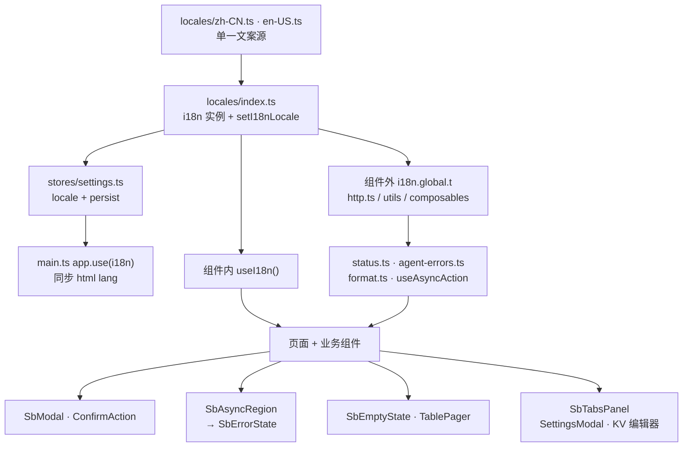

# SimpleBase 控制台 UI 优化计划 v3.0（中英双语 + 结构收敛 + 样式修复）

## 原始需求

> 1. 简化部分代码，去除冗余等不需要的逻辑等
> 2. 增加多语言，支持中文和英文
> 3. 修复样式的 bug，比如统一 modal 框、报错框等等，使用 shadcn/ui，遵循 `AGENTS.md`
> 4. 美化样式部分代码

> 日期：2026-10-10
> 范围：`ui/src/`（`src/components` 非 `ui/` 部分、`src/pages`、`src/layouts`、`src/stores`、`src/composables`、`src/utils`、`src/lib`、`src/services`、`src/router`），不含`ui/src/components/ui/**` 库层风格、不含 `docs/` 文档正文、不含后端
> 状态：**实施中**
> 命名区分：`plan/planv3.0/ui-style-polish-plan.md`（侧栏与视觉定稿）、`plan/planv4.0/ui-cleanup-plan.md`（mock 层退役与目录清理）、`plan/planv5.0/code-and-style-optimization-plan.md`（reka 状态钩子等缺陷清理）。本文件是**第三轮 UI 优化**，与前两者互补，不重复立项。
> 强相关前置：`plan/planv5.0/console-loading-states-plan.md`（加载/空/错误三态主题）、`plan/planv5.0/code-and-style-optimization-plan.md` §2.1（状态钩子）、§2.4（覆盖率与 typecheck 基线）、§4（样式优化）、§5（代码结构）、§9（仓库卫生）

---

## 0. 已确认边界（需求澄清结论）

| 项 | 结论 |
| --- | --- |
| i18n 方案 | 引入 **vue-i18n**（Composition API，`legacy: false`）。这是根 `AGENTS.md`「不新增依赖，除非用户明确要求」的唯一豁免项 |
| i18n 范围 | **仅控制台 UI 界面文案**（约 70 个含中文字面量的源文件）。不含 `docs/` Markdown 正文双语，不含后端返回的自由文本 |
| UI 自有文案 | 一律纳入：`SbModal` / `ConfirmAction` 默认值、`lib/status.ts` 状态表、`utils/agent-errors.ts` 错误码映射、`utils/format.ts` 的 `zh-CN` 写死、`services/http.ts` 的网络错误文案。**不做后端错误码协议改造**，未知码仍回退后端原始 `message` |
| 默认语言 | **中文**，**不做** `navigator.language` 探测，设置内手动切换并持久化 |
| 改动力度 | **激进** —— 清理 + 拆分巨型组件 + 抽公共抽象（统一 Tabs 面板、表单字段、错误态展示） |
| 测试策略 | 同步更新测试断言与桩，并补齐覆盖率；当前 `functions 94.24%` 未达标一并修到 ≥ 95% |
| 依赖变更 | 仅 `ui/package.json` 新增 `vue-i18n`。**不引入** `@intlify/unplugin-vue-i18n`（会迫使改 `vite.config.ts`）；不改 `tsconfig.json` / `vite.config.ts`，不改覆盖率阈值，不升级其它依赖 |

---

## 1. 改造前实测基线

| 项 | 实测值 |
| --- | --- |
| `ui/src/components` 规模 | 241 文件（204 `*.vue` + 37 `*.ts`）；其中 `src/components/ui/` 180 文件（本地 fork 的 shadcn-vue，风格定稿） |
| `src/pages` 规模 | 12 个 `*.vue`，共 3380 行 |
| `src/components`（非 ui）规模 | 12295 行 |
| 测试 | `ui/tests/` 96 个 `*.test.ts`；其中 60 个用 `text()` / `contains()` 断言，11 个含中文字面量 |
| i18n 基础设施 | **0** 处（全仓无 `vue-i18n` / `i18n` / `useI18n` / `$t(`） |
| 中文硬编码源文件 | **70** 个（`grep '[\u4e00-\u9fff]'`） |
| `toast.*` 调用 | **165** 处 |
| 原生 `title="…"` 提示 | 81 处命中（含组件 prop，需逐处区分） |
| `window.alert/confirm/prompt` | 0 处 |
| `console.log` 残留 | 0 处 |
| 弹窗入口 | `SbModal` 27 处引用（24 个组件文件）；外部直接 `import @/components/ui/dialog` 的**只有 SbModal 自身** → 入口已收敛 |
| `ConfirmAction` | 17 处引用，唯一直接使用 `@/components/ui/alert-dialog` 的业务组件 |
| 覆盖面最大的通用件 | `SbAsyncRegion` 26、`SbModal` 27、`ConfirmAction` 17、`SbEmptyState` 12、`PageContainer` 12、`ProjectScope` 10、`TablePager` 9、`SbBlockSkeleton` 6 |
| 覆盖率基线 | statements 99.24% / branches 95.07% / **functions 94.24%（未达标）** |
| `yarn typecheck` | 不干净（`tests/**` 241 处 TS2307 等，共 262 处）——本计划以 `yarn build` + `yarn test` 为准，**不把 typecheck 全绿列入验收** |

巨型文件 TOP（本轮拆分对象）：

| 文件 | 行数 |
| --- | --- |
| `pages/AgentManager.vue` | 610 |
| `pages/Databases.vue` | 518 |
| `components/modal/CronJobModal.vue` | 481 |
| `components/settings/SettingsPanel.vue` | 419 |
| `components/modal/SqlWorkModal.vue` | 405 |
| `components/databases/kv/KvPanel.vue` | 389 |
| `components/docs/DocsArticle.vue` | 364 |
| `components/ai/AgentScheduleModal.vue` | 324 |

中文硬编码分布 TOP：`CronJobModal.vue` 64、`AgentManager.vue` 55、`Databases.vue` 53、`SandboxDrawer.vue` 42、`CronJobs.vue` 42、`SqlWorkModal.vue` 39、`AgentScheduleModal.vue` 38、`KvPanel.vue` 38、`Users.vue` 37、`Dashboard.vue` 36、`GoFunctions.vue` 35、`SettingsPanel.vue` 34、`Sandboxes.vue` 34。

---

## 2. 核心功能

1. **中英双语界面**：默认中文，设置内一键切换；切换后页面文案、状态标签、错误提示、Toast、空态、日期与数字格式同步变化，刷新后保持；`<html lang>` 随之更新。
2. **统一的弹窗与报错框**：全部弹窗经 `SbModal`；确认类经 `ConfirmAction`；加载/空/错误三态经同一闸门组件，**错误态只有一个实现**，不再在表格分支与普通分支各写一遍。
3. **结构与冗余清理**：删除不生效的 prop、重复标记、未使用导入与不可达分支；状态钩子统一使用 reka-ui 真实属性。
4. **视觉与交互一致性美化**：统一弹窗尺寸与底栏行为、统一空态图标语义、交互提示统一为 Tooltip，深浅色下表现一致。

---

## 3. 技术方案

### 3.1 i18n 分层：单一语言源 + 单一切换入口

- `ui/src/locales/` 为唯一文案源：`zh-CN.ts` 为权威树，`en-US.ts` 与之**严格同构**。
- key 采用**命名空间点号**，扁平结构便于查重与构建期裁剪：

  | 命名空间 | 内容 |
  | --- | --- |
  | `common.*` | 确定 / 取消 / 保存 / 重试 / 加载中 / 删除 / 编辑 / 刷新 / 关闭 / 是 / 否 |
  | `nav.*` | 路由页面标题（`meta.titleKey` 消费） |
  | `status.*` | 就绪 / 创建中 / 降级 / 删除中 / 已删除（数据库状态） |
  | `logLevel.*` | 信息 / 警告 / 错误 |
  | `cron.*` | 成功 / 失败 / 执行中 / 未运行 |
  | `error.*` | 后端错误码 → 文案（`agent-errors.ts` 的 14 个码）+ 通用失败文案 |
  | `pages.<page>.*` | 页面私有文案 |
  | `components.<component>.*` | 组件私有文案 |

- 实例在 `ui/src/locales/index.ts` 创建并导出 `i18n`、`setI18nLocale()`；`main.ts` 中 `app.use(i18n)`。
- 语言状态加在既有 `stores/settings.ts`（localStorage key `sb_settings_v1`），与 `theme` 同级，复用其 `persist()`；`load()` 对缺失 `locale` 补默认值 `zh-CN`（保证旧本地数据不炸）。`setLocale()` 同步 `document.documentElement.lang`（`zh-CN` / `en`）。
- **组件内**用 `useI18n()`；**组件外**（`services/http.ts`、`utils/*`、`composables/*`、Pinia getter）用 `i18n.global.t`，避免拿不到注入上下文。
- 语言包**静态导入、不做懒加载**：控制台是单实例应用，语言包为数百条短字符串，懒加载只会引入额外 chunk 与切换闪烁，收益为负。
- 语言包用 `.ts` 而非 `.json`：`tsconfig.json` 虽开了 `resolveJsonModule`，但 `.ts` 可直接导出 `interface`（满足「对象形状用 interface」规则）并保留注释，同时避免 JSON 无法携带类型约束。

### 3.2 文案迁移策略：先「出口收敛」再「消费者迁移」

先把「返回中文字面量」的出口改为「按 key 返回」，再迁移消费者。顺序颠倒会导致同一句话改两遍。

| 出口 | 改造 |
| --- | --- |
| `lib/status.ts` | `statusText` / `logLevelText` / `cronStatusText` 改为 key 查表；`*BadgeVariant` 纯映射不动 |
| `utils/agent-errors.ts` | `LABELS` 的 14 个码改为 `error.<code>` key；`agentErrorText` / `isRetryableError` 签名保留；未知码仍回退原始 `message` |
| `utils/format.ts` | `formatCount` / `formatTime` 去掉写死 `'zh-CN'`，改读当前 locale |
| `composables/useAsyncAction.ts` | 默认 `'操作失败'` key 化 |
| `composables/useLoadState.ts` | 默认 fallback `'加载失败'` key 化 |
| `services/http.ts` | `'网络请求失败'` / `'接口不存在或返回了 HTML 页面'` key 化 |
| `SbModal` | `okText` / `cancelText` 默认值取 `common.*`，**保留 props 覆盖能力** |
| `ConfirmAction` | 按钮与 `description` 默认值取 key，保留覆盖能力 |
| `SbEmptyState` | `title` / `description` 默认值取 key，保留覆盖能力 |
| `TablePager` | 「共 N 条 / 上一页 / 下一页」key 化 |
| `SbAsyncRegion` | 「正在加载 / 加载失败 / 重试」key 化 |
| `ProjectScope` | 「请先选择项目」类文案 key 化 |

### 3.3 i18n 与路由/导航的耦合点

`router/index.ts` 的 `meta.title` 被 `NavMenu`（菜单 + 分组标签）、`DefaultLayout`（面包屑）共同消费。改为 **`meta.titleKey`**，`DefaultLayout.currentTitle` 与 `NavMenu.toItem` 改为 `t(titleKey)`。`NavMenu.GROUP_DEFS` 的分组标签（工作台/数据/自动化/运维）同样 key 化。路由 redirect 语义（`/sql`→`/console/databases`、`/llm`→`/console/agents`、`/settings`→`/console/agents?settings=1`）**保持不变**。

### 3.4 统一弹窗 / 报错框（需求 3 主线）

- **保留 `SbModal` 为唯一弹窗入口**，修三处确证缺陷：
  - `okButtonProps: Record<string, unknown>` 实际只被 `Boolean(props.okButtonProps?.disabled)` 读取，`variant` / `size` / `class` 完全不生效 → 改为把 `okButtonProps` **真正透传给 `Button`**（调用面改动最小），并保留 `okDisabled` 语义等价；
  - `width`（数字 → `sm:max-w-5xl` 分档 class）与 `maxWidth`（CSS 变量 `--sb-modal-max-w`）两套并存 → 统一为 **CSS 变量通道**，`width` 保留为向后兼容别名换算，消除分档表；
  - `okText` / `cancelText` 默认值中文字面量 → key 化。
- **必须保持**既有行为：`flex flex-col` + `max-h-[calc(100vh-2rem)]`，标题与底栏固定在视口内、仅 `[data-slot="sb-modal-body"]` 滚动（`tests/SbModal.test.ts` 已锁定这些 class 与结构）。
- **`SbAsyncRegion` 双分支去重**：`showError` 在 `as='tbody'` 与 `as='div'` 下各写了一遍 `Alert + AlertTitle + 重试按钮` → 抽 `SbErrorState`（`variant: 'inline' | 'block'`），两处共用。**对齐 `console-loading-states-plan.md`**：只做「结构去重 + 文案 key 化」，不推翻其状态机与 160ms 延迟语义、保持 `aria-busy` / `aria-hidden` 约定，不重复立项。
- **`ConfirmAction`** 模板中受控 / 触发器两份 `AlertDialog` 标记合并为一份（`v-if` 切触发器 slot），按钮与默认 `description` 走 i18n。
- `src/components/ui/**` 是本地 fork 的库代码：**不改其风格约定**（含 `DialogContent.vue` 的 `<span class="sr-only">Close</span>`）。

### 3.5 抽公共抽象

- **`SbErrorState`**：统一报错框，`SbAsyncRegion` 两分支共用。
- **`SbTabsPanel`**：`SettingsModal` 的 `Tabs + TabsList variant="line" + 滚动容器` 与 KV 五个编辑器结构重复 → 抽成 `items` + 具名 slot 的面板骨架，`SettingsModal` 与 KV 编辑器改用。
- **表单字段**：`ui/field`（`Field` / `FieldGroup` / `FieldLabel` / `FieldError`）已被多处采用，仍有手写 `<label>` 的业务文件统一迁到 `ui/field`，**不新增组件**。

### 3.6 拆分巨型文件

按「模板职责」而非行数硬切，优先拆「可独立测试的面板」：

| 现状 | 拆分 |
| --- | --- |
| `pages/AgentManager.vue` 610 | 左栏列表 → `components/agent/AgentListPanel.vue`；编辑弹窗 → `components/modal/AgentFormModal.vue` |
| `pages/Databases.vue` 518 | 列表区 → `components/databases/DatabaseListPanel.vue` |
| `components/modal/CronJobModal.vue` 481 | 调度字段 → `components/cronjob/CronJobScheduleFields.vue`；表单状态 → `components/cronjob/useCronJobForm.ts` |
| `components/settings/SettingsPanel.vue` 419 | 按 `section` 分支拆 `ModelDefaultsPanel.vue` / `ProviderKeysPanel.vue`，原文件保留**同名薄壳转发**（避免改动 `SettingsModal` 与测试） |
| `components/modal/SqlWorkModal.vue` 405 | 结果区 → `components/modal/SqlResultPanel.vue` |
| `components/databases/kv/KvPanel.vue` 389 | 键列表 → `components/databases/kv/KvKeyListPanel.vue` |

### 3.7 样式修复与美化（逐项已核证据）

- **`data-active` 澄清（不作为 bug，仅统一）**：仓库根 `AGENTS.md` §4.1 与 `ui/AGENTS.md` 把裸 `data-active:` 列为失效钩子，但实测 reka-ui 2.10.5 的 `RovingFocusItem` **会**渲染空属性 `data-active`（`node_modules/reka-ui/dist/RovingFocus/RovingFocusItem.js`），且 `ui/tests/ui-state-attributes.test.ts` 已断言 TabsTrigger 选中项 `data-active` 为 `''` → `pages/DocsWiki.vue` 的 `data-active:` **其实能命中**。本轮统一为 `data-[state=active]:` **仅为一致性**，并同步修订 `AGENTS.md` 表述（把「TabsTrigger 的 data-active 也失效」纠正为「Switch / 弹层等只有 `data-state`，TabsTrigger 例外」）。真正失效的是 `data-checked:` / `data-open:` / `data-closed:` 一类裸属性 —— 全仓现状 0 处，改造时保持。
- **`SbEmptyState`**：`actionText` 存在时按钮固定用 `PlusIcon`，对「重试 / 刷新 / 查看」语义错误 → 新增 `actionIcon` prop（默认 `PlusIcon` 保兼容）。
- **原生 `title="…"` 提示**：81 处命中中混有组件 prop（如 `ConfirmAction` 的 `title`），**逐处区分**，只把真正的原生 HTML 提示换成 reka-ui `Tooltip`。
- **不得回退的定稿规范**：侧栏菜单项 `h-11`（sm 下 `h-9`）、`gap-1.5`；主内容区铺满全宽；右上角顺序 使用文档 → 项目切换器（`w-56`）→ 设置 → 刷新，间距 `gap-4 sm:gap-5`；页面标题只用 `PageContainer` 的 subtitle 单行；样式只写 template Tailwind class，不新增自定义 CSS 文件；按钮内图标带 `data-icon="inline-start|inline-end"`；提示统一 `vue-sonner` 的 `toast`、确认统一 `ConfirmAction`、弹窗统一 `SbModal`、空态统一 `SbEmptyState`、分页统一 `TablePager` + `usePagination`。
- **已删除的零引用 `ui/` 组件（checkbox / drawer / dropdown-menu / pagination / radio-group）不得重新引入**。

### 3.8 性能与可靠性

- `t()` 为哈希查表，运行时开销可忽略；**禁止在 `v-for` 模板里现拼 key**，列表项文案用 `computed` 预计算或绑定常量 key。
- 语言切换触发全量文本重渲染，与主题切换同量级；切换仅在设置内发生，不需要 `v-memo`。
- 静态语言包进入主 chunk（预计数十 KB 内），不引入额外网络往返；体积敏感时再评估按语言分包，本轮不做。
- 报错框去重后，`aria-busy` / `aria-hidden` 与骨架语义必须保持 `console-loading-states-plan.md` 的约定（骨架可见时区域 `aria-busy="true"`、骨架 `aria-hidden`，不使用会反复朗读的 `aria-live`）。
- `http.ts` 错误文案 key 化后仍禁止把后端原始 payload 明文拼到控制台。

### 3.9 测试与覆盖率（关键风险）

- **避免逐个手改 96 个测试文件**：`ui/src/test/setup.ts` 中注册全局 i18n 并固定 `locale = zh-CN`，使既有中文断言继续成立。**同时加一层防退化**：新增 `ui/tests/i18n.test.ts` 断言 `zh-CN` 与 `en-US` 的 key 集合完全一致、无空值、en 侧无残留中文，并对 `status` / `agent-errors` / `SbModal` / `SbEmptyState` 各加一条 `en` 断言。只固定中文而不做这层校验，会把「英文缺失」测成通过。
- **覆盖率陷阱**：coverage `include` 为 `src/**/*.{ts,js,vue}`，仅排除 `src/components/ui/**`、`src/test/**`、`*.d.ts`、`main.ts`、`services/types.ts` → 新增的 `src/locales/**`、`SbErrorState`、`SbTabsPanel` 及拆分出的新组件**全部计入分母**。达成路径：新增文件四项各 ≥ 95%，总 `functions` 相对基线只升不降且 ≥ 95%。
- **测试桩同步**：`ui/src/test/helpers.ts` 的 `SbModal` / `SbEmptyState` / `ConfirmAction` 桩需与改造后 props 对齐；**不桩掉** `ui/` 下真实交互组件（尤其 `Switch` / `Tabs`）。
- **先读再动**：`tests/SbModal.test.ts`、`loading-surfaces.test.ts`、`loading-region.test.ts`、`template-event-wiring.test.ts`、`router.test.ts`、`layouts.test.ts`、`tabs.test.ts`、`ui-state-attributes.test.ts`、`status.test.ts`、`agent-errors.test.ts`、`format.test.ts`。
- **验收命令**：`cd ui && yarn build` 必须通过；`cd ui && yarn test` 三项覆盖率不低于基线且 `functions ≥ 95%`；**不得**通过下调 `vite.config.ts` 阈值放行。

---

## 4. 架构设计

改造前后分层不变，只在「文案与状态展示」这条纵切面上收敛出口：



---

## 5. 目录结构（改动清单）

```text
ui/
├── package.json                         # [MODIFY] 唯一依赖变更：新增 vue-i18n
├── index.html                           # [MODIFY] <html lang> 随语言同步（初始 zh-CN）
├── src/
│   ├── main.ts                          # [MODIFY] app.use(i18n)
│   ├── locales/                         # [NEW]
│   │   ├── index.ts                     # [NEW] createI18n 实例、消息装配、i18n / setI18nLocale
│   │   ├── types.ts                     # [NEW] LocaleCode / MessageSchema（对象形状用 interface）
│   │   ├── zh-CN.ts                     # [NEW] 中文权威消息树
│   │   └── en-US.ts                     # [NEW] 英文消息树（与 zh-CN 严格同构）
│   ├── composables/useLocale.ts         # [NEW] 语言读写封装：对接 settings store、同步 <html lang>
│   ├── stores/settings.ts               # [MODIFY] state 增 locale；load() 补默认值；setLocale()
│   ├── stores/auth.ts                   # [MODIFY] SettingsTab 增 'language'
│   ├── layouts/DefaultLayout.vue        # [MODIFY] SETTINGS_TABS 同步；文案 key 化
│   ├── layouts/DocsLayout.vue           # [MODIFY] 界面文案 key 化
│   ├── router/index.ts                  # [MODIFY] meta.title → meta.titleKey；redirect 语义不变
│   ├── components/
│   │   ├── SettingsModal.vue            # [MODIFY] 增「语言」页签；改用 SbTabsPanel；标题 i18n
│   │   ├── SbErrorState.vue             # [NEW] 统一报错框
│   │   ├── SbTabsPanel.vue              # [NEW] 统一 Tabs 面板骨架
│   │   ├── SbAsyncRegion.vue            # [MODIFY] 两分支改用 SbErrorState；文案 key 化
│   │   ├── SbEmptyState.vue             # [MODIFY] actionIcon prop；文案 key 化
│   │   ├── TablePager.vue               # [MODIFY] 文案 key 化
│   │   ├── ConfirmAction.vue            # [MODIFY] 合并两份标记；文案 key 化
│   │   ├── ProjectScope.vue             # [MODIFY] 文案 key 化
│   │   ├── NavMenu.vue                  # [MODIFY] 取 meta.titleKey；分组标签 key 化
│   │   ├── UserMenu.vue                 # [MODIFY] 文案 key 化
│   │   ├── GlobalProjectSwitcher.vue    # [MODIFY] 文案 key 化
│   │   ├── modal/SbModal.vue            # [MODIFY] 死 prop / 双套宽度机制 / 默认文案
│   │   ├── modal/AgentFormModal.vue     # [NEW] 从 AgentManager 拆出
│   │   ├── modal/SqlResultPanel.vue     # [NEW] 从 SqlWorkModal 拆出
│   │   ├── agent/AgentListPanel.vue     # [NEW] 从 AgentManager 拆出
│   │   ├── cronjob/CronJobScheduleFields.vue  # [NEW]
│   │   ├── cronjob/useCronJobForm.ts    # [NEW]
│   │   ├── settings/ModelDefaultsPanel.vue    # [NEW]
│   │   ├── settings/ProviderKeysPanel.vue     # [NEW]
│   │   ├── settings/SettingsPanel.vue   # [MODIFY] 保留薄壳转发
│   │   ├── settings/LanguagePanel.vue   # [NEW] 语言切换面板
│   │   ├── databases/DatabaseListPanel.vue    # [NEW]
│   │   ├── databases/kv/KvKeyListPanel.vue    # [NEW]
│   │   └── （modal / databases / ai / sandbox / docs / editor / chat 各组件文案 key 化）
│   ├── pages/                           # [MODIFY] 12 个页面文案 key 化（含拆出面板）
│   ├── lib/status.ts                    # [MODIFY] key 查表
│   ├── utils/agent-errors.ts            # [MODIFY] key 查表
│   ├── utils/format.ts                  # [MODIFY] 去写死 zh-CN
│   ├── composables/useAsyncAction.ts    # [MODIFY] 默认文案 key 化
│   ├── composables/useLoadState.ts      # [MODIFY] 默认 fallback key 化
│   ├── services/http.ts                 # [MODIFY] 错误文案 key 化
│   └── test/
│       ├── setup.ts                     # [MODIFY] 注册全局 i18n 并固定 zh-CN
│       └── helpers.ts                   # [MODIFY] SbModal / SbEmptyState / ConfirmAction 桩对齐
└── tests/
    ├── i18n.test.ts                     # [NEW] key 集合一致性 / 无空值 / 切换持久化 / html lang
    ├── sb-error-state.test.ts           # [NEW]
    ├── sb-tabs-panel.test.ts            # [NEW]
    └── （其余用例按新契约调整断言）
```

---

## 6. 关键代码结构（跨模块约定）

```ts
// ui/src/locales/types.ts —— 语言编码与消息树类型（对象形状用 interface）
export type LocaleCode = 'zh-CN' | 'en-US'

export interface MessageTree {
  [key: string]: string | MessageTree
}
```

```ts
// ui/src/stores/settings.ts —— 语言与既有主题同源持久化，旧本地数据必须补默认值
export interface SettingsState {
  theme: ThemeMode
  /** 界面语言（默认中文，不做浏览器探测） */
  locale: LocaleCode
  projectDefaults: Record<string, ProjectLlmDefaults>
  providerConfigs: Record<string, Record<string, ProviderLocalConfig>>
}
```

```ts
// ui/src/components/SbErrorState.vue —— 统一报错框，替代 SbAsyncRegion 中的两份重复标记
import type { HTMLAttributes } from 'vue'

export interface SbErrorStateProps {
  /** 已翻译的标题；缺省用 error.loadFailed */
  title?: string
  /** 已翻译的详情；缺省用 error.loadFailed */
  description?: string
  /** 已翻译的重试按钮文案；缺省用 common.retry */
  retryText?: string
  /** inline：嵌在表格 tbody 里；block：普通区域 */
  variant?: 'inline' | 'block'
  class?: HTMLAttributes['class']
}
```

```ts
// ui/src/components/SbTabsPanel.vue —— 统一 Tabs 面板，SettingsModal 与 KV 编辑器共用
export interface SbTabsPanelItem {
  /** 稳定标识，同时作为 TabsTrigger value */
  value: string
  /** 已翻译的页签文案 */
  label: string
}

export interface SbTabsPanelProps {
  items: SbTabsPanelItem[]
  modelValue: string
  /** 面板内容滚动区最大高度，默认跟随 SbModal body */
  contentMaxHeight?: string
}
// emit: 'update:modelValue'
// slots: 每个 item.value 对应一个具名 slot；'default' 作为兜底
```

---

## 7. 实施阶段（每阶段单独可构建、可合并）

| 阶段 | 内容 | 依赖 |
| --- | --- | --- |
| P0 | 本计划文档落盘 + `ui/AGENTS.md` 补 i18n 与公共组件约定 | — |
| P1 | i18n 基础设施：新增 `vue-i18n`、`src/locales/**`、`useLocale`、`settings.locale`、设置「语言」页签、`html lang`、`router.titleKey` | P0 |
| P2 | 文案出口收敛：`status` / `agent-errors` / `format` / `http` / `useAsyncAction` / `useLoadState` / `SbModal` / `ConfirmAction` / `SbEmptyState` / `TablePager` / `SbAsyncRegion` / `ProjectScope` | P1 |
| P3 | 组件层文案迁移（modal / databases/kv / settings / ai / sandbox / agent / docs / editor） | P2 |
| P4 | 页面层文案迁移（12 页面 + 2 布局 + NavMenu 分组） | P2 |
| P5 | 抽 `SbErrorState` / `SbTabsPanel`；`SbAsyncRegion` 去重；手写 `<label>` 迁 `ui/field` | P2 |
| P6 | 拆分 6 个巨型文件 | P5 |
| P7 | 样式修复：`SbModal` 死 prop 与双套宽度、`SbEmptyState` 图标、原生 `title` → `Tooltip`、DocsWiki 钩子统一 | P1 |
| P8 | 测试同步与覆盖率补齐（含新增用例）；视觉回归 | P3–P7 |

**blast radius 控制**：先落 P5 的 `SbErrorState` / `SbTabsPanel` 与 P2 的出口层，再迁移消费者；每阶段独立可构建。

---

## 8. 实施注记

- **新增设置页签需同步三处**：`stores/auth.ts` 的 `SettingsTab` 联合类型、`layouts/DefaultLayout.vue` 的 `SETTINGS_TABS` 白名单、`components/SettingsModal.vue` 的 `TabsTrigger`。`route.query.settings` 深链语义与既有 redirect **保持不变**。
- **`services` 层不能 `useI18n()`**：`http.ts`、`utils/*`、`composables/*` 一律走 `i18n.global.t`；`main.ts` 中 `app.use(i18n)` 必须在任何可能触发 `http.ts` 错误处理之前。
- **不扩大范围**：不动 `src/components/ui/**` 风格、不动 `docs/` 正文、不动后端、不动 `vite.config.ts` / `tsconfig.json`、不升级其它依赖。
- **Yarn 版本**：`ui/` 是 Yarn 4 lockfile（本机 4.18.0），`vue-i18n` 安装后须提交更新后的 `yarn.lock`；不要用 Yarn Classic 1（会把 lockfile 重写为 v1）。
- **未跟踪文件提示**：`ui/src/components/agent/`、`ui/src/composables/useAgentConversation.ts` 及部分 `ui/tests/` 用例仍未纳入 git；本轮只提示、不代为提交。

---

## 9. 验收清单

1. `cd ui && yarn build` 通过。
2. `cd ui && yarn test` 通过：statements / branches / functions 均 ≥ 95%（`functions` 从 94.24% 提升到阈值以上），四项不低于实施前基线。
3. `ui/tests/i18n.test.ts` 全绿：`zh-CN` / `en-US` key 集合一致、无空值、en 侧无残留中文。
4. 设置内切换语言：页面文案、状态标签、Toast、空态、日期数字格式同步变化，刷新后保持，`document.documentElement.lang` 同步为 `en` / `zh-CN`。
5. 弹窗行为与改造前一致：标题与底栏固定在视口内，长内容仅在 body 滚动；`ConfirmAction` 受控 / 触发器两种用法均正常。
6. 报错框只有一个实现（`SbErrorState`），`SbAsyncRegion` 的 `tbody` 与普通分支复用同一组件。
7. `ui/AGENTS.md` 已补 i18n 约定、公共组件（`SbErrorState` / `SbTabsPanel`）用法，并修订 `data-active` 表述。
8. 未改 `src/components/ui/**` 风格、未改 `vite.config.ts` / `tsconfig.json`、未新增 `vue-i18n` 以外依赖。
