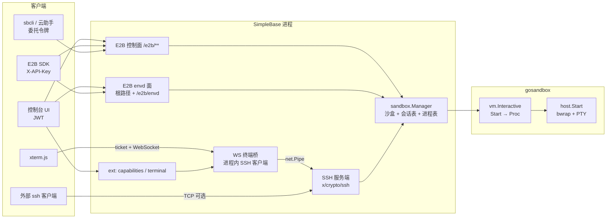

# 云沙盒：全量切换到 E2B 标准 API、弹窗溢出修复、SSH 终端（planv6.2）

> 范围：`internal/api` 里所有沙盒接口；`ui/src/pages/Sandboxes.vue` 及其弹窗；`internal/sandbox`、`gosandbox`；以及所有旧接口的调用方（`sbcli`、JS / Go SDK、文档、技能文档）。
> 依据：2026-10-19 读到的仓库代码；E2B 部分读自 `e2b-dev/E2B`（`spec/openapi.yml`、`packages/js-sdk/src/{connectionConfig,sandbox/index,sandbox/sandboxApi}.ts`）与 `e2b-dev/infra`（`packages/envd/spec/{envd.yaml,process/process.proto,filesystem/filesystem.proto}`）的 main 分支。本文是计划，不是已落地代码。
> 约束：[`AGENTS.md`](../../AGENTS.md)、[`internal/AGENTS.md`](../../internal/AGENTS.md)、[`ui/AGENTS.md`](../../ui/AGENTS.md)、[`gosandbox/README.md`](../../gosandbox/README.md)。数据库迁移**只定义，不代为执行**（见 §8）。

## 0. 本次修订（相对上一版）

用户明确：**不需要兼容原来的 API**，`internal/api` 里关于沙盒的接口**全部改为 E2B 标准 API**。由此：

1. **删除** `/v1/projects/:projectID/sandboxes/**` 全部 15 条路由与 `SandboxHandler` 的旧实现，不保留任何别名或兼容层。
2. 沙盒 HTTP 面**只剩 E2B 的两个面**（控制面 + envd 数据面）。唯一保留的非标准入口是 §4.7 的 3 条 `ext` 路由（能力查询与终端），它们 E2B 本来就没有对应物，且 SDK 不会调用。
3. 所有旧接口调用方必须同步切换，**同一个发布里一起落地**：控制台 UI、`sbcli`、JS / Go SDK 的沙盒模块、委托路由表、技能文档、全部相关测试与文档（§4.8）。
4. 旧接口里 E2B 没有对应概念的功能一并取消：`Idempotency-Key`、`PATCH` 改名与空闲超时、`/run` 一次性执行、显式 `start` / `stop`（改为 `connect` / `pause`）、创建时按沙盒指定 CPU / 内存、`/exec`（由 envd 的 `process.Start` 和终端取代）。清单见 §4.9。
5. 错误体改成 E2B 形状 `{code, message}`，不再是 `{error:{code,message,request_id}}`。
6. 迁移 v50 不再只服务可选功能：整个沙盒模块都依赖它，所以改成「启动自检，缺列则沙盒模块自行置为不可用并写明原因」（§8）。

## 1. 需求与结论摘要

| # | 需求 | 结论 |
|---|---|---|
| 1 | 沙盒接口全部符合标准 E2B API，可直接用 E2B SDK 对接；不兼容旧 API | 做「线协议兼容的子集」：控制面（`/sandboxes`、`/v2/sandboxes`、timeout / pause / connect）+ 数据面 envd（Connect-JSON 的 `process.Process`、`filesystem.Filesystem`，以及 `/files`、`/health`）。旧路由整体删除。**行为不会与 E2B 完全一致**：后端是本机 bwrap 进程隔离，不是 Firecracker microVM，没有网络、模板、内存快照，差异见 §4.6 |
| 2 | 弹窗里「终端 / 文件 / 信息」内容过宽，被边缘覆盖 | 先用 Playwright 复现再改。代码里已有确定缺 `min-w-0` / 断行的地方（§2.2）。页签换成项目约定的 `SbTabsPanel` |
| 3 | 「终端」改成 Terminal 插件，用 SSH 登录 | 前端 xterm.js；后端用 `golang.org/x/crypto/ssh` 做**进程内 SSH 服务端**，会话落到沙盒里的 PTY。浏览器经 WebSocket 接入，可选再开一个外部 SSH 端口。**终端同时是 UI 里执行命令的唯一入口**（旧的「命令输入框 + 历史」随 `/exec` 一起删除） |

三项有一个共同的底层缺口：**今天的沙盒执行只有「同步跑完再返回」**（`gosandbox/vm.Driver.Exec`、`host.Run`）。需求 3 的交互 PTY 和 E2B `process.Start`（流式输出、后台进程、PTY）都要「启动后保持句柄」的原语。先建它（M2），两边共用。

## 2. 现状

### 2.1 已读到的事实

- 沙盒后端只有 `local`（本机 bwrap + Landlock + seccomp / macOS Seatbelt）和仅测试用的 `fake`。网络恒为关闭，`Spec.Network=public` 被拒绝（`internal/sandbox/manager.go` 创建校验 `network not allowed`）。
- 旧 HTTP 面：`/v1/projects/:projectID/sandboxes/**`（`internal/api/router.go` 的 `mountSandboxRoutes`，约 563–597 行；handler 在 `internal/api/sandbox_handler.go`）。鉴权 `Authorization: Bearer`；错误体 `{"error":{"code","message","request_id"}}`；错误映射表在 `internal/api/error.go:94–110`（`sandbox_not_found` 等）。
- **旧调用方（全部要改）**：
  - 前端：`ui/src/services/http-api.ts`（`sandboxesPath` 与 `sandboxes:` 段，约 362–1035 行）、`types.ts`（`Sandbox*` 类型）、`src/test/api-mock.ts`、`pages/Sandboxes.vue`、`components/sandbox/SandboxDrawer.vue`、`components/modal/SandboxCreateModal.vue`、`pages/AgentManager.vue`（仅引用，需核对）、`locales/{zh-CN,en-US}.ts`，以及 `ui/tests/` 下 9 个涉及沙盒的测试文件。
  - 后端：`internal/sbcli`（`sandbox *` 命令与 `commands.go` 的只读表）、`internal/api/delegation_route_table_test.go`（6 条沙盒委托路由）、`internal/app/sandbox_{e2e,cross_project,manager}_test.go`、`internal/api/{b3_sandbox_routes,sandbox_handler}_test.go`。
  - SDK 与文档：`packages/js-sdk/src/sandboxes.ts`（含 `client.ts`、`index.ts`、`README.md`、`__tests__/sandboxes.test.ts`；`dist/` 是构建产物，重新构建，不手改）、`packages/go-sdk/sandboxes.go`（+ 测试）、`docs/sdk/index.md`、`docs/automation/{sandbox,sandbox-api,sandbox-e2e}.md`、`cloudagent/skills/simplebase/references/sandbox.md`。
  - **不受影响**：云助手线程内的 `sandbox_exec` / `sandbox_shell` / `sandbox_read_file` / `sandbox_write_file` 工具走 `cloudagent.Sandbox` 接口 → `app.sandboxAdapter` → `Manager`，是进程内调用，不经过 HTTP（`internal/app/app.go:972`）。
- `Manager`：每个沙盒操作经 `withLock` 串行，等待超过 5 秒返回 `ErrBusy`；`source=agent` 的沙盒对 `Exec` 返回 `ErrBusy`（UI 把它当只读）；状态枚举 `pending/running/stopped/expired/error`；`expires_at` 由 `markActive` 设为启动时刻 + `max_duration`；reaper 只按 `expires_at` 把行标成 `expired`。
- `sys_sandboxes`（`internal/systemdb/migrate.go:557`）**没有 metadata 列**；当前最新迁移版本是 49。沙盒 ID 是 UUID。
- 认证：`auth.AuthMiddlewareWithDelegation` 同时支持 JWT（控制台登录）与 API Key（`Authorization: Bearer`），委托令牌（云助手）也走它。项目归属由 `projectContextMiddlewareEcho` 从路径参数 `:projectID` 解析并校验 `auth.CheckProjectAccess`。
- HTTP 服务有 `WriteTimeout`（`internal/app/app.go:325`，沙盒启用时被抬到 `ExecTimeoutMax+1min`）。Hijack 或长连接流之后 deadline 仍然保留，需调用方清掉（SSE 已有同类处理：`internal/api/sse.go` 的 `beginSSE`）。
- 根 `go.mod`：`golang.org/x/crypto v0.47.0` 已是**直接依赖**（含 `ssh`）；`golang.org/x/net v0.49.0` 是 indirect；没有 websocket 库；`google.golang.org/protobuf` 是 indirect。`gosandbox/go.mod` 已直接依赖 `golang.org/x/sys`。
- 前端没有 xterm（`ui/node_modules/@xterm` 不存在）。`ui/vite.config.ts` 的 dev proxy 只有 `/v1`、`/health`、`/go`。`SbModal` 宽度只走 `--sb-modal-max-w`，正文容器带 `overflow-x-hidden` 与 `px-1 -mx-1`（`ui/AGENTS.md` 明确不能去掉）。

### 2.2 弹窗溢出：代码里的嫌疑点（均在 `SandboxDrawer.vue`，**尚未复现，不是结论**）

| 行 | 现状 | 问题 |
|---|---|---|
| 3 | 根容器 `min-w-0 max-w-full … overflow-y-auto` | 设了 `overflow-y:auto` 后 `overflow-x` 会被计算成 `auto`：子元素过宽时变成内部横向滚动条，而外层 `SbModal` 正文是 `overflow-x-hidden`，两层叠加后右侧容易被裁 |
| 32 | 命令历史 `div.sb-mono` | 无 `break-all`，无空格长命令撑宽（该块随终端改造删除，但同类写法要避免） |
| 41 | 目录行 `flex items-center gap-2` | 路径 `span` 无 `min-w-0` / `truncate` / `break-all`，不换行 |
| 60–61 | 文件列表行 `flex justify-between`，里面 `button.truncate` | **`truncate` 在 flex 子项上必须同时有 `min-w-0` 才生效**，现在没有，长文件名会把行撑出弹窗 |
| 71 | 文件路径 `span.sb-mono` | 无 `break-all` |
| 92–97 | 信息页若干 `<p>` | 只有 ID、VM 两行有 `break-all`；`statusLabel / specLabel / timeLabel` 里的长字符串没有 |
| 2 | `SbModal :max-width="900"` | 窄屏下由 `DialogContent` 的 `max-w-[calc(100%-2rem)]` 兜底，但内部固定宽度元素不受它约束 |

## 3. 总体设计



依赖方向保持 `cmd → app → api → sandbox → gosandbox/vm → host`。新增 / 变化：

- `gosandbox/host`：`Start`（交互 / 流式，带 PTY）。
- `gosandbox/vm`：可选接口 `Interactive`，**不改 `Driver`**。`vm.FileEntry` 追加 `Mode`、`ModTime`。
- `internal/sandbox`：会话表、进程表、`SetExpiry`、`metadata`、按 ID 全局反查（SSH 用）。
- `internal/sandbox/sshd`（新包）：SSH 服务端，只依赖 `internal/sandbox` 的接口与 `x/crypto/ssh`。
- `internal/e2bproto`（新包，只 import 标准库）：Connect envelope 编解码、`process` / `filesystem` 的 JSON 报文结构、E2B 错误体。
- `internal/api`：删除 `sandbox_handler.go` 旧实现，新增 `e2b_auth.go`（认证 / 项目解析 / 错误体）、`e2b_control_handler.go`、`e2b_envd_handler.go`、`e2b_process_handler.go`、`e2b_ext_handler.go`。

## 4. 需求 1：E2B 标准 API（全量替换）

### 4.1 E2B 协议结构（已核对）

1. **控制面**：REST，`X-API-Key` 鉴权。`POST /sandboxes`（deprecated）/`POST /v2/sandboxes`、`GET /sandboxes`（deprecated）/`GET /v2/sandboxes`、`GET|DELETE /sandboxes/{id}`、`POST /sandboxes/{id}/timeout|pause|resume|connect`、`POST /v2/sandboxes/{id}/connect`。错误体 `{code:int32, message:string, error_code?:string}`；429 可带 `Retry-After`。
2. **数据面 envd**：每个沙盒内的守护进程，默认端口 49983。HTTP：`/health`（204）、`/envs`、`/metrics`、`/files`（GET 下载、POST 上传；查询参数 `path`、`username`、`signature`、`signature_expiration`）；RPC 是 **Connect 协议 + JSON**（JS SDK `useBinaryFormat: false`），服务 `process.Process`（`List/Connect/Start/Update/StreamInput/SendInput/SendSignal/CloseStdin`，`Start`、`Connect` 为服务端流）与 `filesystem.Filesystem`（`Stat/MakeDir/Move/ListDir/Remove/WatchDir/CreateWatcher/GetWatcherEvents/RemoveWatcher`）。鉴权头 `X-Access-Token`；SDK 另发 `E2b-Sandbox-Id`、`E2b-Sandbox-Port`。
3. SDK 地址来源：`apiUrl`（`E2B_API_URL`）、`sandboxUrl`（`E2B_SANDBOX_URL`）。设置 `sandboxUrl` 后 SDK 直接用它作为 envd 基址，所以不需要泛域名 `{port}-{sandboxId}.domain`。`E2B_DEBUG=true` 时 SDK 固定连 `localhost:3000` 与 `localhost:49983`。

### 4.2 路由拓扑

SPA 前端已占用 `/sandboxes`（`router/index.ts` 的页面路径），控制面不能挂根。

| 面 | 路径 | 用途 |
|---|---|---|
| 控制面 | `/e2b/sandboxes`、`/e2b/v2/sandboxes/**` | SDK：`E2B_API_URL=https://host/e2b`；控制台 |
| envd（SDK） | 根路径：`/process.Process/*`、`/filesystem.Filesystem/*`、`/files`、`/envs`、`/health`、`/metrics` | SDK：`E2B_SANDBOX_URL=https://host` |
| envd（控制台） | `/e2b/envd/` + 同样的相对路径 | 控制台 UI；与根路径**挂同一组 handler 函数**，只是多挂一次，这样 dev proxy 只需代理 `/e2b` |
| ext | `/e2b/ext/**` | §4.7，仅控制台 |

- **`/files` 必须在根路径**：SDK 的 `fileUrl` 用 `new URL('/files', envdDirectUrl)` 拼 URL，绝对路径会丢掉基址里的路径前缀（已从 `sandbox/index.ts` 源码看出）。
- **`/health` 与现有路由冲突**：看到请求头 `E2b-Sandbox-Id` 时按 envd 语义返回，否则保持原行为。
- 控制面是否允许带路径前缀（`E2B_API_URL=https://host/e2b`），由 M0 实测。**备选拓扑**：`sandbox.e2b.listen` 独立监听（如 `:3000`），控制面与 envd 都挂根，`E2B_API_URL=E2B_SANDBOX_URL=http://host:3000`。handler 相同，只改挂载点，所以 handler 先写、挂载最后定。
- 兜底：`/e2b/**` 下未注册的路径返回 E2B 形状的 404；§4.4 列出的不支持端点返回 501。路由必须在 SPA fallback 之前注册。

### 4.3 鉴权、项目解析、错误体

**认证**（控制面与 envd 通用）：

- `X-API-Key: <SimpleBase API Key>`：在 E2B 路由组的第一层中间件里，把它归一为 `Authorization: Bearer <key>`（仅当后者缺失），然后复用现有 `authMW`。同时接受 `Authorization: Bearer <JWT 或 API Key>`（控制台用）与委托令牌（云助手用）。不支持 E2B 的 `X-Team-ID` / 管理员头。
- 权限：读 `database:read`，写 `database:write`（创建、删除、timeout、pause、connect、`process.*`、文件写）。
- envd 另接受 `X-Access-Token`（见下），仅用于 envd 路由，不能调控制面。
- 风险（M0 核实）：官方 SDK 可能校验 API Key 的前缀（`validateApiKey` 选项存在）。若要求 `e2b_` 前缀，则在文档里写明用 `validateApiKey:false`；不改 SimpleBase 的 Key 格式。

**项目解析**：E2B 请求路径里没有项目。规则：

1. 请求头 `X-SimpleBase-Project` 存在则取它；
2. 否则主体恰好授权一个项目（API Key / 委托令牌的常见情况）则取它；
3. 否则 400（`message` 说明需要该头）。

随后复用 `catalog.ResolveProjectTenant` + `auth.CheckProjectAccess`（把 `projectContextMiddlewareEcho` 里的解析逻辑抽成可传参函数，路径参数版和头版共用，不复制）。系统项目：写操作返回 403，与现状一致。这是 SimpleBase 对标准协议的**唯一请求侧扩展**，SDK 可通过 `headers` 选项传入。

**envd 令牌 `X-Access-Token`**：

- 格式 `base64url(payload).base64url(HMAC-SHA256(auth.api_key_hash_secret, payload))`，`payload={p:项目ID, s:沙盒ID, exp:沙盒 expires_at}`。**无状态、不落库**；沙盒删除后因按 ID 反查不到而失效，到期自动失效；重新 `connect` 签发新令牌。
- 校验：令牌的 `s` 必须等于请求头 `E2b-Sandbox-Id`；项目取自令牌。
- **只在创建 / connect 响应里下发，`GET /sandboxes/{id}` 仅当调用方有 `database:write` 才带 `envdAccessToken`**。否则只读 Key 能通过详情拿到可写令牌，等于越权。
- 令牌与 `signature` 不得进日志与审计。`/files` 的 `signature` 算法以 M0 读 `getSignature` 源码为准。
- 同时接受 `Bearer` + 项目头 + `E2b-Sandbox-Id`（控制台与 sbcli 用，权限按读 / 写校验）。

**错误体**：E2B 路由统一 `{"code":<http 状态>,"message":"…","error_code":"…"}`，**不再带 `request_id` 包装**；`X-Request-Id` 响应头保留。实现：在 E2B 路由组内用自己的 `writeE2BError`，并让 Echo 的 `HTTPErrorHandler` 对 E2B / envd 路径（前缀匹配）改用它，保证认证中间件、项目解析、BodyLimit 等产生的错误也是 E2B 形状。envd 的 Connect 错误则按 Connect 规范用 `{code:"not_found",message:…}` 与对应 HTTP 状态。错误映射：

| 领域错误 | HTTP | `error_code` |
|---|---|---|
| `sandbox.ErrNotFound`（含跨项目一律等同不存在） | 404 | `sandbox_not_found` |
| `sandbox.ErrInvalidSpec` / `ErrInvalidPath` | 400 | `invalid_request` |
| `sandbox.ErrLimitExceeded` | 429（带 `Retry-After: 5`） | `sandbox_limit_exceeded` |
| `sandbox.ErrBusy` | 409 | `sandbox_busy` |
| `sandbox.ErrGone` | 410 | `sandbox_gone` |
| `sandbox.ErrFileTooLarge` | 413 | `file_too_large` |
| `vm.ErrUnavailable` | 503 | `sandbox_unavailable` |
| `vm.ErrBackend` | 502 | `sandbox_backend_error` |
| 只读实例 | 503 | `readonly_instance` |
| 系统项目写 | 403 | `system_project_protected` |

### 4.4 控制面映射

| E2B | 实现 |
|---|---|
| `POST /v2/sandboxes`（`NewSandboxV2`）、`POST /sandboxes` | `Manager.Create` 后立即 `Start`（E2B 创建即运行）。`templateID` → 镜像标签（`base` → `sandbox.image`，其余按 `sandbox.images` 白名单，不在名单内 400）。`timeout`（秒，v2 默认 300）→ `expires_at = now+timeout`，**超过 `max_duration` 时截断**，真实到期时间看响应与详情的 `endAt`。`metadata` → 新列（§8）。`envVars` → **仅内存**随沙盒保存，重启丢失（不把用户密钥明文写进系统库）。`secure` 忽略。响应 `Sandbox`：`sandboxID`、`templateID`、`alias`、`clientID`（= sandboxID，已废弃字段）、`envdVersion`、`envdAccessToken`、`domain:null` |
| `GET /v2/sandboxes`、`GET /sandboxes` | 项目内未删除行。支持 `state`（`running` / `paused`）、`metadata`（`k=v&k2=v2`，**在内存里过滤**——项目内沙盒上限 ≤100）、`order`、`startedAfter`、`limit`（1–100，默认 100）、`nextToken`（沿用现有基于 id 的游标）；响应头 `X-Next-Token`、`X-Total-Running`。字段 `cpuCount`、`memoryMB`、`diskSizeMB=0`、`startedAt`、`endAt`、`state`、`metadata`、`envdVersion` |
| `GET /sandboxes/{id}` | `SandboxDetail`：另有 `allowInternetAccess:false`、`lifecycle:{onTimeout:"kill",autoResume:false}`；`envdAccessToken` 见 §4.3 |
| `DELETE /sandboxes/{id}` | `Manager.Delete` → 204；`ErrBackend` 沿用「用户请求成功、reaper 重试」；同时关闭该沙盒全部会话与进程 |
| `POST …/timeout`（`{timeout}`） | 新增 `Manager.SetExpiry`：从**调用时刻**重新计时，同样截断到 `max_duration`；204 |
| `POST …/pause` | `Manager.Stop`：文件保留，**进程丢失**（无内存快照）；`memory` 参数忽略；已暂停 409；204 |
| `POST /v2/sandboxes/{id}/connect`、`POST /sandboxes/{id}/connect`、`POST …/resume` | 已暂停 → `Manager.Start`（201）；已运行 → 仅延长超时（200，TTL 只延长不缩短）。响应 `Sandbox`，含新 `envdAccessToken` |
| `fork`、`snapshots`、`logs`、`metrics`、`network`、`refreshes`、`volumes`、`templates`、`teams` | 不实现：501，`error_code:"unsupported_feature"` |

**状态映射**：`pending` / `running` → `running`；`stopped` / `expired` / `error` → `paused`（文件还在，`connect` 可重启）。

**名称与来源**：E2B 创建体没有 `name` 与 `source`。约定两个保留的 metadata 键：`name`（可选，用于展示；缺省 `sb-<id 前 8 位>`；沿用现有名称校验与同项目唯一约束，冲突返回 409 `sandbox_name_conflict`）与只读的 `simplebase.source`（服务端按主体注入：JWT → `console`，API Key → `api`，委托令牌 → `agent`；用户传入 `simplebase.` 前缀的键一律 400）。`GET /v2/sandboxes?metadata=simplebase.source=agent` 即可按来源过滤，不需要新参数。

**拒绝并返回 400 + 说明**的请求字段（不静默忽略，免得用户以为生效）：`allow_internet_access:true`、`network`（任何配置）、`iam`、`volumeMounts`、`mcp`、`autoPause`、`autoResume`。

### 4.5 envd 面映射

| E2B | 实现 |
|---|---|
| `GET /health` → 204 | 沙盒存在且 `running` 返回 204，否则 502（SDK 把 502 视为未运行） |
| `process.Process/Start`（Connect 服务端流，`application/connect+json`） | 依赖 M2。事件序列 `start{pid}` → `data{stdout|stderr|pty}`（bytes 在 JSON 里是 base64）→ `end{exitCode,exited,status}`，空闲时发 `keepalive`。支持 `process.{cmd,args,envs,cwd}`、`pty.size.{cols,rows}`、`tag`、`stdin`。**本机后端 stdout 与 stderr 在 `host.Run` 里是合并的**，流式版本沿用：全部作为 `stdout` 事件下发（PTY 本来就是单流） |
| `Connect` / `List` / `SendInput` / `SendSignal` / `CloseStdin` / `Update`（PTY 缩放） | 进程表（pid、tag）；`SendSignal` 仅 `SIGTERM(15)` / `SIGKILL(9)` |
| `StreamInput`（客户端流） | 不实现：HTTP/1.1 无法双向流，返回 Connect `unimplemented`。JS SDK 的 stdin 走 `SendInput` |
| `filesystem.Filesystem/Stat|MakeDir|Move|ListDir|Remove` | 一元 JSON。`EntryInfo` 需要 `mode`、`modifiedTime`、`permissions` 等，故给 `vm.FileEntry` **追加** `Mode`、`ModTime`（`local`、`fake` 同步填充） |
| `WatchDir` / `CreateWatcher` / `GetWatcherEvents` / `RemoveWatcher` | 不实现，`unimplemented` |
| `GET|POST /files` | 下载、上传（`multipart/form-data` 的 `file` 字段，或 `application/octet-stream` + `path`）；上传自动建父目录。受 `sandbox.max_file_bytes`（默认 1 MiB）限制；**读到被截断时返回 413 而不是静默给出残缺文件**。需把 `/files` 加进 `skipLargeUploadBodyLimit` 的放行条件（替换掉旧的 `/sandboxes/…/files/content`） |
| `GET /envs`、`GET /metrics` | `/envs` 返回沙盒最小环境；`/metrics` 返回 501 |

路径映射：E2B 的相对路径相对用户 home，这里相对沙盒逻辑工作目录 `/workspace`；`/workspace` 之外的绝对路径返回 400。`username` / `user` 只接受空或当前唯一用户。

长连接细节：`process.Start` / `Connect` 是长流，进入 handler 后先解除 `WriteTimeout`（照 `beginSSE` 的做法），并在连接断开（`ctx.Done()`）时终止对应读写协程；**对客户端不读输出的情况要背压**（见 §6.2）。

### 4.6 与 E2B 的差异清单（写进文档，不要隐瞒）

| 方面 | E2B | 这里 |
|---|---|---|
| 隔离 | Firecracker microVM | 本机 bwrap，共享内核，只适合自托管 / 受信任用户 |
| 网络 | 默认可出网 | 恒为关闭 |
| 模板 | 自定义模板、`code-interpreter` | 无；镜像只是展示标签。**不支持 `@e2b/code-interpreter`**（依赖模板里的 Jupyter 服务） |
| 资源规格 | 由模板决定 | 由 `sandbox.cpus` / `sandbox.memory_mib` 实例级统一配置，创建时不可按沙盒指定 |
| 暂停 | 内存快照 | 只保留文件 |
| 最长存活 | Pro 24h / Hobby 1h | `sandbox.max_duration`（默认 30m），超出截断 |
| 文件 | 整个文件系统、任意大小 | 仅 `/workspace`，单文件受 `max_file_bytes` 限制 |
| 端口转发 / `getHost` | 支持 | 不支持 |
| 文件监听、`StreamInput`、卷、MCP、快照、fork | 支持 | 不支持（501 / unimplemented） |
| stdout / stderr | 分流 | 本机后端合并为一路 |
| 沙盒 ID | 短随机串 | UUID（对 SDK 不透明，可用） |
| 项目 | 无此概念（按 team） | `X-SimpleBase-Project` 头或单项目 Key |
| 鉴权 | `X-API-Key`、`X-Team-ID` 等 | `X-API-Key` / Bearer；无 team |

### 4.7 非标准的 ext 路由（仅控制台，SDK 不使用）

E2B 没有对应物、但控制台必须有，只保留这 3 条，全部在 `/e2b/ext/` 下，文档里明确标注「非 E2B 标准」：

| 路由 | 用途 |
|---|---|
| `GET /e2b/ext/capabilities` | 沙盒是否可用及原因、后端、镜像白名单、规格与超时上限、`max_file_bytes`、`max_output_bytes`、`max_per_project`、`terminal`、`ssh`（启用 / 地址 / 主机密钥指纹）、`e2b`（`apiUrl` / `sandboxUrl` 示例值）。沙盒关闭时仍返回 `available:false`。读权限 |
| `POST /e2b/ext/sandboxes/{id}/terminal-tickets` | 签发终端一次性票据（§6.5）。写权限，不可委托 |
| `GET /e2b/ext/sandboxes/{id}/terminal` | WebSocket 升级（§6.5） |

**响应扩展（附加字段，SDK 忽略未知字段）**：为让控制台显示 E2B 没有的信息，`Sandbox` / `ListedSandbox` / `SandboxDetail` 响应各多一个对象 `x_simplebase`：`{status, source, lastError, lastActiveAt, idleTimeoutS}`。其中 `status` 是五态原值（`pending|running|stopped|expired|error`），E2B 的 `state` 仍是二态。**这是对「标准响应」的唯一加法**，只增不改；若你要求严格零扩展，改为控制台只用 `state` 与 metadata，并删掉「最近活跃」「错误原因」两处展示（见 §13）。

### 4.8 切换清单（全部在同一个发布里）

| 对象 | 动作 |
|---|---|
| `internal/api/router.go` | 删除 `mountSandboxRoutes`；新增 `mountE2BRoutes`（控制面、envd 双挂载、ext、兜底 404 / 501）；`skipLargeUploadBodyLimit` 改匹配 envd `POST /files`；`WriteTimeout` 抬高逻辑保留 |
| `internal/api/sandbox_handler.go` | 删除；`bindSandboxJSON`、`recordExec`、`guardWrite` 里可复用的部分搬进新文件，不留死代码 |
| `internal/api/error.go` | 沙盒错误表改为服务 `writeE2BError`；旧 `sandbox_*` 错误码不再出现在响应里 |
| `SandboxService` 接口 | 去掉 `Update`（若无其他调用）、`RunOnce`（仅当 `sandboxAdapter` 与 cloudagent 均无调用时，实施时 grep 确认）；增加 `SetExpiry`、`GetByID`、会话 / 进程方法。**同步所有 fake**（`fakeRouterSandbox`、`fakeAPISandbox`），否则整包编译失败 |
| `internal/api/delegation_route_table_test.go` | 删掉 6 条旧沙盒项；见下表新增 E2B 项 |
| `internal/sbcli` | 保留并改走 E2B：`sandbox list|get|create|delete|start|stop|capabilities`（纯 REST：`start`→`connect`，`stop`→`pause`）。**删除** `sandbox update|run|exec|files`（E2B 里没有对应 REST，需要 Connect 客户端；这些能力由 E2B SDK、终端、云助手线程内工具提供）。同步 `commands.go` 的只读表、`cli_test.go`、`internal/agentbridge` 的 readonly / 分发对账测试 |
| `cloudagent/skills/simplebase/references/sandbox.md` | 命令清单改为 `list|get|create|delete`；删掉 `run` / `update` 小节；顺手改掉「云上隔离微虚机」的过时说法（现在是本机进程隔离）；错误码段改为 E2B 的 `error_code` |
| 控制台 UI | 见 §6.6 |
| `packages/js-sdk` | 删除 `src/sandboxes.ts` 及其测试、`client.ts` / `index.ts` 里的导出、`README.md` 沙盒章节；`dist/` 重新构建。不改 `package.json`（版本号由你决定）。沙盒使用方改用官方 `e2b` npm 包 |
| `packages/go-sdk` | 删除 `sandboxes.go` 与测试（E2B 没有官方 Go SDK） |
| 文档 | `docs/automation/sandbox-api.md` 整体重写为「E2B 兼容 API」，含 §4.6 差异表与各 SDK 的环境变量示例；`sandbox-e2e.md` 改用 E2B SDK；`sandbox.md`、`docs/sdk/index.md` 同步；`config.example.yaml` 增补 §7 |
| 后端测试 | 重写 `b3_sandbox_routes_test.go`、`sandbox_handler_test.go`，以及 `internal/app/sandbox_{e2e,cross_project,manager}_test.go` 里打旧 HTTP 路径的部分（Manager 单测保留） |

新的委托路由表（云助手 / sbcli 的委托令牌）：

| 路由 | 可委托 | 说明 |
|---|---|---|
| `GET /e2b/sandboxes`、`GET /e2b/v2/sandboxes`、`GET /e2b/sandboxes/:id` | 是 | 读 |
| `POST /e2b/sandboxes`、`POST /e2b/v2/sandboxes` | 是 | 创建；`simplebase.source` 注入 `agent` |
| `DELETE /e2b/sandboxes/:id` | 是 | |
| `timeout` / `pause` / `connect` / `resume` | 是 | 对应 sbcli `start` / `stop`，不在助手可用的命令里（技能文档已写「`start`、`stop` 不对助手开放」，由 sbcli 的 `AllowArgv` 保证） |
| 全部 envd 路由、`/e2b/ext/**` | **否** | 与旧版 `exec` / `files` 不可委托一致；云助手执行命令继续走线程内工具 |

### 4.9 因 E2B 没有对应概念而取消的旧功能

`Idempotency-Key`；`PATCH`（改名、改空闲超时）；`POST /run` 一次性执行（`sbcli sandbox run` 随之删除；`Manager.RunOnce` 视进程内调用方决定去留）；显式 `start` / `stop` 路由（用 `connect` / `pause` 代替）；创建时按沙盒指定 `cpus` / `memory_mib` / `image` 之外的规格；`start:false` 的「只登记不启动」；`/exec` 同步执行与「空闲 / 最长时间」两个可调参数（统一为 `timeout`）；旧的 `source` 查询参数（改为 metadata 过滤）。

## 5. 需求 2：弹窗溢出

### 5.1 先复现（M1 第一步）

1. `./build.sh dev`，创建沙盒并打开弹窗。
2. 用 Playwright 在 1440 / 1024 / 768 / 375 宽度下，在三个页签里制造长内容：长文件名 120 字符、无空格长路径、长镜像标签。
3. 对 `[data-slot="sb-modal-body"]` 与 `[data-slot="dialog-content"]` 读 `scrollWidth - clientWidth` 并截图。目标：任何宽度下差值都是 0，右侧内容不被边缘或关闭按钮遮挡。
4. 复现不出的嫌疑点（§2.2）降级为「顺手加固」，不当成根因写进提交说明。

### 5.2 修复

- 页签换成 `SbTabsPanel`（`ui/AGENTS.md` 规定多页签面板用它），去掉手写 `Button` 页签行与 `tab === 'x'` 分支。
- 根容器去掉 `overflow-y-auto`（滚动已由 `SbModal` 正文承担），改 `flex min-w-0 flex-col gap-3`，避免双层滚动。
- 长文本统一：路径、ID、模板标签加 `break-all`；目录行与文件列表行补 `min-w-0`，路径 `truncate` 并带 `title`；按钮行 `flex-wrap`。
- 弹窗宽度：`SbModal :max-width="960"`（仍走 `--sb-modal-max-w` 这一条通道）。
- 加一条源码断言测试（`ui/tests/modal-input-layout.test.ts` 同风格）：文件列表行含 `min-w-0`、根容器不含 `overflow-y-auto`、按钮行含 `flex-wrap`。
- M1 先于接口切换发布，只动布局；数据来源的重写在 M6 一并做。

## 6. 需求 3：Terminal 插件 + SSH

### 6.1 方案选择与需要你确认的点

- **Terminal 插件 = xterm.js**。新增前端依赖 `@xterm/xterm` 与 `@xterm/addon-fit`（MIT）。`AGENTS.md` 规则 4 默认禁止新增依赖；需求写的是「Terminal 插件」，按已授权处理，**版本在实施时钉死并记入 PR 说明**。动态 `import()` 懒加载。xterm 的样式表 `import '@xterm/xterm/css/xterm.css'` 是库自带样式，不是自写 CSS，属于 `ui/AGENTS.md`「不写自定义 CSS 文件」的例外，实施时补进 `ui/AGENTS.md`。
- **「SSH 登录」的落地方式**：浏览器不能直接说 SSH，所以 WebSocket → 服务端内的 SSH 客户端 → 进程内 SSH 服务端（`net.Pipe`，不占端口）→ 沙盒 PTY。同一个 SSH 服务端可选地监听 TCP 端口给真实 `ssh` 客户端用。浏览器与命令行走**同一套认证、PTY 与会话代码**。
- **WebSocket 库**（二选一，需你确认）：A（推荐）`golang.org/x/net/websocket`，仓库已有该模块（v0.49.0，indirect），只需去掉 `go.mod` 里的 `// indirect`，没有 ping/pong，需应用层心跳；B 新增 `github.com/coder/websocket` 等。不推荐手写 RFC 6455。
- **PTY 的 macOS 支持**：Linux 用 `/dev/ptmx` + `TIOCSPTLCK` / `TIOCGPTN`；macOS 用 `TIOCPTYGRANT` / `TIOCPTYUNLK` / `TIOCPTYGNAME`。在 macOS 开发机验证，**跑不通则 macOS 上 `capabilities.terminal=false`**，UI 走空态，不影响 Linux。

### 6.2 M2：gosandbox 交互原语

```go
// gosandbox/host
type StartSpec struct {
    Command Command   // Argv/Dir/Env，与 Run 相同；Env 仍由调用方先脱敏
    PTY     *PTYSize  // nil = 管道模式（E2B 非 PTY 进程）；非 nil = 分配 PTY
    // 不设 Timeout：生命周期由调用方通过 ctx 与 Kill 控制
}
type PTYSize struct{ Cols, Rows uint16 }

type Proc interface {
    PID() int
    Stdin() io.Writer              // 管道模式下可 Close 发 EOF；PTY 模式写入即键盘输入
    Output() io.Reader             // PTY 模式单流；管道模式 stdout+stderr 合并（与 Run 一致）
    Resize(PTYSize) error          // 仅 PTY
    Signal(syscall.Signal) error   // 仅 SIGTERM / SIGKILL
    Wait() (ExitInfo, error)
}
func Start(ctx context.Context, p Policy, spec StartSpec) (Proc, error)
```

- 复用 `Run` 的 bwrap 参数、Landlock、seccomp、`Setpgid` 杀进程组与 `--die-with-parent`；失败语义不变：隔离不可用返回 `ErrIsolationUnavailable`，**不退回裸执行**。
- **控制终端**：`bwrap_args.go` 里固定有 `--new-session`（防 TIOCSTI 注入宿主终端）。PTY 模式下沙盒内 shell 需要控制终端才有作业控制。做法：由 `gosandbox-inner` 在加载 Landlock / seccomp 之前 `setsid` 并对 fd 0 执行 `TIOCSCTTY`。PTY 是我们新建的，TIOCSTI 只会打回我们自己的 PTY；seccomp 仍可对 `TIOCSTI` 加一条拒绝作纵深防御。M2 用真 bwrap 验证。
- 输出不再走 `cappedBuffer`：流式输出要**限速并对未消费的数据背压**（读端慢则阻塞写端，不在内存里无限堆积）。
- `gosandbox/vm` 新增可选接口 `Interactive{ Start(ctx, Target, StartSpec) (Proc, error) }`；`local` 实现（沿用 `os.Root`、`ProtectDirs`、最小环境变量），`fake` 实现回显版本供测试。`Manager` 用类型断言判断，不支持则 `capabilities.terminal=false` 且 `process.Start` 返回 501。
- 同步更新 `gosandbox/README.md` 与 `internal/AGENTS.md` 的 `gosandbox` 行。

### 6.3 Manager：会话与进程表

- `Manager.OpenSession` / `StartProcess`：**只在校验与 `Ensure`/`Start` 时持有 `withLock`，拿到 `Proc` 后立即释放**。否则长会话会占住锁，让同一沙盒的文件操作 5 秒后全部 `ErrBusy`。
- 会话与进程登记在 `Manager` 的内存表（单写实例，进程内）：每沙盒会话数上限（默认 4）、每项目上限；`pause`、`DELETE`、reaper 标记 `expired`、服务 `Close` 都要先关闭该沙盒的会话与进程。
- 活跃续期：会话 / 进程存在期间每 30 秒调用一次现有 `markActive`；终端会话空闲超过 `sandbox.terminal.idle_timeout`（默认 15 分钟）自动断开。会话总时长不得超过沙盒的 `expires_at`。
- `source=agent` 的沙盒拒绝开会话与启动进程（与旧 `Exec` 一致）。系统项目、实例只读同样拒绝。
- 审计：会话结束写 `sandbox.terminal.session`（沙盒 ID、时长、退出码，**不记录键入内容与输出**），并调用 `RecordSandbox` 累计耗时。`process.Start` 与 SSH `exec` 只记命令的 SHA-256（沿用 `recordExec`）。

### 6.4 SSH 服务端（`internal/sandbox/sshd`）

- 库：`golang.org/x/crypto/ssh`（已是直接依赖）。
- **主机密钥**：Ed25519，路径 `sandbox.ssh.host_key_path`，空则 `<storage.data_dir>/sandbox_ssh_host_ed25519`，不存在时生成，权限 0600，用 `internal/utils/atomicfile` 写。该文件在 `storage.data_dir` 下，已被 `local` 驱动的 `ProtectDirs` 遮住。信息页显示公钥指纹。
- **认证（只做密码）**：用户名 = 沙盒 ID，密码 = SimpleBase API Key。流程：按 ID 全局反查沙盒（新增只读方法，不改表结构）→ `Authenticate(key)` → 校验 `CanAccessProject` 与 `database:write`。**沙盒不存在、无权限、密钥错误对外返回同一种失败**。按来源 IP 做失败限速。公钥认证需要新表，留作后续。
- **只允许的通道请求**：`session` 通道里的 `pty-req`、`window-change`、`shell`、`exec`；`env` 只接受 `TERM`、`LANG`、`LC_*`。**拒绝** `direct-tcpip`、`tcpip-forward`、`auth-agent-req`、`x11-req`、`subsystem`（含 sftp：文件页签已覆盖）。沙盒无网络，端口转发没有意义，拒绝是为了不把 SimpleBase 所在主机的网络当跳板。
- shell：`/bin/sh -i`（PTY）；`exec`：`/bin/sh -c`，非 PTY 时走管道模式。
- **外部监听**：`sandbox.ssh.listen` 默认空（不开放）；给了地址才起 TCP 监听，示例 `127.0.0.1:2222`；对外开放必须由操作者显式写 `0.0.0.0` 或经反向代理。
- **进程内入口**：`sshd.Server.ServeConn(net.Conn)`，WebSocket 桥传入 `net.Pipe` 的一端，用票据代替密码；浏览器路径不占任何 TCP 端口，默认就可用。

### 6.5 WebSocket 终端桥（浏览器路径）

浏览器的 `WebSocket` 不能自定义头，所以用一次性票据：

1. `POST /e2b/ext/sandboxes/{id}/terminal-tickets`：走 §4.3 的认证与项目解析（`database:write`、写门禁、沙盒归属），返回 `{ticket, expires_in: 30}`。票据 32 字节随机，**内存存储、单次使用、绑定主体 + 项目 + 沙盒**，30 秒过期。
2. `GET /e2b/ext/sandboxes/{id}/terminal?ticket=…`：WebSocket 升级。校验票据（立即作废）、校验 `Origin` 与 `Host` 同源（不同源 403，防跨站 WebSocket 劫持）。
3. 升级后创建 `net.Pipe`，一端交给 `sshd.ServeConn`，另一端由 `ssh.NewClientConn` 连接，认证用票据，请求 PTY 与 shell。
4. 帧协议：**二进制帧 = 终端数据**，双向；**文本帧 = JSON 控制**：客户端发 `{"type":"resize","cols":N,"rows":N}`，服务端发 `{"type":"exit","code":N}` / `{"type":"error","code":"…"}`。单帧上限 64 KiB。
5. 服务端细节：
   - 避开 `middleware.BodyLimit`；`accessLogMiddleware` 包装后的 `ResponseWriter` 必须仍实现 `http.Hijacker`（实施时确认）。
   - Hijack 后 `http.Server` 的 `ReadTimeout` / `WriteTimeout` deadline 不会自动清除，必须对底层连接 `SetDeadline(time.Time{})`，否则会话在 `write_timeout` 到点被切断。
   - **访问日志与审计要脱敏 query 里的 `ticket`**。
   - 不可委托。反向代理需放行 `Upgrade`，写进文档。

### 6.6 前端（接口切换与终端）

接口层（`ui/src/services/`）：

- `types.ts`（只用 `interface`）重塑：`SandboxItem { id, name, templateId, state, status, source, cpuCount, memoryMB, startedAt?, endAt?, lastActiveAt?, lastError?, metadata }`，`status` 来自 `x_simplebase`，`state` 为 `running | paused`；`SandboxCapabilities` 追加 `terminal`、`ssh`、`e2b`；`SandboxCreate { name?, templateId?, timeoutS?, metadata? }`；新增 `SandboxTerminalTicket`。**删除** `SandboxExecInput`、`SandboxExecResult`。
- `http-api.ts` 的 `sandboxes` 段重写：控制面走 `/e2b/...`，文件走 `/e2b/envd/...`（`filesystem.Filesystem/ListDir|Remove` 一元 Connect-JSON，请求头 `Connect-Protocol-Version: 1`；读写走 `GET|POST /files`），每个请求带 `X-SimpleBase-Project`（来自调用方显式传入的 `projectId`，services 层仍不 import store）。后端 camelCase 经映射函数转成前端类型。`start` → `connect`，`stop` → `pause`，`remove` → `DELETE`。`list` 仍循环翻页（`X-Next-Token`）。`api.ts` / mock（`src/test/api-mock.ts`）同步。
- `vite.config.ts` dev proxy 增加 `/e2b`（`ws: true`，终端 WebSocket 需要）。**这需要改 `vite.config.ts`，属 `AGENTS.md` 规则 4 的例外，需你确认**（§13）。envd 双挂载正是为了让 proxy 只需这一条。

页面与组件：

- `Sandboxes.vue`：状态过滤从五态改为 `running | paused`（值本身是后端枚举，不翻译）；来源过滤改读 metadata 的 `simplebase.source`；列「镜像」→「模板」，「最近活跃」「到期」取 `x_simplebase.lastActiveAt` 与 `endAt`；停止 / 启动按钮改调 `pause` / `connect`。
- `SandboxCreateModal.vue`：去掉 CPU、内存、网络、「创建后启动」、空闲超时；保留名称、模板（来自 `capabilities.images`）、超时（秒，上限 `max_duration`）。
- `SandboxDrawer.vue`：「终端」页签换成 `SandboxTerminal.vue`；「命令输入 + 历史」整块删除；「信息」页签增加：SSH 登录命令（仅当 `ssh.enabled`，`ssh -p <port> <sandboxId>@<host>`，带复制）与 E2B 接入片段（`E2B_API_KEY` / `E2B_API_URL` / `E2B_SANDBOX_URL` 三行环境变量与一小段 SDK 示例，带复制）；原「复制 curl 示例」改成指向 E2B 控制面的 curl。
- `SandboxTerminal.vue`（新）：动态 `import('@xterm/xterm')` 与 `FitAddon`；`ResizeObserver` + 页签激活时 `fit()`；`onBeforeUnmount` 里 `dispose()` 并关闭 WebSocket；容器 `h-[min(60vh,28rem)] w-full min-w-0`。状态 `connecting / connected / closed / error`；断线后给「重新连接」按钮，**不自动重连**。不可用空态（`SbEmptyState`）：`source=agent`（只读）、`capabilities.terminal=false`、`state` 不是 `running`（提示先「启动」）、无写权限（`auth.canWrite` 为假）。
- 文案：`zh-CN.ts` 与 `en-US.ts` **同时**补，key 完全一致；文案里的 `@` 必须写成 `{'@'}`（`ssh user@host` 示例要特别注意）。
- 测试：`@xterm/xterm`、`WebSocket` 用桩（第三方库与浏览器 API，不是 `ui/` 下的交互组件，不违反「不桩 `ui/` 组件」约定）；`ui/tests/` 下 9 个沙盒相关测试按新接口重写，新增 `SandboxTerminal.test.ts`；覆盖率阈值 95% 要守住，新组件的分支（四种空态、四种连接状态、resize、断线）逐个补用例。

## 7. 配置

只来自 `config.yaml` + `SIMPLEBASE_*` 环境变量；本计划没有新增密钥。

```yaml
sandbox:
  terminal:
    enabled: true                  # 浏览器终端（WS + 进程内 SSH，不占端口）。SIMPLEBASE_SANDBOX_TERMINAL_ENABLED
    max_sessions_per_sandbox: 4
    idle_timeout: 15m
  ssh:
    listen: ""                     # 空 = 不开放外部 SSH。例：127.0.0.1:2222。SIMPLEBASE_SANDBOX_SSH_LISTEN
    host_key_path: ""              # 空 = <storage.data_dir>/sandbox_ssh_host_ed25519
  e2b:
    listen: ""                     # 空 = 与主服务同端口（§4.2）；非空 = 独立监听（备选拓扑）
    default_template: base
    envd_version: ""               # 由 M0 确定，需满足 SDK 版本门槛
```

- **E2B 面随 `sandbox.enabled` 开关，不再单设 `e2b.enabled`**：沙盒的唯一 HTTP 面就是 E2B。
- `terminal.enabled` 默认 `true`：否则升级后所有人的终端页签都是空态。后端不支持 PTY 时自动降级为 `capabilities.terminal=false`。
- `ssh.listen` 默认关闭：它会开放新的攻击面。
- `internal/config` 校验：`max_sessions_per_sandbox` 1–32；`idle_timeout` ≥ 1m；`listen` 必须是合法 `host:port`。同步 `config.example.yaml`。

## 8. 数据库迁移（只定义，不代为执行）

E2B 的 `metadata`（创建传入、列表过滤）需要持久化。唯一的结构变更：

```sql
ALTER TABLE sys_sandboxes ADD COLUMN metadata VARCHAR DEFAULT '{}';
```

- 在 `internal/systemdb/migrate.go` 迁移列表末尾追加 **v50**（当前最新 49）；`sandboxColumns` 与行扫描**把新列加在末尾**，避免按位扫描错位。`name` 沿用现有 `name` 列（对应 metadata 的 `name` 键），`simplebase.source` 沿用 `source` 列，所以 `metadata` 列只存用户自己的键值。
- **不执行**。由用户手动执行上面这条 SQL，或以 `TIMER_NO_RUN=0` 正常启动让启动流程应用。以 `TIMER_NO_RUN=1`（纯 API 模式）运行**不会**应用迁移。
- **本次修订带来的变化**：旧版里 `metadata` 只被可选的 E2B 路径用，所以只需让 E2B 自行拒绝启动；现在整个沙盒 HTTP 面都读这一列，未迁移时所有沙盒查询会因缺列失败。缓解：沙盒模块在装配时做一次只读自检（探测 `sys_sandboxes` 是否有 `metadata` 列），**缺列则 `Manager` 不挂载（`Available()` 为 false）并在日志与 `ext/capabilities` 的 `reason` 里写明「需要执行迁移 v50」**，而不是让每个请求 500。自检本身只做 `SELECT`，不改结构。
- 其余一切（会话表、进程表、票据、`envVars`）都在内存，没有新表。

## 9. 里程碑

> M3–M6 改动同一批调用方，**必须在同一个发布里合入**（用一个集成分支）；分支上间隔期间控制台沙盒页不可用。M1 可独立先发。

| 阶段 | 内容 | 依赖 | 验收 |
|---|---|---|---|
| **M0** SDK 契约探针 | 起最小 stub，用官方 JS SDK（及 Python SDK）跑 `Sandbox.create / list / kill / setTimeout / commands.run / files.write|read|list`，记录真实请求：路径、头、JSON 字段、`envdVersion` 门槛、`signature` 算法、控制面前缀是否可用、API Key 前缀校验、Python SDK 是否用二进制 protobuf | 无 | 产出 `plan/planv6.2/e2b-contract-notes.md`，定稿 §4.2 拓扑、§4.3 签名与 Key 前缀问题；若 Python 必须二进制 protobuf，评估启用 `google.golang.org/protobuf` 及代码生成（新增依赖与构建步骤，**需另行确认**），否则声明仅兼容 JSON 线协议的 SDK（JS） |
| **M1** 弹窗溢出 | §5：复现、修复、源码断言测试、`SbTabsPanel` 迁移 | 无 | Playwright 四档宽度下 `scrollWidth==clientWidth`；`yarn test`、`yarn build` 通过。可独立先发 |
| **M2** 交互原语 | §6.2 + §6.3 的会话 / 进程表 | 无 | `host.Start` 在真 bwrap 上：PTY 内 `tty` 有输出、`stty size` 与 resize 一致、杀进程组后无残留；`vm.Interactive` 在 `local`/`fake` 上通过；`gosandbox` 模块 `go build/vet/test` 全绿；`pause` / `DELETE` 会关闭会话 |
| **M3** E2B 后端替换 | §4.2–§4.5（不含 `process.*`）、§4.7 的 capabilities、§4.8 的后端部分、迁移 v50 定义与启动自检、旧路由删除 | M0 | 官方 SDK 的 `create / list（含分页）/ kill / setTimeout / pause / connect / getInfo`、`files.*` 全通；被拒字段返回 400；错误体全部是 E2B 形状（含认证失败、项目解析失败）；旧 `/v1/projects/:id/sandboxes/**` 一律 404 |
| **M4** envd process | §4.5 的 `process.*` | M2、M3 | SDK 的 `commands.run`（前台）、`commands.run(background)` + `connect`、`pty.create` 通过；`StreamInput` / `WatchDir` 返回 `unimplemented`；客户端断开后进程被回收 |
| **M5** SSH + 终端 | §6.4–§6.5，配置 | M2、M3 | 真实 `ssh -p` 登录并执行 `ls`、`vim` / `top` 可用；浏览器终端同样可用；错误密钥 / 越权 / 不存在的沙盒返回同一失败；端口转发、sftp 被拒；票据单次可用、过期失效、不进日志 |
| **M6** 前端与调用方切换 | §6.6、§4.8 中的 `sbcli`、技能文档、SDK 模块删除、委托路由表、测试与 mock | M3、M4、M5 | `yarn test`（覆盖率 95%）与 `yarn build` 通过；`go test ./...` 通过；`delegation_route_table_test` 覆盖新路由；`internal/agentbridge` 对账测试通过；仓库内再无对 `/sandboxes/…/exec|files/content|run|start|stop` 旧路径的引用（grep 验收） |
| **M7** 文档与收尾 | `docs/automation/*`、`docs/sdk/index.md`、`internal/AGENTS.md`、`gosandbox/README.md`、`ui/AGENTS.md`、`config.example.yaml` | 前述 | 文档含 §4.6 差异表；AGENTS 的依赖方向与禁止项同步 |

推荐顺序：M1 → M2 →（M0 并行）→ M3 → M4 → M5 → M6 → M7。

## 10. 测试要求

后端（`go test ./...`，handler 测试用 fake service，不依赖真实 DuckDB / S3）：

- **每条 E2B 写路径（create / delete / timeout / pause / connect / `process.*` / 文件写 / 终端票据 / SSH 登录）都要有「系统项目拒绝」用例**，并有实例只读（`Writable=false`）用例。
- 同步所有 `SandboxService` 的 fake（`b3_sandbox_routes_test.go` 的 `fakeRouterSandbox`、`agent_sandbox_test.go` 的 `fakeAPISandbox`）。
- **项目隔离**：用其它项目的沙盒 ID 访问一律等同「不存在」（E2B 404 / SSH 同一失败）；项目头指向无权限项目返回 403；多项目 Key 缺项目头返回 400。
- **令牌**：`X-Access-Token` 过期、篡改、与 `E2b-Sandbox-Id` 不一致均拒绝；只读 Key 的 `GET /sandboxes/{id}` 响应里**没有** `envdAccessToken`（越权回归用例）。
- **错误体**：认证失败、项目解析失败、BodyLimit、未知路径、501 路径全部是 E2B 形状；`WriteError` 的旧形状不会泄漏到 E2B 路由。
- **委托**：委托令牌访问 envd 与 `ext` 路由返回 403；访问控制面 list / create / get / delete 成功且 `simplebase.source=agent`；用户传 `simplebase.` 前缀的 metadata 键返回 400。
- `sshd`：用 `x/crypto/ssh` 客户端起内存连接：未授权通道请求被拒、失败限速、`pty-req` / `window-change` 到 `Proc.Resize`、会话数上限、关闭沙盒时会话被断开。
- `e2bproto`：Connect envelope 往返、`end-stream` 帧、错误帧；`process` / `filesystem` JSON 往返（base64 bytes、int64 以字符串编码等 protobuf-JSON 细节）。
- 迁移自检：缺 `metadata` 列时 `Manager` 不挂载、`capabilities.available=false` 且带 `reason`，其余功能（数据库、KV 等）不受影响。
- 前端：见 §6.6；`yarn build` 与 `yarn test` 必须通过。
- 真 bwrap 用例沿用 `gosandbox` 现有风格：没有 bwrap 或用户命名空间被禁时 `Skip`。
- 可选（不进默认 CI）：`packages/` 之外的脚本用官方 `e2b` npm 包做契约回归，M0 产出的探针脚本可直接复用。

## 11. 风险

| 风险 | 为什么成立 | 处理 |
|---|---|---|
| 多处调用方同时切换，漏改会在运行时才暴露 | 旧路径被硬删除，无兼容层 | §4.8 清单 + M6 的 grep 验收（仓库内不得再出现旧路径）；同一个发布合入 |
| 只读 Key 经详情拿到可写 envd 令牌 | E2B 的 `SandboxDetail` 含 `envdAccessToken` | 仅写权限调用方返回令牌；加越权回归用例 |
| 开放 SSH 端口等于对外暴露一个 shell | 共享内核，`gosandbox/README.md` 已声明不承诺挡住内核提权 | 外部监听默认关闭、示例只绑回环；失败限速；审计只记元数据；文档写明只适合自托管 / 受信任用户 |
| 把 API Key 当 SSH 密码 | 密钥会出现在 shell 历史或脚本里 | 文档推荐用只授权单项目的 Key；公钥认证列为后续项 |
| E2B 路由的错误体与全局 `WriteError` 不一致 | 认证、BodyLimit 等中间件的错误走全局处理器 | §4.3：对 E2B / envd 路径前缀改用 E2B 错误处理器，并有专门测试 |
| WebSocket / Connect 长流被 `WriteTimeout` 切断 | `http.Server` 的 deadline 不会自动清除 | 进入 handler 后解除；加长连接测试 |
| 访问日志泄露票据 | `ticket` 在 query 里 | 日志与审计脱敏该参数，加测试 |
| 交互会话占住 `withLock` | 现有 `Exec` 持锁到命令结束 | §6.3：只在建立时持锁 |
| PTY 控制终端与 `--new-session` 冲突 | bwrap 会 `setsid`，沙盒内没有控制终端 | §6.2：helper 内 `setsid` + `TIOCSCTTY`，M2 用真 bwrap 验证；失败则不交付终端 |
| macOS 上 PTY 不通 | ioctl 常量与 Linux 不同 | 验证不通就 `terminal=false`，不影响 Linux |
| SDK 对路径前缀 / Key 前缀不友好 | `new URL('/files', base)` 会丢前缀（已从源码看出）；`validateApiKey` 选项存在 | envd 面挂根路径；M0 实测；备选独立监听 |
| `/health` 与现有路由冲突 | 同一路径 | 按 `E2b-Sandbox-Id` 头分流 |
| 声称「E2B 兼容」但行为不同 | 后端是本机进程隔离 | §4.6 差异表写进文档与 UI 接入片段；`@e2b/code-interpreter` 明确不支持 |
| `x_simplebase` 扩展字段 | 响应不再「纯标准」 | 只增不改、SDK 忽略；若要求零扩展见 §13 |
| `envVars` 含用户密钥 | 若落库会明文存系统库 | 仅内存，重启丢失；文档写明 |
| 迁移 v50 未应用 | 用户常以 `TIMER_NO_RUN=1` 运行，迁移不会生效；现在整个沙盒面依赖该列 | §8：不代为执行；启动自检让沙盒模块自行不可用并写明原因；PR 描述写明 |
| 新依赖与配置改动 | `AGENTS.md` 规则 4 | 前端：`@xterm/xterm`、`@xterm/addon-fit`；`vite.config.ts` 增加 `/e2b` 代理；后端：仅把 `golang.org/x/net` 从 indirect 改为直接（方案 A）。其余零新增 |
| 覆盖率回退 | 前端阈值 95%，且当前 functions 已是 94.24% | 新组件分支逐个补用例；不降阈值 |

## 12. 非目标

E2B 模板构建与 `code-interpreter`、卷与快照、`fork`、文件监听、`StreamInput`、网络配置与出网、端口转发与 `getHost`、多租户不可信代码（仍需 VM 级隔离）、SFTP、SSH 公钥认证、E2B 的 team / 管理员鉴权、旧 API 的任何形式的兼容或重定向。

## 13. 需要你确认的事项

1. **取消的旧功能**（§4.9）：创建时按沙盒指定 CPU / 内存、改名与空闲超时、`/run` 一次性执行、`Idempotency-Key`、`start:false`。确认都可以不要。
2. **`sbcli` 缩减**（§4.8）：保留 `list|get|create|delete|start|stop|capabilities`，删除 `update|run|exec|files`。云助手线程内的 `sandbox_*` 工具不受影响。
3. **删除 JS / Go SDK 的沙盒模块**：改用官方 `e2b` 包；Go 没有官方 SDK，等于不再提供。`packages/js-sdk/package.json` 版本号不动，由你决定是否发 major。
4. **响应扩展 `x_simplebase`**（§4.7）：允许，还是严格零扩展（控制台只用 `state` 与 metadata，去掉「最近活跃」「错误原因」展示）。
5. **`vite.config.ts` 增加 `/e2b` 代理（含 `ws: true`）**：属规则 4 的例外，需明确同意。
6. **SSH 的含义**：按 §6.1 理解为「同一个 SSH 服务端同时服务浏览器（进程内）与真实 `ssh` 客户端」。若只要浏览器终端、不要外部 `ssh` 登录，可砍掉 `sandbox.ssh.listen` 整段。
7. **WebSocket 库**：方案 A（`golang.org/x/net/websocket`，仅去掉 `// indirect`）还是方案 B（新增依赖）。
8. **前端依赖**：确认可新增 `@xterm/xterm` 与 `@xterm/addon-fit`。
9. **E2B 兼容范围**：是否只要求 JS SDK（JSON 线协议）。若必须支持 Python SDK 且它需要二进制 protobuf，要额外决定是否启用 `google.golang.org/protobuf` 及代码生成。
10. **迁移 v50 的执行方式**：由你手动执行 §8 的 SQL，还是以 `TIMER_NO_RUN=0` 启动应用。我不会代为执行。
