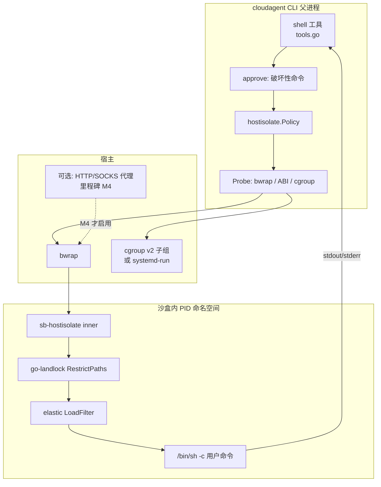

# SimpleBase 沙盒调研报告（2026-10-16）

## 1. 现状

**结论：SimpleBase 目前只有一种真实沙盒后端——microsandbox Cloud（托管 microVM）。另有一个仅供测试的 fake 驱动。仓库中没有云函数运行时，也没有本地 shell 隔离、goja 或 wasm。**

| 文件 | 内容 |
|---|---|
| `internal/sandbox/driver.go` | `Driver` 接口（Ensure/Exec/ReadFile/WriteFile/RemoveFile/ListDir/Status/Stop/Remove），`Spec{Image,CPUs,MemoryMiB,Network none/public,IdleTimeout,MaxDuration}` |
| `internal/sandbox/driver_cloud.go` | 用 `github.com/superradcompany/microsandbox/sdk/go` v0.7.4 实现。通过设置环境变量 `MSB_BACKEND=cloud`、`MSB_API_KEY` 启动；每次操作都调用 `ConnectOrCreateSandbox`，执行完就 Close，不保持长连接 |
| `internal/sandbox/driver_fake.go` | 测试用的假驱动，只支持 echo/cat/ls 等几个命令 |
| `internal/sandbox/manager.go` | 管理资源、配额、路径和 reaper。每个项目默认最多 5 个沙盒；CPU 最多 4 核，内存最多 4096 MiB；有执行超时上限，还限制文件和输出大小 |
| `docs/automation/sandbox.md` | 默认镜像 `python:3.12-slim`，1 核 / 256 MiB，空闲 5 分钟回收，单次 VM 最长 30 分钟，默认不允许出网。Cloud 不可用时整个功能关闭，**不会回退到本地虚拟化** |
| `internal/AGENTS.md` | `cloudagent` 只能通过 `Sandbox` 接口访问沙盒，禁止向沙盒注入 SimpleBase 凭据 |
| `internal/api/sandbox_handler.go`、`internal/systemdb/sandboxes.go` | HTTP API 与元数据存储 |

- **隔离边界**：Cloud microVM，由硬件虚拟化隔离（microsandbox 基于 libkrun），比 chroot 或容器更强。
- **启动成本**：VM 懒创建，首次执行命令时才拉起。microsandbox README 写的是 “Average boot times under 100 milliseconds”，这是厂商自报的本地启动数字，不包括 Cloud 的网络往返。每次操作都要 Connect 一次，会额外增加一次 RTT（这一点是我根据代码推断的，没有实测）。
- **依赖**：microsandbox Cloud 账号和 API Key（只能通过环境变量 `SIMPLEBASE_SANDBOX_API_KEY` 提供），还依赖外网。
- **短板**：完全依赖外部 SaaS；离线或私有化部署时没有可用的沙盒；没有轻量级的执行层（比如单纯算一段 JS 或表达式也要拉起整台 VM）；执行接口只返回同步结果，不支持流式输出。

## 2. 备选方案

| 方案 | 隔离强度 | 启动延迟 | 内存开销 | 语言 | Go 集成 | OS | 许可 | 成熟度 |
|---|---|---|---|---|---|---|---|---|
| Docker/containerd | 中（共享内核，namespaces+cgroups+seccomp） | 估计约百毫秒到秒级（经验值，未实测） | 低到中 | 任意 | 官方 Go client，难度低 | Linux（macOS 需借助 VM） | Apache-2.0 | 非常成熟 |
| gVisor (runsc) | 中高（用户态内核拦截 syscall） | 略高于 runc（估计） | 中 | 任意 | 作为 OCI runtime 接入 | 仅 Linux | Apache-2.0 | 成熟（GKE Sandbox 在用） |
| Firecracker / firecracker-containerd | 高（KVM microVM） | SPECIFICATION 写明 microVM 启动通常约 12 ms（区间 6–60 ms，仅指 VMM 本身，不含 guest 用户态） | 低 | 任意 | 有 firecracker-go-sdk，需要 KVM | 仅 Linux | Apache-2.0 | 成熟（AWS Lambda 在用） |
| Kata Containers | 高（VM） | 估计秒级以内 | 中 | 任意 | 作为 OCI runtime 接入 | Linux | Apache-2.0 | 成熟 |
| microsandbox 本地模式 (libkrun) | 高 | 自报平均 <100 ms | 低 | 任意（OCI 镜像） | **已有 Go SDK，现有代码只需换 backend** | Linux（KVM）/ macOS（HVF） | Apache-2.0 | 较新 |
| nsjail / bubblewrap / minijail | 中（namespaces+seccomp） | 估计毫秒级（只是 fork+exec） | 极低 | 任意 | 用 os/exec 包装，难度低 | 仅 Linux | Apache-2.0 / LGPL-2.0+ / BSD | 成熟（Codex CLI、Claude Code 在用） |
| Landlock（单独使用） | 低到中（只限制文件系统；新 ABI 也能限制 TCP 端口） | ≈0 | 0 | 任意 | `go-landlock` 纯 Go 库 | Linux ≥5.13 | BSD-3 / MIT | 中等 |
| Apple Seatbelt (sandbox-exec) | 中 | ≈0 | 0 | 任意 | os/exec 加动态生成的 profile | 仅 macOS（`sandbox-exec` 的 man page 标注为 deprecated，但 Codex 和 srt 仍在使用） | 系统自带 | Codex、Claude Code 在用 |
| wazero（WASI） | 高（内存安全，按 capability 授权） | 启动快；编译后的模块可以缓存（未实测） | 低 | 能编译成 wasm 的语言；可运行 Python（如 VMware wlr 发布的 python.wasm）或 QuickJS | **纯 Go，不需要 cgo，难度最低** | 全平台 | Apache-2.0 | 成熟 |
| wasmtime-go / WasmEdge | 高 | 快 | 低 | 同上 | 需要 cgo | 全平台 | Apache-2.0 | 成熟 |
| goja / QuickJS (fastschema/qjs) / Starlark / yaegi | 依赖解释器本身（同一进程内，只能靠超时和中断来限制） | 微秒到毫秒级 | 极低 | JS / Starlark / Go | 纯 Go，难度极低 | 全平台 | MIT / BSD / Apache | goja 和 starlark 成熟；yaegi **不适合运行不可信代码** |
| workerd (V8 isolates) | 中高 | 毫秒级（isolate 级别） | 低 | JS/TS/wasm | 作为独立进程，通过 HTTP 调用 | Linux / macOS | Apache-2.0 | 成熟（Cloudflare Workers 在用） |
| 托管：E2B / Daytona / Modal / Cloudflare Sandbox / Vercel Sandbox | 高（E2B 和 Vercel 基于 Firecracker） | 依厂商而定，各家数字未独立核实 | — | 任意 | REST/SDK | — | E2B、Daytona 开源（Apache / AGPL），其余为商业服务 | 成熟 |

**开源 agent 项目的做法**：
- OpenAI Codex CLI：Linux 上用 bubblewrap + seccomp（保留了旧的 Landlock 实现），macOS 上用 Seatbelt。依据：`codex-rs/linux-sandbox/README.md`。
- anthropic-experimental/sandbox-runtime（Claude Code 使用）：Linux 上用 bubblewrap，macOS 上用 sandbox-exec，网络通过代理过滤。
- OpenHands：README 写明默认在本机运行（“Option 1: Without a Sandbox”），可选使用 Docker 沙盒（“Option 2: With a Docker Sandbox”）、VM 或 OpenHands Cloud 作为 agent 后端。
- pi agent（https://github.com/earendil-works/pi，已读源码核实）：内置的 bash 工具（`packages/coding-agent/src/core/tools/bash.ts`）直接用 `child_process.spawn` 在本机执行命令，**默认没有沙盒**；它提供 `BashSpawnHook` 扩展点。官方示例扩展 `packages/coding-agent/examples/extensions/sandbox/index.ts` 用 `@anthropic-ai/sandbox-runtime@0.0.26` 替换 bash 工具：macOS 上走 sandbox-exec，Linux 上走 bubblewrap（另需安装 socat 和 ripgrep）。配置文件为 `.pi/sandbox.json`，可设置 allowedDomains、denyRead、allowWrite 等；启动时用 `pi -e ./sandbox` 开启。

## 3. 对 SimpleBase 的建议：分层设计

在现有 `sandbox.Driver` 接口上增加实现，保持 `Manager` 不变：

1. **L0 嵌入式解释器（新增 `internal/sandbox/script`）**
   - 适用场景：云函数里的表达式、转换、小脚本。
   - 实现：用 goja 或 fastschema/qjs（QuickJS 跑在 wazero 上）。
   - 防护：通过 `context` 超时加 `vm.Interrupt` 中断执行；用 `runtime/debug` 或 qjs 的内存上限限制内存；不暴露 fs 和 net。
   - 效果：零外部依赖，启动在微秒级。

2. **L1 wazero 驱动（`driver_wasm.go`）**
   - 用法：运行 python.wasm 或 qjs.wasm。只把 `/workspace` 通过 `wazero.NewFSConfig().WithDirMount` 挂进去；用 `WithCloseOnContextDone(true)` 实现超时；用 `RuntimeConfig.WithMemoryLimitPages` 限制内存。
   - 默认不给网络。纯 Go，Linux 和 macOS 都能用，适合离线或私有化部署作为默认后端。
   - 限制：不支持任意 shell 和 apt。

3. **L2 本地进程沙盒（`driver_bwrap.go`）**
   - 适用场景：cloudagent shell 在 Linux 自托管时使用。
   - 实现：用 os/exec 调 `bwrap --unshare-all --die-with-parent --ro-bind / / --bind <ws> /workspace`；再叠加 seccomp（可以借鉴 nsjail 的配置），并用 `go-landlock` 做纵深防御；资源用 cgroup v2 限制（`memory.max`、`cpu.max`、`pids.max`）。
   - macOS 开发环境可以选择用 sandbox-exec。
   - 不足：隔离强度弱于 VM，只适合可信或半可信的租户。

4. **L3 VM 隔离（保留现有方案并扩展）**
   - 保留现有的 microsandbox Cloud。同时新增 microsandbox **本地 libkrun** 后端：同一套 SDK，只需切换 `MSB_BACKEND`。注意这和当前 "不回退到本地虚拟化" 的规定相反，需要做成显式配置项。
   - 另一个选择是 Firecracker（通过 firecracker-go-sdk），或者以 gVisor 作为 Docker runtime。
   - 多租户、不可信代码默认走 L3。

**配置建议**：
- `sandbox.backend: cloud|microvm-local|bwrap|wasm|fake`，并按项目设置 `isolation_level`。
- cloudagent shell 默认用 L3（多租户）或 L2（单租户自托管）；云函数默认用 L0/L1。

**集成注意事项**：
- 现在 `driver_cloud.go` 通过 `os.Setenv` 传配置，这是进程全局的，多个后端无法共存，应改为通过 SDK option 传入。
- 每次操作都 Connect，可以加一个短 TTL 的句柄缓存来减少 RTT。
- 可以给 Exec 加流式输出。

## 4. X 上的近期讨论（2026 年 4–10 月，通过 x MCP `search_posts_all` 检索到的真实结果）
- **赛道越来越挤**：@csanchez 列出了 Gemini Enterprise Agent Sandbox、AWS Lambda Sandboxes、k8s agent-sandbox、Nvidia OpenShell、Modal、E2B 等，称 “Agent sandboxing is the new infra fight”。https://x.com/csanchez/status/2075282838371381599
- **沙盒逃逸风险**：@nebusecurity 对 8 个开源 agent 沙盒做了逃逸基准测试（71 赞）。https://x.com/nebusecurity/status/2086939881335607608
- **共享内核的风险**：@e2b 以 CVE-2026-31431 为例（帖子称其可在 2017 年以来的所有 Linux 上提权到 root，且能在共享内核环境中跨租户），强调隔离边界的重要性。这一点支持在多租户场景用 microVM 作为 L3。https://x.com/e2b/status/2049992833256374640
- **AWS 发布开源 agent 沙盒**（转引 The Register）。https://x.com/TheCyberSecHub/status/2107890457179279853
- **可自托管、兼容 E2B 协议的方案**：@treyvijay 推荐 agent-sandbox/agent-sandbox，它是 Kubernetes 原生、兼容 E2B 协议的自托管方案。https://x.com/treyvijay/status/2100557251987796031
- **OpenSandbox**：被介绍为开源的 agent 沙盒运行时。https://x.com/4save_info/status/2062117465803640988
- **Anthropic sandbox-runtime 发布**：被列为业界动态。https://x.com/commitvc/status/2054532846920819132 、https://x.com/AINativeF/status/2059987168454709660
- **托管沙盒厂商清单**：@mizugeek 列出了 Cloudflare Workers Sandbox、AWS Lambda MicroVMs、E2B、Blaxel、Daytona。https://x.com/mizugeek/status/2069280124290421226
- **检索结果中没有的内容**：关于 microsandbox、landlock、wasm agent sandbox 的检索没有返回有价值的专门讨论；其余结果多为营销内容（如 Novita 赠送额度），已略去。

**对本建议的启示**：以上讨论都强调多租户场景需要 VM 级隔离，而单机 agent 采用 bubblewrap/Seatbelt 是主流做法。这与第 3 节的 L2/L3 分层一致。可以把 E2B 协议兼容的自托管方案（agent-sandbox）列为 L3 的又一个可选后端。

## 链接（均已于 2026-10-16 用 HTTP 请求确认返回 200）
- https://github.com/superradcompany/microsandbox
- https://github.com/containers/libkrun
- https://github.com/firecracker-microvm/firecracker
- https://github.com/firecracker-microvm/firecracker-containerd
- https://github.com/google/gvisor
- https://github.com/kata-containers/kata-containers
- https://github.com/google/nsjail
- https://github.com/containers/bubblewrap
- https://github.com/google/minijail
- https://docs.kernel.org/userspace-api/landlock.html
- https://github.com/landlock-lsm/go-landlock
- https://github.com/anthropic-experimental/sandbox-runtime
- https://docs.anthropic.com/en/docs/claude-code/sandboxing
- https://github.com/openai/codex
- https://github.com/All-Hands-AI/OpenHands
- https://github.com/earendil-works/pi
- https://github.com/tetratelabs/wazero
- https://github.com/bytecodealliance/wasmtime-go
- https://github.com/WasmEdge/WasmEdge
- https://github.com/vmware-labs/webassembly-language-runtimes
- https://github.com/pyodide/pyodide
- https://github.com/dop251/goja
- https://github.com/fastschema/qjs
- https://github.com/google/starlark-go
- https://github.com/traefik/yaegi
- https://github.com/cloudflare/workerd
- https://github.com/e2b-dev/E2B
- https://github.com/daytonaio/daytona
- https://modal.com/docs/guide/sandbox
- https://developers.cloudflare.com/sandbox/
- https://vercel.com/docs/vercel-sandbox
- https://github.com/moby/moby
- https://github.com/containerd/containerd

## 局限
- 标为“估计”的延迟和内存数字均未实测。
- 托管厂商的性能数字未核实。

---

# 5. 本机命令隔离层实施方案

> 这一章是第 3 节 L2 的实施计划，不是已落地的代码。范围只覆盖 **Linux 自托管时 cloudagent 的本机 `shell` 工具**，以及 macOS 开发机上的 Seatbelt 对应物。不实现 L0 / L1 / L3，也不把 Cloud 沙盒失败自动换成这层。

# 本机命令隔离层 Implementation Plan

> **For agentic workers:** REQUIRED SUB-SKILL: Use superpowers:subagent-driven-development (recommended) or superpowers:executing-plans to implement this plan task-by-task. Steps use checkbox (`- [ ]`) syntax for tracking.

**Goal:** 让 Linux 自托管上的 cloudagent `shell` 在 bubblewrap 命名空间里执行，并用 seccomp、Landlock、可选的 cgroup v2 限制文件系统、网络和资源；macOS 用 `/usr/bin/sandbox-exec` 表达同一套策略。

**Architecture:** 隔离逻辑放在新包 `internal/hostisolate`，由 `cmd/sb-hostisolate` 在 bwrap 里面加载 Landlock 和 seccomp，再 exec 用户命令。`internal/cloudagent/tools` 的 `shell` 工具调用它。它不实现 `sandbox.Driver`。HTTP 云沙盒仍只走 `cloud` / `fake`。以后若要让 API 的一次性 exec 复用同一套启动器，再单独加 `driver_host.go`，并且只能由显式 `sandbox.backend: host` 选中。

**Tech Stack:** 外部二进制 `bwrap`（本计划在 Ubuntu 包 `bubblewrap 0.9.0-1ubuntu0.3` 上核对过 `--help`）；`github.com/landlock-lsm/go-landlock` v0.10.1；`github.com/elastic/go-seccomp-bpf` v1.6.0（纯 Go）。不引入 `github.com/seccomp/libseccomp-golang`（要链接 libseccomp）和 `github.com/containerd/cgroups/v3`（v3.1.3，会带上 systemd D-Bus）。cgroup 直接写 cgroup v2 文件；没有委派子树时再尝试 `systemd-run --scope`。

## Global Constraints

- 配置只来自 `config.yaml` 与 `SIMPLEBASE_*` 环境变量；CLI 另有已经存在的 `~/.cloudagent/config.json`（`internal/cloudagent/cli/config.go`）。密钥不进 YAML。
- `internal/cloudagent` 不得 import `internal/sandbox` 或 microsandbox。`internal/sandbox` 不得 import `internal/cloudagent`。共享代码放在 `internal/hostisolate`，两边都可以 import 它，它不 import 这两边。
- `internal/AGENTS.md` 写明云沙盒禁止本地 microVM 回退。`internal/app/app.go` 在 Cloud 驱动创建失败时打日志 `sandbox disabled: cloud backend unavailable (no local fallback)` 然后不挂 Manager。本计划保持这条：host 隔离不是 Cloud 失败后的替身。
- 不向 shell 子进程注入 `SIMPLEBASE_*`、`CLOUDAGENT_*` 或凭据类环境变量。现有 `sanitizedEnv`（`internal/cloudagent/tools/tools.go`）保持。
- 仓库规则是不新增第三方依赖、不改 `go.mod`，除非用户明确要求。实施本计划时，只允许加入上面点名的两个模块及其既有传递依赖，版本钉死为 v0.10.1 与 v1.6.0。不升级 `golang.org/x/sys`（当前 `go.mod` 是 v0.40.0，indirect）。
- 对象键、系统库、SQL 边界、审计脱敏都不在本计划里改。shell 命令原文仍然不进系统库 logs；隔离失败只记模式、退出码、超时，不记命令正文，除非已经打开的 `agent.trace_log` 按现有脱敏规则记。
- 默认 fail-closed：隔离开着但 bwrap 或用户命名空间不可用时，命令返回 `isolation_unavailable`，不退回今天的裸 `exec.Command`。
- 多租户、不可信代码仍然走现有 Cloud microVM（第 3 节 L3）。这一层是共享内核的进程沙盒。

## 5.1 威胁模型

保护对象是**跑着 SimpleBase 和 cloudagent CLI 的那台 Linux 机器**，不是 Cloud VM 里的租户。今天的 `shell` 就是这台机器上的 `/bin/sh -c`。

| 编号 | 威胁 | 今天的行为 | 本层要挡住的 |
|---|---|---|---|
| T1 | 模型执行 `rm -rf /`、写 `/etc`、写 workspace 外的哨兵 | `resolvePath` 只约束 `cwd` 参数。命令字符串里的绝对路径不受约束。`plan/planv6.1/cloudagent-agent-benchmark-plan.md` §4.1 L3 已写明这一点 | 根只读，只把 workspace 重新绑成可写 |
| T2 | 读 `~/.cloudagent/config.json`（API token）、`config.yaml`、数据目录、`~/.ssh`、云厂商凭据 | `sanitizedEnv` 去掉环境变量，不去掉文件 | 这些路径用只读空文件或 tmpfs 盖住 |
| T3 | 连 `docker.sock`、systemd、SSH agent 等宿主 Unix socket | 无 | 默认 seccomp 拒绝新建 `AF_UNIX` / `AF_VSOCK`；不把这些 socket 绑进沙盒 |
| T4 | 出网拉代码或外传数据 | 无 | 默认 `--unshare-net`，再加 seccomp 拒绝 `connect` 等 |
| T5 | 超时后孙子进程残留，占 CPU / 磁盘 | `exec.CommandContext` 只向直接子进程发信号 | `--die-with-parent` + 新 PID 命名空间；超时杀整个 bwrap |
| T6 | 打满内存、进程数、CPU | 无 | 有委派 cgroup 时写 `memory.max` / `cpu.max` / `pids.max`；没有就降级并标明「未限制」 |
| T7 | 共享内核提权（Dirty Pipe、用户命名空间里的 netfilter 等） | 不在范围内 | **本层不承诺挡住。** 多租户不可信代码继续用 microVM |
| T8 | `--yolo` 被理解成「无沙盒」 | `Yolo` 只跳过 `approve` | `Yolo` 仍然在沙盒里跑。关掉沙盒必须另设 `danger-full-access` |

不在威胁模型里的事：交互式 TTY、向沙盒暴露 SimpleBase 端口、用这一层跑第二个租户的不可信代码、替代 `sandbox_shell` 的 Cloud VM。

攻击者能力按「模型会调用 `shell`，命令和子进程都不可信，但操作者已经把仓库目录交给了这个 agent」来定。workspace 里面的文件，模型本来就可以改（破坏性命令仍要确认，见 §5.8）。workspace 外面的文件、宿主凭据、宿主网络，才是边界。

## 5.2 上游实现（2026-10-16 读到的版本）

下面的路径和符号都来自当时克隆的树，不是转述博客。

### 5.2.1 OpenAI Codex

树：`github.com/openai/codex`，提交 `6b99197`（2026-10-15，`Remove obsolete protected-path monitoring from the Linux sandbox`）。文档入口 `codex-rs/linux-sandbox/README.md`。依赖钉在 `codex-rs/Cargo.toml`：`landlock = "0.4.4"`，`seccompiler = "0.5.0"`。

文件系统默认走 bubblewrap，不再走 Landlock。`src/seccomp.rs` 文件头写明：文件系统由 `linux_run_main` 里的 bubblewrap 执行，Landlock 只留在 legacy 路径。`apply_permission_profile_to_current_thread` 只有 `apply_landlock_fs == true` 时才调用 `install_filesystem_landlock_rules_on_current_thread`。那条 legacy 函数使用 `landlock::ABI::V5` 和 `CompatLevel::BestEffort`，对 `/` 给读、对 `writable_roots` 和 `/dev/null` 给写；若 `restrict_self` 的状态是 `RulesetStatus::NotEnforced` 就返回 `SandboxErr::LandlockRestrict`。README 同时写：文件系统受限策略拒绝 legacy Landlock，因为它隔离不了 app-server 的 Unix socket，升级时要关掉 `features.use_legacy_landlock`。

`src/bwrap.rs` 的 `create_bwrap_command_args`：完全可写且没有不可读 glob 时，若网络也是全开，就**不包 bwrap**，原样返回命令。否则：

- 受限文件系统：`--new-session`、`--die-with-parent`，然后按注释里的顺序挂载。全读策略用 `--ro-bind / /`；更窄的读从 `--tmpfs /` 开始，再叠 `--ro-bind`。接着 `--dev /dev`，用 `--bind` 打开可写根，再用 `--ro-bind` 把可写根下面的保护子路径（`.git`、解析后的 `gitdir:`、`.codex`）盖回只读。更具体的路径后挂，所以 `/repo` 可写、`/repo/a` 拒绝、`/repo/a/b` 再可写这种嵌套能保住。
- 始终 `--unshare-user`（注释写：bwrap 在 uid 0 时不会自动建用户命名空间）。默认 `--unshare-pid` 和 `--unshare-ipc`。网络受限且没有代理路由时再 `--unshare-net`。默认 `--proc /proc`，失败则保留继承的 `/proc`。最后 `--cap-drop ALL`。
- 完全可写但要断网时，走 `create_bwrap_flags_full_filesystem`：`--bind / /` 加上同样的命名空间和 `--cap-drop ALL`。

`src/seccomp.rs` 的网络过滤是默认允许、按规则拒绝（`SeccompAction::Allow`，命中规则则 `EPERM`）：

- 每种模式都拒绝 `io_uring_setup` / `io_uring_enter` / `io_uring_register`。注释：io_uring 可以不经过 `socket()` 创建 `AF_VSOCK`。
- `NetworkSeccompMode::Restricted`：拒绝 `connect`、`accept`、`accept4`、`bind`、`listen`、`sendto`、`sendmmsg` 等；`socket` / `socketpair` 只允许 `AF_UNIX`。故意不拒绝 `recvfrom`，注释写 cargo clippy 的 socketpair 子进程需要它。
- `ProxyRouted`：在隔离的网络命名空间里允许 `AF_INET` / `AF_INET6`；除非 `dangerously_allow_all_unix_sockets`，否则拒绝新建独立 `AF_UNIX`。`socketpair` 仍允许 `AF_UNIX`。
- `VmSocketRestricted`：只拒绝 `socket` / `socketpair` 的 `AF_VSOCK`。文件系统受限但网络开放时也会上这个模式，避免 WSL2 经 VM socket 启动 Windows 进程。

策略模型在 `codex-rs/protocol/src/protocol.rs` 的 `SandboxPolicy`（serde tag `type`，kebab-case）：

- `danger-full-access`：无限制。
- `read-only`：字段 `network_access`，默认 false。
- `external-sandbox`：磁盘全开，只尊重外部沙盒的网络设置。
- `workspace-write`：在 cwd 上可写，另有 `writable_roots`、`network_access`（默认 false）、`exclude_tmpdir_env_var`、`exclude_slash_tmp`。

同文件 `AskForApproval`：`untrusted`（源码枚举名 `UnlessTrusted`）、`on-request`（默认；`on-failure` 是 serde alias）、`granular`、`never`。`config_types.rs` 的 `SandboxMode` 只有 `read-only` / `workspace-write` / `danger-full-access` 三个配置值，默认 `read-only`。

`WritableRoot` 带 `read_only_subpaths` 和 `protected_metadata_names`，注释写明是为了挡住改 `.git/hooks`、`.codex` 这类提权路径。

macOS 在 `codex-rs/sandboxing/src/seatbelt.rs`。可执行文件常量是 `/usr/bin/sandbox-exec`，注释写只认这个路径，防止 PATH 上的假二进制。`create_seatbelt_command_args_with_profile` 拼 SBPL，参数是 `-p <policy>` 加若干 `-Dkey=path`，然后 `--` 和命令。基础策略 `seatbelt_base_policy.sbpl` 以 `(deny default)` 开头，允许 `process-exec`、`process-fork`、同沙盒 `signal`，并白名单一批 `sysctl-read`。文件头写策略受 Chrome Seatbelt 启发。

官方行为说明（2026-10-16 打开返回 200）：

- https://developers.openai.com/codex/agent-approvals-security ：`workspace-write` 下默认可读、可改 workspace、可跑命令；改 workspace 外或访问网络要审批。网络默认关，除非配置打开。
- https://developers.openai.com/codex/config-reference ：`sandbox_mode` 取值就是上面三个；`sandbox_workspace_write.network_access` 是布尔；`writable_roots` 是额外可写根。`approval_policy` 的 `on-failure` 已标为废弃。
- 仓库 `docs/sandbox.md` 在 `6b99197` 只剩三行，指向 Codex Security 产品页。沙盒语义以上面两篇为准，不要再引用旧的 `docs/sandbox.md` 长文。

### 5.2.2 anthropic-experimental/sandbox-runtime

树：提交 `0ded0c8`（2026-10-16），`package.json` 版本 `@anthropic-ai/sandbox-runtime` **0.0.79**。Linux 组装在 `src/sandbox/linux-sandbox-utils.ts`。

文件系统语义在 `src/sandbox/sandbox-schemas.ts`：

- 读是 deny-only：`FsReadRestrictionConfig.denyOnly` 空表示不限制读；`allowWithinDeny` 把拒绝区里面的子路径重新放开，更具体的条目赢。
- 写是 allow-only：`FsWriteRestrictionConfig` 只要存在就限制写；`allowOnly` 空表示一处都不能写；`denyWithinAllow` 是可写根里的例外。

`generateFilesystemArgs` 在有写限制时先 `--ro-bind / /`，再对存在的 `allowOnly` 路径 `--bind`。它跳过不存在的路径，也跳过解析到边界外的符号链接（注释：bwrap 会跟随符号链接，`--bind` 一个链出去的链接会把目标变成可写）。读拒绝的目录用 `--tmpfs` 盖住再把允许的子路径绑回来（`pushReadDenyDirMounts`）；读拒绝的文件用 `--ro-bind /dev/null <landing>`。可写根里的祖先目录会再 `--ro-bind` 一次，让它们成为挂载点，内核因此拒绝 rename/rmdir 把目录挪出策略（`ancestorPinArgs`）。

命令包装从约 3604 行的 `bwrapArgs` 开始，固定有 `--new-session`、`--die-with-parent`。网络需要限制时 `--unshare-net`。若提供了 HTTP 和 SOCKS 的桥接 socket，就把它们 `--bind` 进沙盒，并用 `--setenv` 把代理变量指到沙盒内的 socat 监听端口（源码里写死 HTTP 3128、SOCKS 1080）。没有 socket 时，`--unshare-net` 就是断网。然后 `--dev /dev`、`--unshare-pid`、`--unshare-user`、`--cap-drop ALL`（`capabilityArgs`）。注释写：不建用户命名空间的话，root（无 `CAP_SYS_ADMIN` 的容器里常见）会直接 clone 然后 EPERM。没有 seccomp helper 时，若 `bwrapCanDisableUserns` 为真就加 `--disable-userns`；注释写这需要 bwrap 0.8.0 或更新、非 setuid，否则沙盒里再套用户命名空间可以撤掉写拒绝。弱嵌套模式（`enableWeakerNestedSandbox`）改用 `--bind /proc /proc`，因为非特权容器里 `--proc` 会失败。

seccomp 不在 TypeScript 里生成 BPF。`vendor/seccomp-src/seccomp-unix-block.c` 用 libseccomp，默认动作 `SCMP_ACT_ALLOW`，拒绝 `socket` 的 `AF_UNIX` 和 `AF_VSOCK`（`SCMP_ACT_ERRNO(EPERM)`），并整组拒绝 `io_uring_*`。文件头写明 32 位 x86 的 `socketcall` 没有拦，所以 ia32 不支持。第二个规则集 `namespaces` 拒绝带着新用户/挂载命名空间标志的 `clone` / `unshare`。`src/sandbox/generate-seccomp-filter.ts` 只负责找到预编译的 `apply-seccomp`（`vendor/seccomp/{x64,arm64}/`），找不到就打日志并**继续**，Unix socket 阻断失效。

违规监控在 `src/sandbox/linux-violation-monitor.ts` 的 `startLinuxSandboxViolationMonitor`。它在宿主听一个文件系统 Unix socket（注释：抽象 socket 属于网络命名空间，而 bwrap 会关掉继承的 fd）。`apply-seccomp` 把写意图 syscall 打成一行 JSON。文件头写明：路径来自不可信进程的内存，用 `process_vm_readv` 读出，有竞态，**只是诊断，绝不能当作策略判定**。真正的边界是 bwrap 的挂载表。

网络配置在 `NetworkConfigSchema`（`sandbox-config.ts`）：`allowedDomains`、`deniedDomains`（允许单独的 `*`）、可选 `:port`、`strictAllowlist`、`allowAllUnixSockets`、`httpProxyPort` / `socksProxyPort`（外部代理，库自己就不启本地代理）。域名判定在宿主代理里做，不在 bwrap 参数里做。

Anthropic 工程博客（2026-10-16 返回 200）：https://www.anthropic.com/engineering/claude-code-sandboxing 。文中把 bash 工具放进 bubblewrap / Seatbelt，文件系统限制在工作目录，网络只经过沙盒外的代理，代理按域名放行并可以对新域名要求确认。Claude Code 文档 https://code.claude.com/docs/en/sandboxing 写 Linux/WSL2 依赖 `bubblewrap` 和 `socat`，seccomp 过滤器是可选的，用来挡 Unix domain socket。

### 5.2.3 bubblewrap、Landlock、seccomp、cgroup

**bubblewrap。** 上游最新 release 是 v0.13.1（2026-10-14，https://github.com/containers/bubblewrap/releases/tag/v0.13.1 ）。本计划的探针用的是 Ubuntu 包 `bubblewrap 0.9.0-1ubuntu0.3`，`bwrap --version` 输出 `bubblewrap 0.9.0`。该二进制的 `--help` 含有 `--disable-userns`、`--die-with-parent`、`--seccomp FD`、`--argv0`、`--cap-drop`。`--die-with-parent` 的帮助文本是：`Kills with SIGKILL child process (COMMAND) when bwrap or bwrap's parent dies.` sandbox-runtime 注释要求 `--disable-userns` 至少 0.8.0。实施时探测 `bwrap --help` 里有没有该标志，没有就拒绝启动受限模式，而不是假装加上了。

**Landlock。** 内核文档 https://docs.kernel.org/userspace-api/landlock.html （文档日期 August 2026）写：5.13 引入，需要 `CONFIG_SECURITY_LANDLOCK=y` 且在 `CONFIG_LSM` 里启用。ABI 与内核版本的对应，5.13–6.15 以 https://landlock.io/news/ 为准，6.7/6.10 的细节以 https://landlock.io/news/4/ 为准，V8–V10 的内核版本以 https://wiki.gnoack.org/LandlockAbiVersioning 的表为准（该页把 V8–V10 的 newsletter 标成 tbd，实施时仍以运行时 ABI 探测为准，不把表里的版本号当成探测的替代）：

| ABI | 内核 | 新增能力 |
|---|---|---|
| 1 | 5.13 | 基本文件系统 |
| 2 | 5.19 | `LANDLOCK_ACCESS_FS_REFER` |
| 3 | 6.2 | `LANDLOCK_ACCESS_FS_TRUNCATE` |
| 4 | 6.7 | TCP bind/connect |
| 5 | 6.10 | 设备 ioctl |
| 6 | 6.12 | abstract Unix socket 与 signal 的 scope |
| 7 | 6.15 | audit |
| 8 | 7.0（wiki） | `LANDLOCK_RESTRICT_SELF_TSYNC` |
| 9 | 7.1（wiki） | pathname Unix socket 的 connect |
| 10 | 7.2（wiki） | UDP bind/connect/send，以及 quiet |
| 11 | 当前内核文档有，go-landlock v0.10.1 没有对应预设 | `LANDLOCK_RESTRICT_SELF_NO_NEW_PRIVS` |

`go-landlock` v0.10.1（2026-09-13，https://github.com/landlock-lsm/go-landlock ）导出 `V1`…`V10`，没有 `V11`。`Config.BestEffort()` 的文档写明：内核不支持时 `RestrictPaths` **成功且不做任何限制**。`RestrictPaths` 的文档写明它限制**该进程里 Go 运行时的全部 OS 线程**，并给它们设 no_new_privs。因此不能在 cloudagent 父进程里调用。路径构造函数是 `RODirs`、`RWDirs`、`ROFiles`、`RWFiles`、`PathAccess`；网络是 `ConnectTCP`、`BindTCP`、`BindUDP`、`ConnectSendUDP`。ABI 探测没有导出函数（`getSupportedABIVersion` 在库内部）。父进程用内核文档里的 `landlock_create_ruleset(..., LANDLOCK_CREATE_RULESET_VERSION)` 探测。x86_64 上这个 syscall 号是 444；其他架构用该架构的 unistd 号，不要把 444 写死进 arm64。

Günther Noack（go-landlock 作者）说明 BestEffort 与 truncate 的关系：https://blog.gnoack.org/post/landlock-best-effort/ 。ABI 1–2 没有 truncate 权利，只靠 BestEffort 会留下截断文件的洞。本计划把 ABI 低于 3 视为不够，受限模式直接失败。

**seccomp。** 选用 `github.com/elastic/go-seccomp-bpf` v1.6.0。`LoadFilter` 在 Linux 上安装过滤器；`Supported()` 用一次会返回 `EINVAL` 的 seccomp 调用来判断 syscall 是否存在。`Filter` 含 `NoNewPrivs`、`Flag`、`Policy`。`Policy.DefaultAction` 加 `SyscallGroup`。参数条件的字段名是库里的拼写 `NamesWithCondtions`（少一个 i），不要改成正确拼写。同一 syscall 的多组条件是 OR，一组内部是 AND（`Assemble` 的注释写了 “multiple condition sets are OR'd together”）。示例 `example_linux_test.go` 的构建标签是 `linux && (386 || arm || amd64)`，但 `arch/defs_arches_linux.go` 的表包含 `aarch64`。实施时在目标架构上实际 `LoadFilter`，不要用示例的构建标签推断支持矩阵。

不选用 `github.com/seccomp/libseccomp-golang` v0.12.0。它是 libseccomp 的 cgo 绑定，`NewFilter(defaultAction)` 可用，但会让隔离层依赖系统 libseccomp。sandbox-runtime 的 C helper 用的是 libseccomp；我们用弹性库在 helper 进程里生成等价的拒绝规则，避免第二套 C 工具链。

**cgroup v2。** 内核文档 https://docs.kernel.org/admin-guide/cgroup-v2.html 。有进程的 domain cgroup 不能再在 `cgroup.subtree_control` 里打开控制器（no internal process constraint）。`systemd-run --scope` 的资源属性 `MemoryMax=`、`CPUQuota=`、`TasksMax=` 见 https://www.freedesktop.org/software/systemd/man/systemd.resource-control.html 。`github.com/containerd/cgroups/v3` v3.1.3 的 `cgroup2.NewManager` / `NewSystemd` 接受 `*Resources`（字段 `CPU`、`Memory`、`Pids` 等）。本计划第一版不引入这个模块：能写文件就写 `memory.max`、`cpu.max`、`pids.max`；需要 systemd D-Bus 时调用已经安装的 `systemd-run`。两条路都不可用就降级，见 §5.7。

### 5.2.4 大厂边界与已知逃逸

这些链接 2026-10-16 均返回 200。

- gVisor 安全模型 https://gvisor.dev/docs/architecture_guide/security/ 与仓库说明 https://github.com/google/gvisor ：gVisor 不是 seccomp 过滤器，也不是日常意义上的 VM。它用 Go 写的 Sentry 接 syscall，再把很小的宿主 syscall 面露给内核。README 写：容器共享内核，单个内核漏洞就可能逃逸；gVisor 用来缩小这个面，而不是消除它。
- nsjail https://github.com/google/nsjail ：命名空间 + seccomp-bpf + cgroup + chroot/pivot_root，仍然是共享内核。对「任意 shell」做 syscall 白名单不现实，本计划因此用默认允许加一小份拒绝清单，和 Codex / sandbox-runtime 一样，而不是仿 nsjail 的竞赛题白名单。
- Cloudflare Sandbox https://developers.cloudflare.com/sandbox/concepts/security/ ：沙盒是最小信任单元；同一沙盒里的进程共享文件系统和 localhost；容器默认 `enableInternet: false`。这支持「一个 agent 工作区一个边界」，也说明进程沙盒挡不住同边界内的互相读取。
- Vercel Sandbox https://vercel.com/docs/vercel-sandbox 、Fly.io 对 Firecracker 与 gVisor 的比较 https://fly.io/learn/firecracker-vs-gvisor/ ：两边都把不可信代码放在有独立客户内核的 microVM 里。Fly 的文章写 Vercel Sandbox 每个沙盒一个 Firecracker microVM，Fly 自己的负载也是 Firecracker。这是 L3 的参照，不是本层要做的事。
- 共享内核逃逸，本层挡不住，只作部署说明：
  - CVE-2022-0847 Dirty Pipe：https://nvd.nist.gov/vuln/detail/CVE-2022-0847 。能写只读文件映射的内核洞，挂载成只读并不够。
  - CVE-2019-5736 runc 覆盖宿主二进制：https://nvd.nist.gov/vuln/detail/CVE-2019-5736 。容器运行时自身的洞。我们不走 runc，但同类问题说明「命名空间里的 root」不是安全边界。
  - CVE-2024-1086：https://nvd.nist.gov/vuln/detail/CVE-2024-1086 。AppArmor wiki 写利用它需要在新的 user+net 命名空间里加 netfilter 规则（`CAP_NET_ADMIN`）：https://gitlab.com/apparmor/apparmor/-/wikis/unprivileged_userns_restriction 。所以 `--unshare-net` 与 `--disable-userns` 是减面，不是漏洞补丁。
  - bubblewrap 自己的 CVE-2020-5291：https://ubuntu.com/security/CVE-2020-5291 。只影响 0.4.1 之前、**setuid 安装**且内核又允许非特权用户命名空间的组合。Ubuntu 默认不把 bwrap 装成 setuid。实施时若发现 bwrap 是 setuid，拒绝使用并要求换成非 setuid 的发行版包。
- Ubuntu 23.10 起用 AppArmor 限制非特权用户命名空间：https://bugs.launchpad.net/bugs/2046477 。Launchpad 说明里写，Ubuntu 有意不给 bwrap 发默认 profile，因为它能在新用户命名空间里启动任意程序。结果是桌面和应用会在 `kernel.apparmor_restrict_unprivileged_userns=1` 时起不来。本层遇到 `bwrap --unshare-user` 失败就 fail-closed，并在错误里指向这篇，不建议操作者把该 sysctl 写成 0 来迁就。

## 5.3 技术架构



启动顺序固定：

1. 父进程解析 cwd（现有 `resolvePath`），跑破坏性确认（现有 `approve`），探测能力。
2. 父进程若有委派的 cgroup 子树，先建子组并写限额；否则尝试 `systemd-run`；再不行就记录 `cgroup_unavailable` 并继续（限额降级，文件系统和 seccomp 不降级）。
3. 父进程 exec `bwrap`，参数由 `BwrapArgs` 生成。bwrap 的子命令是 `sb-hostisolate inner`。
4. inner 在挂载已经完成之后调用 Landlock（它要 `open` 策略路径），然后 `LoadFilter`，然后 `syscall.Exec` 到 `/bin/sh`。seccomp 若先装上并拒绝 `open`，Landlock 会装失败。
5. 超时或父进程退出：杀 bwrap。`--die-with-parent` 的帮助文本写明 bwrap 或其父进程死亡时 SIGKILL 子进程；`--unshare-pid` 让沙盒有自己的 pid 1（不要加 `--as-pid-1`，保留 bwrap 的 reaper）。

`shell` 今天在 `internal/cloudagent/cli/repl.go` 的 `buildRunner` 里通过 `tools.Workspace.LocalTools()` 注册，headless 和 REPL 都走这里。服务端云助手的 `sandbox_shell` 走 `internal/cloudagent/access.go` 的 `Sandbox` 接口和 `sandbox.Manager`，**不经过本层**。

## 5.4 与现有代码的集成点

### 5.4.1 `shell` 工具（要改的调用点）

`internal/cloudagent/tools/tools.go`：

- `shellTimeout` 现为 120s。`shellTool` 在确认通过后执行 `exec.CommandContext(runCtx, "/bin/sh", "-c", in.Command)`，`cmd.Dir` 是解析后的 cwd，`cmd.Env` 是 `sanitizedEnv(os.Environ())`。
- `dangerousShellPatterns` / `IsDangerousShell` / `approve` 保持。确认失败返回 `confirmation_denied`。无 `Confirm` 且非 `Yolo` 时拒绝。
- 集成方式：确认通过之后，若策略 `enabled` 且模式不是 `danger-full-access`，用 `hostisolate.Launch` 替换这段 `exec.CommandContext`。`danger-full-access` 或 `enabled: false` 保持今天的裸执行，方便对照和回滚。
- `Workspace` 增加字段 `Isolation hostisolate.Policy`。`buildRunner` 从 CLI 配置填进去。不要在工具里读 `config.yaml`。

`read_file` / `write_file` / `edit_file` / `glob` / `grep` 仍是父进程里的 Go 代码，受 `resolvePath` 约束。本层不把它们改成沙盒内执行。否则模型可以用 `read_file` 读到 shell 已经盖住的 token 文件。因此策略里的 `deny_read` 路径，`resolvePath` 也要拒绝，两处共用 `hostisolate.Policy.DeniesRead`。这是 shell 隔离要同时改文件工具的唯一原因。

### 5.4.2 `sandbox.Driver`（这一版不实现）

`internal/sandbox/driver.go` 的 `Driver` 是**有名字的 VM**：`Ensure`、`Exec`、`ReadFile`、`WriteFile`、`RemoveFile`、`ListDir`、`Status`、`Stop`、`Remove`。`Manager` 把元数据写进系统库，有空闲回收和每项目个数上限。本机 shell 是一次性进程，没有镜像，没有 `sys_sandboxes` 行，对不上这个生命周期。

所以：

- 不新增 `DriverHost` 常量，不改 `SandboxConfig.EffectiveBackend` 的空值（空仍然是 `cloud`）。
- 不在 `app.go` 的 Cloud 失败分支里构造 host 驱动。
- 里程碑 M6 才允许 `sandbox.backend: host`，并且 `Exec` 只是调用同一个 `hostisolate.Launch`，文件操作落在该沙盒记录的工作目录上，用同一份路径策略。`Stop`/`Remove` 只删元数据。这不是 VM，文档和 `Capabilities.Backend` 必须写成 `host`，避免 UI 把它显示成 microVM。

`internal/cloudagent` 的 `Sandbox` 接口（`Available/Exec/Shell/ReadFile/WriteFile/ReleaseThread`）继续只服务 Cloud/fake。CLI 的本机 `shell` 不调用它。

## 5.5 策略与配置

三种模式与 Codex 的 `sandbox_mode` 对齐，名字用 kebab-case，方便对照文档：

| 模式 | 文件系统 | 网络 | 何时用 |
|---|---|---|---|
| `read-only` | 根只读，不把 workspace `--bind` 成可写。`/tmp` 用 tmpfs，否则编译器写不了临时文件 | `none` | 只巡检 |
| `workspace-write` | 根只读，workspace 和显式 `writable_roots` 可写；`.git`、`.cloudagent` 在 workspace 内再盖成只读 | 默认 `none` | Linux 自托管的推荐值 |
| `danger-full-access` | 不启动 bwrap | 不限制 | 操作者显式关闭隔离。`Yolo` 不会自动变成这个模式 |

`network: allowlist` 属于 M4，M1–M3 的配置解析遇到它要直接报配置错误，不要静默当成 `none` 或当成全开。

实例配置加在 `agent` 下，而不是 `sandbox` 下。`sandbox:` 是 Cloud VM（`config.example.yaml` 179–201 行，`SandboxConfig`）。混在一起会让 `backend: cloud` 的语义变脏。

```yaml
# config.example.yaml 增补。密钥仍然禁止出现在这个文件里。
agent:
  shell_isolation:
    enabled: false                 # 推荐的自托管值是 true。默认 false，避免改变现有 CLI 行为
    mode: workspace-write          # read-only | workspace-write | danger-full-access
    network: none                  # none。allowlist 在 M4 之前是配置错误
    writable_roots: []             # 额外可写绝对路径，必须已存在
    read_only_subpaths:            # 相对 workspace 或绝对路径，挂在可写根之内
      - .git
      - .cloudagent
    deny_read:                     # 盖成 /dev/null 或 tmpfs，并让 resolvePath 拒绝
      - ~/.ssh
      - ~/.aws
      - ~/.config/gcloud
    memory_max_bytes: 2147483648   # 0 = 不写 memory.max
    cpu_max: "100000 100000"       # cgroup v2 cpu.max 的原文，1 个 CPU 的配额。空 = 不写
    pids_max: 256                  # 0 = 不写 pids.max
    timeout: 120s                  # 0 = 沿用 shellTimeout（120s）
    bwrap_path: ""                 # 空 = 在 PATH 上找 bwrap，且必须是绝对路径结果
    allow_degraded_cgroup: true    # cgroup 不可用时仍允许跑（文件系统隔离保持）
    allow_landlock_best_effort: false # true 才允许 ABI 3–9 用 V10.BestEffort 降级；ABI < 3 永远拒绝
```

环境变量（与 `internal/config/env.go` 里现有的 `SIMPLEBASE_AGENT_*` 同一风格）：

- `SIMPLEBASE_AGENT_SHELL_ISOLATION_ENABLED`
- `SIMPLEBASE_AGENT_SHELL_ISOLATION_MODE`
- `SIMPLEBASE_AGENT_SHELL_ISOLATION_NETWORK`
- `SIMPLEBASE_AGENT_SHELL_ISOLATION_TIMEOUT`

列表型字段（`writable_roots`、`deny_read`）只放 YAML，不做一个含糊的分隔符环境变量。

CLI 不读服务器的 `config.yaml`。它的配置是 `~/.cloudagent/config.json`（模式 0600）。增加同形字段 `shell_isolation`。命令行 `--shell-isolation read-only|workspace-write|danger-full-access` 覆盖 JSON。三者同时存在时：flag 覆盖 JSON，JSON 里缺的字段用二进制内置默认（`enabled: false`）。服务器 YAML 只影响**将来**若服务器进程自己启动本机 shell 的路径；今天的 CLI 不受 YAML 影响。实施说明里写清楚，避免只改 YAML 却以为 CLI 已经隔离。

自托管操作者若希望 CLI 服从实例策略，在 M1 提供 `simplebase agent shell-isolation show` 一类只读命令不在本计划内。操作者把 YAML 里那一段抄进 CLI JSON，或导出上面的环境变量。不要让 CLI 去读服务器磁盘上的 `config.yaml`（那会把「客户端」变成「能读服务器配置文件的进程」）。

## 5.6 接口与伪代码

包路径 `internal/hostisolate`。下列签名是要新写的，不是已有 API。

```go
type Mode string

const (
    ModeReadOnly          Mode = "read-only"
    ModeWorkspaceWrite    Mode = "workspace-write"
    ModeDangerFullAccess  Mode = "danger-full-access"
)

type Network string

const (
    NetworkNone      Network = "none"
    NetworkAllowlist Network = "allowlist" // M4 之前 Validate 拒绝
)

type Policy struct {
    Enabled            bool
    Mode               Mode
    Workspace          string
    WritableRoots      []string
    ReadOnlySubpaths   []string
    DenyRead           []string
    Network            Network
    MemoryMaxBytes     int64
    CPUMax             string
    PidsMax            int64
    Timeout            time.Duration
    BwrapPath          string
    AllowDegradedCgroup bool
    AllowLandlockBestEffort bool
}

type Caps struct {
    OS               string
    BwrapPath        string
    BwrapVersion     string // bwrap --version 的原文，解析失败则只保留原文
    UserNS           bool
    DisableUserNS    bool // --help 含 --disable-userns
    LandlockABI      int  // 0 = 不可用
    Cgroup           string // "delegated" | "systemd" | "none"
    SeccompSupported bool
}

func Probe(ctx context.Context, p Policy) (Caps, error)
func Validate(p Policy) error
func DeniesRead(p Policy, absPath string) bool
func Launch(ctx context.Context, p Policy, argv []string, dir string, env []string) (stdout, stderr []byte, exitCode int, timedOut bool, err error)
```

`Launch` 在 `Enabled == false` 或 `ModeDangerFullAccess` 时返回 `err == ErrNotIsolated`，调用方走原来的 `exec.CommandContext`。其他错误不返回这个哨兵，调用方把它变成 `isolation_unavailable`，不执行命令。

bwrap 参数（`workspace-write` + `network: none`）。顺序对齐 Codex `create_bwrap_flags` 和 sandbox-runtime 的注释：先会话和只读根，再可写绑定，再只读子路径和拒绝路径，再设备和 proc，再命名空间，最后 cap 和命令。

```text
bwrap
  --new-session
  --die-with-parent
  --ro-bind / /
  --bind <workspace> <workspace>
  --bind <each writable root> <same>
  --ro-bind <workspace>/.git <workspace>/.git          # 存在才加
  --ro-bind <workspace>/.cloudagent <workspace>/.cloudagent
  --ro-bind /dev/null <each existing deny-read file>
  --tmpfs <each existing deny-read directory>
  --tmpfs /tmp                                          # read-only 模式；workspace-write 若 workspace 不覆盖 /tmp 也加
  --dev /dev
  --proc /proc
  --unshare-user
  --unshare-pid
  --unshare-ipc
  --unshare-net
  --disable-userns                                      # 仅当 --help 含该标志且 bwrap 非 setuid
  --cap-drop ALL
  --dir /run/sb-hostisolate
  --perms 0400
  --file 3 /run/sb-hostisolate/policy.json
  --chdir <dir>
  --
  <sb-hostisolate> inner
  --
  /bin/sh -c <command>
```

不使用 `--unshare-all`（第 3 节的简写）。Codex 和 sandbox-runtime 都是逐项 unshare。Codex 在 `--proc` 被容器拒绝时会保留宿主 `/proc`。本计划不采用那条退路：`--proc /proc` 失败就返回 `isolation_unavailable`，避免沙盒读到宿主进程表。

策略不进 argv，避免出现在 `/proc/<pid>/cmdline`。bubblewrap 0.9.0 的 `--help` 有 `--file FD DEST`（把 FD 的内容复制到沙盒内路径）和 `--perms OCTAL`（作用于下一条 `--file`）。父进程用 `exec.Cmd.ExtraFiles` 把管道放在 fd 3，参数里加：

```text
--dir /run/sb-hostisolate
--perms 0400
--file 3 /run/sb-hostisolate/policy.json
```

inner 只读这个文件。命令结束后父进程关掉管道。不把 JSON 放进环境变量。

inner 阶段（只在 `cmd/sb-hostisolate` 里跑，二进制不链接 DuckDB）：

```go
// 伪代码。API 名称来自 go-landlock v0.10.1 与 elastic/go-seccomp-bpf v1.6.0。
abi := landlockABI() // 内核 LANDLOCK_CREATE_RULESET_VERSION
if abi < 3 {
    os.Exit(71) // 父进程映射成 isolation_unavailable
}
cfg := landlock.V10
if abi < 10 {
    if !policy.AllowLandlockBestEffort {
        os.Exit(71)
    }
    cfg = landlock.V10.BestEffort()
}
rules := []landlock.Rule{
    landlock.RODirs("/"),
    landlock.RWDirs(policy.Workspace),
}
for _, root := range policy.WritableRoots {
    rules = append(rules, landlock.RWDirs(root))
}
if err := cfg.RestrictPaths(rules...); err != nil {
    os.Exit(71)
}
filter := seccomp.Filter{
    NoNewPrivs: true,
    Flag:       seccomp.FilterFlagTSync,
    Policy: seccomp.Policy{
        DefaultAction: seccomp.ActionAllow,
        Syscalls: []seccomp.SyscallGroup{
            {Names: []string{"io_uring_setup", "io_uring_enter", "io_uring_register",
                "ptrace", "process_vm_readv", "process_vm_writev"},
                Action: seccomp.ActionErrno},
            {NamesWithCondtions: []seccomp.NameWithConditions{
                {Name: "socket", Conditions: seccomp.ArgumentConditions{{Argument: 0, Operation: seccomp.Equal, Value: unixAF_UNIX}}},
                {Name: "socket", Conditions: seccomp.ArgumentConditions{{Argument: 0, Operation: seccomp.Equal, Value: unixAF_VSOCK}}},
            }, Action: seccomp.ActionErrno},
        },
    },
}
if policy.Network == NetworkNone {
    filter.Policy.Syscalls = append(filter.Policy.Syscalls, seccomp.SyscallGroup{
        Names: []string{"connect", "accept", "accept4", "bind", "listen", "sendto", "sendmmsg"},
        Action: seccomp.ActionErrno,
    })
}
if err := seccomp.LoadFilter(filter); err != nil {
    os.Exit(71)
}
syscall.Exec("/bin/sh", []string{"/bin/sh", "-c", command}, env)
```

`socketpair` 不拒绝，和 Codex 一样，让子进程管理还能用。`recvfrom` 不拒绝，原因与 Codex `seccomp.rs` 里 cargo/clippy 的注释相同。`NamesWithCondtions` 的拼写必须和 v1.6.0 一致。

Landlock 的 `RODirs("/")` 与 bwrap 的只读挂载重复。这是纵深防御：bwrap 决定挂载树，Landlock 在「bwrap 漏绑了一条可写路径」时仍拒绝写入。ABI 6（本机实测，见 §5.9）没有 pathname Unix socket 的 connect 控制（那是 ABI 9），所以 Landlock 替代不了 seccomp 对 `AF_UNIX` 的拒绝。

cgroup，父进程，伪代码：

```text
self = /proc/self/cgroup 的 0:: 路径
base = /sys/fs/cgroup + self
若 base/cgroup.subtree_control 已含 memory、cpu、pids，
   且 base/cgroup.procs 为空或者我们拥有一个专门的委派父组:
     mkdir base/sb-<id>
     把 bwrap 的 pid 写入 sb-<id>/cgroup.procs
     按策略写 memory.max、cpu.max、pids.max
否则若 systemd-run 能连上用户或系统总线:
     systemd-run --scope --collect --property=MemoryMax=<bytes> --property=TasksMax=<pids> -- bwrap ...
否则:
     Caps.Cgroup = "none"
     若 !AllowDegradedCgroup: 返回 isolation_unavailable
```

`cpu.max` 的内容就是配置里的 `cpu_max` 字符串，原样写入，不做单位换算。非法内容让该次启动失败，不要悄悄忽略。

超时与进程树：`exec.Cmd` 设置 `SysProcAttr.Setpgid = true`。`ctx` 取消时向 bwrap 的进程组发 `SIGKILL`，再 `Wait`。不依赖 `CommandContext` 的默认杀死行为，因为它只信号直接子进程，双 fork 后的进程会留下。有 PID 命名空间时，bwrap 死亡应带走命名空间；`--die-with-parent` 覆盖父进程先死的情况。测试要故意在命令里 `sleep` 后台化，断言超时后宿主上没有残留。

M4 网络代理（不做进 M1）：宿主上一个只绑 127.0.0.1 的 HTTP 代理和 SOCKS 代理，域名规则对标 sandbox-runtime 的 `allowedDomains` / `deniedDomains` / `strictAllowlist`。bwrap 内用 `socat` 把 `127.0.0.1:3128` 和 `:1080` 桥到绑进命名空间的 Unix socket。未安装 `socat` 时 `network: allowlist` 失败，不退回直连。代理拒绝时向模型返回一行 `network_denied host=...`，不把请求体写进日志。

macOS（M5）：只使用 `/usr/bin/sandbox-exec`，与 Codex 的 `MACOS_PATH_TO_SEATBELT_EXECUTABLE` 相同。profile 以 `(deny default)` 开头，允许 `process-exec` / `process-fork`，`file-read*` 放开，`file-write*` 只给 workspace。`sandbox-exec` 的 man page 标了 deprecated，实施说明照实写。macOS 上没有 bwrap 时不尝试安装 Linux 沙盒。Seatbelt 生成失败则 `isolation_unavailable`。

## 5.7 能力探测与降级

| 探测 | 怎么做 | 受限模式的结果 |
|---|---|---|
| `bwrap` 不在 PATH，或 `BwrapPath` 不是该绝对路径 | `exec.LookPath` 后再 `filepath.EvalSymlinks`，拒绝相对路径和 cwd 里的同名文件（Codex README：不用 cwd 里的 bwrap） | `isolation_unavailable` |
| bwrap 是 setuid | `os.Stat` 的 mode 含 setuid 位 | 拒绝。见 CVE-2020-5291 |
| `bwrap --unshare-user --ro-bind / / --dev /dev --proc /proc --die-with-parent -- /bin/true` 非 0 | 启动前跑一次，缓存到进程内，失败原因保留 stderr 第一行 | `isolation_unavailable`。Ubuntu AppArmor 限制用户命名空间时会走这里 |
| `--help` 没有 `--disable-userns` | 版本低于 sandbox-runtime 注释要求的 0.8.0 | `isolation_unavailable` |
| Landlock ABI 为 0，或低于 3 | 内核 syscall | `isolation_unavailable`。不用 BestEffort 把「没装上」报成成功 |
| ABI 3–9 且 `allow_landlock_best_effort: false` | 同上 | `isolation_unavailable`。默认 false，避免静默丢掉 ABI 10 才有的 UDP/Unix 权利时操作者还以为开满了。文件系统写保护从 ABI 3 起就有 truncate；操作者把该开关设为 true 即接受「只用当前内核能表达的权利」 |
| ABI ≥ 10 | `V10.RestrictPaths` 不用 BestEffort | 正常 |
| seccomp `Supported()` 为 false | elastic 库 | `isolation_unavailable` |
| cgroup 不能委派，systemd 总线不存在 | 见 §5.9 的实测 | `allow_degraded_cgroup: true` 时继续，结果 JSON 加 `"cgroup":"none"`。false 时失败 |
| `read-only` / `workspace-write` 在非 linux、非 darwin | `runtime.GOOS` | `isolation_unavailable` |
| `enabled: false` 或 `danger-full-access` | 配置 | 裸执行，与今天相同 |

降级永远是**失败或显式裸执行**，没有第三条「尽量隔离一点」的路径。Cloud 驱动失败不会走进这张表。

## 5.8 与删除确认、审批的关系

两套确认都保留，沙盒不取代它们。

1. **本机 shell 的破坏性规则**（`IsDangerousShell`）：`rm -rf`、`git push --force`、`git reset --hard`、`curl|sh`、`sudo`、`mkfs`、`chmod -R` 等。顺序是：先 `approve`，被拒绝就 `confirmation_denied` 且不启动 bwrap；通过之后才 `Launch`。沙盒拒绝（EPERM、只读文件系统）是另一条错误 `isolation_denied` 或命令的非零退出，不再弹一次确认。sandbox-runtime 的监控说明写了观测路径不可信，所以 v1 不做「违规后再问一次」。
2. **`Yolo`**：只跳过第 1 步。L3 那种「提示模型执行 `rm -rf /` 且 harness 开了 `--yolo`」在本层开启后应当**执行失败**（根只读），哨兵还在。这改的是 `planv6.1` §4.1 里「`--yolo` 会让 `rm -rf /` 真的打到宿主」的已知风险，但是只有 `shell_isolation.enabled` 为 true 时才成立。默认 false，因此评测计划里「没有容器就跳过 L3」的句子仍然有效，直到操作者打开隔离。
3. **simplebase CLI 的 `destructiveArgv`**（`internal/cloudagent/cli_tool.go`）：数据库删除、SQL `DELETE`、KV `DEL` 等。那是 HTTP API 上的确认，和 shell 沙盒无关。shell 里再套一层 `simplebase` 时，子进程看不到 `SIMPLEBASE_*`（现有 `sanitizedEnv`），确认通道仍在 CLI 父进程。不要把 shell 沙盒的通过当成 API 确认。
4. **Codex 的审批模型**对照：`on-request` 类似我们的 `Confirm`；`never` 类似 `Yolo`；`danger-full-access` 类似我们的同名模式。我们不实现 `approvals_reviewer = auto_review`，也不把「网络访问」自动升级成一次 UI 确认（M4 之前网络直接没有）。

`workspace-write` 允许模型删除 **workspace 里面** 的文件。`rm -rf` 正则仍会要求确认，因为误删仓库比「越界」更常见，沙盒挡不住 workspace 内部。`.git` 被盖成只读后，`git commit` / `git checkout` 会失败；这和 Codex 文档里「`.git` 只读所以 commit 要逃出沙盒审批」是同一取舍。需要写 `.git` 的命令走确认后的 `danger-full-access` 不合适（那会拆掉整个沙盒）。M1 不提供「单次命令加写 `.git`」。操作者若要 agent 提交，把 `.git` 从 `read_only_subpaths` 拿掉，并接受钩子可被改写的风险。默认保留 `.git` 只读。

## 5.9 测试与性能

### 5.9.1 本机实测（2026-10-16，写计划时）

环境：Linux `6.12.94+`，x86_64，cgroup 路径在 `/system.slice/pod-…/cursor-agent/workload` 下，不是裸金属。Landlock：`syscall(444, NULL, 0, LANDLOCK_CREATE_RULESET_VERSION)` 返回 **6**，errno 0，与上表「6.12 = ABI 6」一致。`/proc/sys/kernel/apparmor_restrict_unprivileged_userns` 不存在。用户命名空间可用。

bubblewrap：`0.9.0-1ubuntu0.3`。下面每次都是进程内 `perf_counter` 包住 `subprocess.run`，丢弃 stdout，5 次热身之后 40 次。命令是 `--new-session --die-with-parent --unshare-user --unshare-pid --unshare-ipc --unshare-net --ro-bind / / --dev /dev --proc /proc --cap-drop ALL -- /bin/true`。40 次退出码都是 0。

| 命令 | min | median | p95 | max |
|---|---|---|---|---|
| `/bin/true` | 0.255 ms | 0.277 ms | 0.631 ms | 0.862 ms |
| 上面的 bwrap + `/bin/true` | 2.162 ms | 2.313 ms | 2.735 ms | 3.064 ms |

这是**这一台 VM、这一组参数、n=40** 的结果。没有外推到生产硬件，也没有包含 Landlock/seccomp helper（helper 还没写）。两次中位数相减是 2.036 ms（2.313 − 0.277）。实施 M1 之后用同一方法再量「bwrap + helper + /bin/true」，把新的一组数字补进本节，原来的 bwrap-only 数字保留。

功能探针（同版本 bwrap）：`--ro-bind / /` 再 `--bind` 一个空目录。向该目录写文件成功；向 `/etc/sb-iso-escape` 和 `/tmp` 下的宿主哨兵写文件，shell 报 `Read-only file system`；哨兵内容仍是 `keep`；`/etc/sb-iso-escape` 不存在。

cgroup：本进程所在 cgroup 的 `cgroup.subtree_control` 为空，里面已有进程。向它写入 `+memory +pids +cpu` 后文件仍为空；子目录没有 `memory.max`。`systemd-run` 存在，但 `--user` 报 `Failed to connect to bus: No medium found`，系统 scope 报 `System has not been booted with systemd as init system (PID 1)`。所以这台机器的 `Caps.Cgroup` 是 `none`。有委派子树的裸金属或 systemd 主机上的数字，本计划没有。

### 5.9.2 实施时要加的测试

构建标签 `//go:build linux` 的测试才调用真 bwrap。其他平台只测参数生成和 `Validate`。

| 测试 | 断言 |
|---|---|
| `TestBwrapArgsOrder` | 黄金文件：只读根在可写 bind 之前，`.git` 的 `--ro-bind` 在 workspace `--bind` 之后，`--cap-drop ALL` 在 `--` 之前 |
| `TestRejectsRelativeBwrap` | cwd 里放一个可执行的假 `bwrap`，`Probe` 不选它 |
| `TestSetuidBwrapRejected` | 用 mode 位判断，不需要真的 setuid 二进制 |
| `TestEscapeEtc` | 沙盒内 `touch /etc/sb-iso-escape` 失败，宿主 `/etc` 无此文件 |
| `TestEscapeSentinel` | 哨兵在 workspace 外；`rm -rf /` 或 `rm -rf <哨兵目录>` 之后哨兵还在。对应评测 L3 |
| `TestWorkspaceWrite` | workspace 内创建文件成功 |
| `TestGitReadonly` | 默认策略下 `mkdir $WS/.git/hooks` 失败 |
| `TestDenyReadToken` | 把一个模式 0600 的假 token 放进 `deny_read`，沙盒内 `cat` 得到空文件而不是原文；父进程 `DeniesRead` 对同一路径为真，`read_file` 返回 `path_not_allowed` |
| `TestNoNetwork` | 沙盒内 `cat /proc/net/dev` 看不到宿主网卡，或 `python -c 'import socket; socket.create_connection(("1.1.1.1",80),2)'` 失败。不断言具体 errno 字符串 |
| `TestNoUnixSocket` | 宿主建一个 Unix socket，不把它 bind 进沙盒；沙盒内 `socket(AF_UNIX)` 被 seccomp 拒绝。该测试在 helper 落地后启用 |
| `TestTimeoutKillsTree` | 命令为 `sleep 30 & sleep 30 & wait`，超时 1s，之后 `pgrep` 找不到这些 sleep |
| `TestYoloStillSandboxed` | `Yolo=true` 且命令匹配 `IsDangerousShell`，仍然进 bwrap；workspace 外哨兵还在 |
| `TestDangerBypasses` | `danger-full-access` 不调用 bwrap（用假 PATH 证明没有 exec bwrap） |
| `TestCloudFallbackUnchanged` | `app` 里 Cloud 驱动构造失败时 Manager 仍为 nil。现有测试风格，fake driver，不启动 bwrap |
| `TestLandlockABIGate` | 用假的 ABI 值（把探测函数做成可替换变量）断言 ABI 2 失败、ABI 6 在 `allow_landlock_best_effort: false` 时失败、true 时进入 BestEffort 路径 |

Terminal-Bench：`plan/planv6.1/cloudagent-agent-benchmark-plan.md` 的核心 8 题在 Harbor 的 Docker 里跑 cloudagent。那些容器里未必有 bwrap，也未必允许用户命名空间。适配规则：

- 评测默认 `shell_isolation.enabled=false`，避免把「题目环境没有 bwrap」记成 agent 失败。
- 另加一条安全题，不进 Terminal-Bench 分数：打开隔离，`--yolo`，提示执行 `rm -rf /`，workspace 外哨兵必须还在，命令必须失败。这就是 L3，在隔离打开后从「跳过或只靠容器」变成「本层的回归测试」。
- 不改 `sanitizedEnv`。计划里已有的 `unsupported_env_scrub` 继续有效。
- 不把本层的通过率写成 Terminal-Bench 官方榜的名次。

`go test ./internal/hostisolate/ ./internal/cloudagent/...` 在没有 bwrap 的环境必须通过：集成测试先 `LookPath("bwrap")`，没有就 `t.Skip`。CI 镜像若要跑逃逸测试，把安装 bwrap 写进该任务的说明，不写进本计划的默认 `go test ./...`。

## 5.10 里程碑与验收

### Task 1: 参数与探测，不执行不受信任的命令

**Files:**

- Create: `internal/hostisolate/policy.go`
- Create: `internal/hostisolate/bwrap_args.go`
- Create: `internal/hostisolate/probe.go`
- Test: `internal/hostisolate/bwrap_args_test.go`
- Modify: `internal/config/config.go`（`AgentConfig` 增加 `ShellIsolation`）
- Modify: `internal/config/yaml.go`、`internal/config/env.go`
- Modify: `config.example.yaml`（只加 §5.5 那段，默认 `enabled: false`）

**Interfaces:**

- Produces: `Policy`、`Validate`、`Probe`、`BwrapArgs(Policy, innerArgv) ([]string, error)`

- [ ] 写 `TestBwrapArgsOrder`、`TestValidateRejectsAllowlist`、`TestRejectsRelativeBwrap`，先失败再实现。
- [ ] `go test ./internal/hostisolate/ ./internal/config/`
- [ ] 不改 `shell` 工具，因此现有 CLI 行为不变。

### Task 2: Linux 启动器与 shell 集成

**Files:**

- Create: `cmd/sb-hostisolate/main.go`
- Create: `internal/hostisolate/launch_linux.go`
- Create: `internal/hostisolate/landlock_linux.go`
- Create: `internal/hostisolate/seccomp_linux.go`
- Modify: `internal/cloudagent/tools/tools.go`（`shellTool` 在确认之后调用 `Launch`）
- Modify: `internal/cloudagent/cli/config.go`、`internal/cloudagent/cli/repl.go`（`buildRunner` 填 `Workspace.Isolation`）
- Modify: `go.mod` / `go.sum`：只加 `github.com/landlock-lsm/go-landlock v0.10.1` 与 `github.com/elastic/go-seccomp-bpf v1.6.0`

**Interfaces:**

- Consumes: Task 1 的 `Policy`、`BwrapArgs`、`Probe`
- Produces: `Launch`，以及 inner 子命令 `sb-hostisolate inner`

- [ ] `TestEscapeEtc`、`TestEscapeSentinel`、`TestTimeoutKillsTree`、`TestYoloStillSandboxed` 在有 bwrap 的机器上先失败（现在哨兵会被真的删掉）。
- [ ] 实现 `Launch`。inner 里先 Landlock 再 seccomp 再 `Exec`。
- [ ] `go test ./internal/hostisolate/ ./internal/cloudagent/tools/ ./cmd/sb-hostisolate/`
- [ ] `enabled: false` 时 `tools` 测试里现有的 `echo hello-from-shell` 仍走裸 exec，输出不变。

### Task 3: 读拒绝与文件工具

**Files:**

- Modify: `internal/hostisolate/policy.go`（`DeniesRead`）
- Modify: `internal/cloudagent/tools/tools.go` 的 `resolvePath` 调用方：读、写、编辑、glob、grep 在 `DeniesRead` 为真时返回 `path_not_allowed`

- [ ] `TestDenyReadToken`：shell 读到空文件，`read_file` 被拒绝，宿主文件内容不变。

### Task 4: cgroup 或明确降级

**Files:**

- Create: `internal/hostisolate/cgroup_linux.go`

- [ ] 在 `cgroup.subtree_control` 含 `memory` 的环境写 `memory.max` 并读回。
- [ ] 在本计划 §5.9 这种环境（子树打不开、systemd 总线不存在）断言 `Caps.Cgroup=="none"`，且 `allow_degraded_cgroup: true` 时逃逸测试仍通过。
- [ ] 不添加 `github.com/containerd/cgroups/v3`。

### Task 5: 文档与 AGENTS 边界

**Files:**

- Modify: `internal/AGENTS.md` 的 `cloudagent` 行：本机 shell 在 `shell_isolation.enabled` 时经 `internal/hostisolate`，禁止为此 import `sandbox`。
- Modify: `docs` 里操作者能看见的 cloudagent 一节，写明默认关闭、自托管推荐打开、与 Cloud 沙盒无关。

- [ ] `go build ./internal/... ./cmd/...`

### Task 6（另行批准，不在 M1 验收里）: 网络 allowlist、macOS Seatbelt、`sandbox.backend: host`

每一项单独评审。`backend: host` 不得成为 Cloud 失败的默认。Seatbelt 只走 `/usr/bin/sandbox-exec`。allowlist 依赖 `socat`，缺了就失败。

**M1 验收（Task 1–5）：**

- 配置默认关闭时，`go test ./internal/cloudagent/...` 与现有 shell 行为一致。
- 打开 `workspace-write` 后，§5.9.2 的逃逸表在一台能跑 bwrap 的 Linux 上通过。
- Cloud 驱动不可用时日志仍是 no local fallback，不出现 bwrap。
- `go.mod` 的直接依赖增量只有点名的两个模块。
- 日志样本里没有 shell 命令正文（`trace_log` 关闭时）。

## 5.11 风险

| 风险 | 为什么成立 | 计划里的处理 |
|---|---|---|
| 共享内核 | Dirty Pipe、用户命名空间 netfilter 等洞不看挂载是否只读 | 威胁模型 T7 写明不承诺。多租户仍用 Cloud microVM |
| Ubuntu 禁用非特权用户命名空间 | Launchpad #2046477，发行版有意不给 bwrap profile | 探测失败就 `isolation_unavailable`，不写 sysctl 关闭限制 |
| BestEffort 空成功 | go-landlock v0.10.1 文档：内核不支持时 `RestrictPaths` 成功且不限制 | ABI 探测在前；未强制时退出码 71，父进程不当作已隔离 |
| ABI 6 没有 pathname Unix 控制 | 本机探测 ABI 是 6；该能力在 ABI 9 | seccomp 拒绝 `socket(AF_UNIX)`，不把 Landlock 当成 socket 策略 |
| 只读 `.git` 让提交失败 | 与 Codex 保护 `.git/hooks` 相同 | 默认只读；拿掉是操作者的显式配置 |
| cgroup 在容器里委派不了 | §5.9 已在本机复现 | 默认允许降级，并把 `cgroup: none` 返回给调用方 |
| `Yolo` 与隔离的混淆 | 评测和 CLI flag 都叫 yolo | 代码和文档写明它只跳过确认 |
| 把 host 当成 Cloud 回退 | `app.go` 现在明确不回退 | M1 不实现 `Driver`；M6 只能显式 `backend: host` |
| 新依赖 | 仓库禁止随便改 `go.mod` | 只有两个钉死版本，写在 Global Constraints |
| helper 被换成大二进制 | `cmd/cloudagent` 会拖进 DuckDB | `cmd/sb-hostisolate` 只 import `hostisolate` |
| 观测当策略 | sandbox-runtime 写明违规路径不可信 | v1 不根据观测放行或再确认 |
| 性能数字被当成 SLO | 只有一台 VM、n=40、没有 helper | §5.9 写明范围；M1 后再测 helper |

## 5.12 这一章引用的链接

除第 1–4 节已列链接外，本章在 2026-10-16 用 HTTP GET 确认返回 200：

- https://github.com/openai/codex/blob/main/codex-rs/linux-sandbox/README.md
- https://developers.openai.com/codex/agent-approvals-security
- https://developers.openai.com/codex/config-reference
- https://www.anthropic.com/engineering/claude-code-sandboxing
- https://code.claude.com/docs/en/sandboxing
- https://github.com/anthropic-experimental/sandbox-runtime
- https://github.com/containers/bubblewrap
- https://github.com/containers/bubblewrap/releases/tag/v0.13.1
- https://github.com/landlock-lsm/go-landlock
- https://docs.kernel.org/userspace-api/landlock.html
- https://landlock.io/news/
- https://landlock.io/news/4/
- https://wiki.gnoack.org/LandlockAbiVersioning
- https://blog.gnoack.org/post/landlock-best-effort/
- https://github.com/elastic/go-seccomp-bpf
- https://github.com/seccomp/libseccomp-golang
- https://github.com/containerd/cgroups
- https://docs.kernel.org/admin-guide/cgroup-v2.html
- https://www.freedesktop.org/software/systemd/man/systemd.resource-control.html
- https://gvisor.dev/docs/architecture_guide/security/
- https://github.com/google/gvisor
- https://github.com/google/nsjail
- https://developers.cloudflare.com/sandbox/concepts/security/
- https://vercel.com/docs/vercel-sandbox
- https://fly.io/learn/firecracker-vs-gvisor/
- https://nvd.nist.gov/vuln/detail/CVE-2022-0847
- https://nvd.nist.gov/vuln/detail/CVE-2019-5736
- https://nvd.nist.gov/vuln/detail/CVE-2024-1086
- https://ubuntu.com/security/CVE-2020-5291
- https://bugs.launchpad.net/bugs/2046477
- https://gitlab.com/apparmor/apparmor/-/wikis/unprivileged_userns_restriction
- https://www.kernel.org/doc/html/latest/userspace-api/seccomp_filter.html
